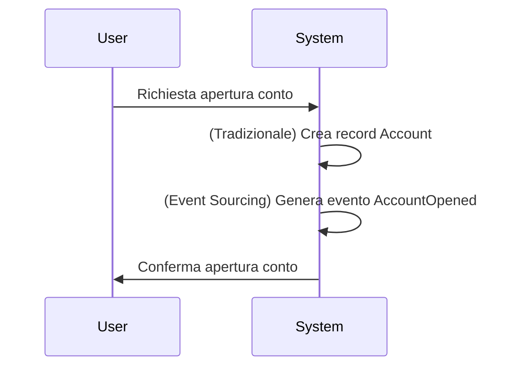
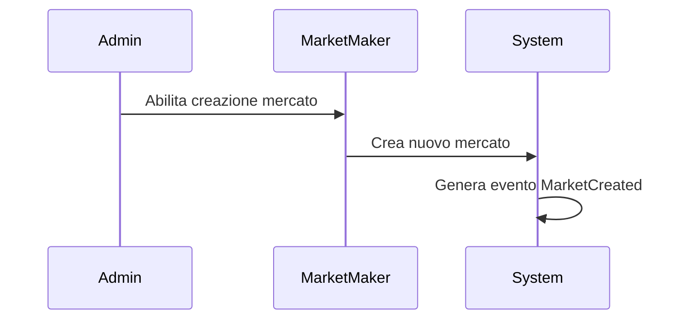

# Overflow history (ceiling 100)

Overflow force-cap: 438 file oltre target 100.

### `_integration/filament.md` — filament


# filament

<!-- Contenuto migrato da _docs/filament.txt -->

https://laraveldaily.com/post/filament-activity-logs-three-packages-comparison-review

### `ai-methodologies.md` — ai-methodologies


See canonical documentation: ../../../Themes/docs/shared-components/ai-methodologies.md

### `analisi-ottimizzazioni.md` — 📊 analisi e ottimizzazioni - modulo activity


# 📊 analisi e ottimizzazioni - modulo activity

## 🎯 panoramica analisi

il modulo **activity** è un sistema avanzato di audit trail e event sourcing che presenta eccellenti standard di qualità ma alcune aree di ottimizzazione.

## 📈 punti di forza identificati

### ✅ qualità del codice
- **phpstan level 9** configurato correttamente
- configurazioni multiple per diversi scenari (`phpstan_activity.neon`, `phpstan_minimal.neon`)
- suite di test pest completa
- configurazioni advanced: `grumphp.yml`, `rector.php`, `pint.json`

### ✅ documentazione
- documentazione estremamente completa (100+ file)
- esempi pratici dettagliati (bank, <nome progetto>ion_market, shop)
- copertura completa di event sourcing patterns
- integrazione filament ben documentata

### `analysis-religion-zen.md` — Activity Module: Complete Analysis (Religion, Philosophy, Politics, Zen)

# Activity Module: Complete Analysis (Religion, Philosophy, Politics, Zen)

---

## Analisi del modulo

Il modulo Activity gestisce il tracciamento delle attività degli utenti e il log delle azioni, con supporto per event sourcing. Si integra con Spatie Laravel Activitylog e Spatie Laravel Event Sourcing per mantenere un audit trail completo di tutte le operazioni nel sistema.

**Modelli principali**: StoredEvent, Snapshot, Activity
**Actions**: LogActivityAction, LogUserLogoutAction, RedactModelAttributesAction
**Dipendenze**: Xot, User

---

## Religione

1. **Ogni azione deve essere registrata**: Non esiste operation senza log. Se un'azione viene compiuta, deve esserci un record associato.
2. **Event Sourcing è sacro**: Gli eventi sono append-only, non cancellabili. Questo garantisce co

### `architecture/dedicated-connection.md` — Activity Module — Database Connection: Pattern Corretto


# Activity Module — Database Connection: Pattern Corretto

## Regola definitiva

**Tutti i modelli del modulo Activity DEVONO dichiarare:**

```php
/** @var string */
protected $connection = 'activity';
```

Questo vale per: `BaseModel`, `Activity`, `Snapshot`, `StoredEvent`.

---

## Perché `/** @var string */` e NON `/** @var string|null */`

- La connessione `'activity'` è **garantita e sempre presente** in `database.php`
- Il tipo `string` (non nullable) è più preciso — non c'è caso in cui la connessione sia null

### `architecture/structure.md` — Modulo Activity


# Modulo Activity

Data: 2025-04-23 19:09:55

## Informazioni generali

- **Namespace principale**: Modules\\Activity
Modules\\Activity\\Database\\Factories
Modules\\Activity\\Database\\Seeders
Workbench\\App
Workbench\\Database\\Factories
Workbench\\Database\\Seeders
- **Pacchetto Composer**: laraxot/module_activity_fila5
Marco Sottana
- **Dipendenze**: spatie/laravel-activitylog * spatie/laravel-event-sourcing * repositories type path url ../Xot type path url ../Tenant type path url ../UI scripts post-autoload-dump
- **Totale file PHP**: 55
- **Totale classi/interfacce**: 30

## Struttura delle directory

### `architecture/testing-structure-login-analysis.md` — Struttura Corretta dei Test di Login - Analisi Completa


# Struttura Corretta dei Test di Login - Analisi Completa
# Struttura Corretta dei Test di Login - Analisi Completa <nome progetto>

## 🎯 **Struttura del Sistema di Autenticazione**

### **1. PAGINA LOGIN** `/it/auth/login`
- **Routing**: Laravel Folio automatico
- **Template**: `laravel/Themes/One/resources/views/pages/auth/login.blade.php`
- **Component**: Volt component inline
- **Tipo**: Pagina web frontend con localizzazione

### **2. WIDGET LOGIN** Livewire
- **Classe**: `Modules\User\Filament\Widgets\Auth\LoginWidget`
- **Metodo**: `login()` per autenticazione
- **Tipo**: Widget riutilizzabile Filament/Livewire

### **3. ALTRI COMPONENTI**
- **Livewire**: `Modules\User\Http\Livewire\Auth\Login`
- **Volt**: `Modules\Cms\Http\Volt\LoginComponent`

### `architecture-uppercase-historical.md` — Architecture Documentation


# Architecture Documentation
---
title: "Activity Module Architecture"
type: architecture
tags: [module, architecture, audit]
created: 2026-07-28
updated: 2026-07-28
---
---
title: "Activity: architettura (diagramma non allineato al codice)"
type: reference
status: stale
module: Activity
updated: 2026-10-14
tags: [activity, architecture, stale]
qmd: "activity architettura diagramma repositories services projections stale"
---

> Nota 2026-10-14 (docs-audit): il diagramma elenca Repositories, Services, Commands e Projections che non esistono in `app/` (cartelle reali: Actions, Adapters, Console, Contracts, Datas, Enums, Events, Exceptions, Filament, Http, Listeners, Models, Providers, Traits, View; `Support` assente, riverificato 2026-10-23). Il modulo non ha un layer Services (regola no-s

### `archived-note.md` — archived-note


### `aws-test-vs-database-connection.md` — Overview


See canonical documentation: ../../../Themes/docs/shared-components/aws-test-vs-database-connection.md# AWS Test Bugfix vs Database Connection Configuration

## Overview
This document clarifies the distinction between two separate concepts that may appear related but serve completely different purposes:

1. AWS Test bugfix documentation (related to undefined variables in Blade templates)
2. Database connection configuration for the Activity module

## AWS Test Bugfix Documentation
- Located in: `laravel/Modules/UI/docs/bugfix-awstest-undefined-variable.md`
- Purpose: Addresses undefined variable issues in AWS Test Page
- Focus: Blade template variable management and error handling
- Issues addressed: `ErrorException: Undefined variable $results in awstest.blade.php`

## Database Connectio

### `bad-practices.md` — Bad Practices – Activity

# Bad Practices – Activity

## ❌ Log delle attività senza livello di severità
Crea noise utile solo se si usa un filtro `level`.

## ❌ Mancanza di indicizzazione per query frequenti
Aggiungi indici su `user_id`, `log_name`, `created_at`.

## ❌ Dati duplicati nei "properties" JSON
Normalizza campi ricorrenti in tabelle distinte per query efficienti.

### `basemodel-connection-why-activity-not-null.md` — BaseModel Activity: Perché $connection = 'activity' e NON null


# BaseModel Activity: Perché $connection = 'activity' e NON null

## Risposta diretta

**NO, non è corretto avere `protected $connection = null` nel BaseModel del modulo Activity.**

Il BaseModel deve avere `protected $connection = 'activity'`.

## Ragionamento

### 1. Architettura TenantServiceProvider

TenantServiceProvider crea a runtime una connessione per ogni modulo attivo. Per il modulo Activity, `getSnakeName()` restituisce `'activity'`, quindi la connessione si chiama `'activity'`. La connessione punta allo stesso DB del default (o a `DB_DATABASE_ACTIVITY` se configurato).

### 2. Cosa significa $connection = null

In Eloquent, `$connection = null` significa: **usa la connessione default** (`config('database.default')` = `'mysql'`).

### 3. Cosa significa $connection = 'activity'

### `binary-assets.md` — Asset binari

# Asset binari

Gli asset binari sono file normali del repository.

Regole:
- non aggiungere filtri o backend di storage esterno in `.gitattributes`;
- non committare file pointer al posto del contenuto reale;
- se un asset manca, recuperare il binario originale e committarlo direttamente;
- prima del push verificare che immagini, font, archivi e PDF siano contenuti reali.

### `bmad/architecture/module-boundary.md` — Activity — architettura

# Activity — architettura

## Scopo osservato

Modulo per il tracciamento delle attività degli utenti e la gestione di log delle azioni. Scheda derivata da `module.json`, struttura `app/` e conteggi del repository; non sostituisce decisioni architetturali non ancora approvate.

## Inventario verificato

- PHP in `app/`: 89 file.
- Test PHP in `tests/`: 145 file.
- Aree applicative: `Enums`, `Http`, `Filament`, `Support`, `Events`, `Exceptions`, `Contracts`, `Models`, `Console`, `Actions`, `Traits`, `Providers`, `Listeners`, `View`, `Datas`, `Adapters`.
- Persistenza: `database/factories`, `database/migrations`, `database/seeders` presenti.

## Confini

Il modulo espone risorse, azioni e contratti verso i consumatori; la logica di dominio deve restare nelle Action e nei modelli del modulo. 

### `bmad/architecture/module-map.md` — Activity — mappa file -> responsabilita


# Activity — mappa file -> responsabilita

> **SUMMARY**: una riga per file (o gruppo omogeneo) con la responsabilita
> unica. Se un file non sta qui, e probabile che sia da spostare o da dichiarare
> esplicitamente.

## Entry point

| File | Responsabilita |
|---|---|
| `module.json` | Manifesto del modulo: alias, provider, dipendenze (`Xot`, `User`) |
| `config/config.php` | Icona, posizione di navigazione (sort 20), rotte e middleware |

## Modelli

| File | Responsabilita |
|---|---|
| `app/Models/Activity.php` | Riga di audit, estende Spatie Activity, `properties` schemaless |
| `app/Models/StoredEvent.php` | Evento di event sourcing persistito, `meta_data` schemaless |

### `bmad/audit.md` — Audit BMAD — Activity


# Audit BMAD — Activity

SSoT dettagliata (inventario, evidenze `path:line`, non-finding): [audits/activity-audit.md](./audits/activity-audit.md).

**Scopo in una frase:** Activity risponde a "chi ha cambiato cosa, quando e com'era prima" — in una PA è un obbligo ([purpose.md](./purpose.md)).

## Sintesi (2026-11-16)

| Metrica | Valore |
|---|---:|
| PHP `app/` / test PHP / file `*Test.php` | 92 / 152 / 100 |
| Resource / Actions / Services / Widget | 3 / 30 / 0 / 0 |
| Policy `return true` (solo `before()`) | 2 |
| Marker conflitto / `RefreshDatabase` | 0 / 0 |
| Test file vuoti / punti di skip | 8 / 19 |

## Finding principali

| # | Sev | Finding |

### `bmad/audits/activity-audit.md` — Audit approfondito — Activity


# Audit approfondito — Activity

## Metodo

Source-first, 2026-11-16: inventario filesystem, `rg -n` con `path:line`, lettura dei file
critici (listener, policy, Resource, Action di logging), `git log` sui test svuotati,
PHPStan sul modulo, Pest sullo scratch DB del repo. La documentazione è stata trattata come
ipotesi e verificata sul codice. Nessuna UI o screenshot inventati.

Limiti dichiarati: nessun test runtime del pannello Filament (nessun `Livewire::test` nel
modulo, vedi P1-5); l'esito Pest è nella sezione [Gate](#gate).

## Scopo (perché esiste)

Activity risponde a "chi ha cambiato cosa, quando e com'era prima". In una PA è un obbligo
di accountability, non una curiosità. Vedi [purpose.md](../purpose.md). Conseguenza
progettuale che l'audit usa come criterio: **il registro deve

### `bmad/bmad-dossier.md` — Activity — BMAD dossier

# Activity — BMAD dossier
## Product brief / PRD
Provide trustworthy operational history for every important domain mutation.
## Architecture / UX / security
Owning Actions emit actor/reason/time/visibility events; the viewer paginates and filters without exposing internal notes.
## Epics and stories
Immutable events; retention/archive; admin viewer/export. Stories cover tamper resistance and high-volume pagination.
## Gaps / release
Retention, immutability evidence and public/internal filtering need candidate proof. Release requires the Fixcity transition matrix to be auditable.

### `bmad/brainstorming/module-opportunities.md` — Activity — brainstorming

# Activity — brainstorming

## Punto di partenza

Modulo per il tracciamento delle attività degli utenti e la gestione di log delle azioni. L'inventario corrente misura 89 file applicativi e 145 file di test.

## Domande ad alto valore

- Quale problema utente risolve il modulo e quale comportamento è vincolante?
- Quali dati sono autorevoli e quali sono proiezioni o cache?
- Quali ruoli possono leggere, creare, modificare o approvare?
- Quale errore deve essere osservabile senza esporre dati sensibili?
- Quale parte è riusabile e quale è specifica del dominio PTVX?

## Ipotesi da validare

- Le Action sono il punto di orchestrazione del caso d'uso.
- Le Resource Filament sono adattatori, non il luogo della regola di business.
- I test esistenti sono evidenza parziale e vanno confrontati c

### `bmad/brainstorming.md` — Activity — brainstorming BMAD


# Activity — brainstorming BMAD

> **SUMMARY**: decisioni prese (con l'evidenza nel codice), problemi aperti
> verificati, e scelte scartate con il motivo.

## Shard

- [module-opportunities.md](./brainstorming/module-opportunities.md) — brainstorming preesistente del modulo.
- [module-map.md](./architecture/module-map.md) — mappa file -> responsabilita del modulo.

I problemi aperti verificati sono elencati direttamente in [Problemi aperti](#problemi-aperti-verificati-2026-09-28) sotto, perche non esiste uno shard `open-problems.md` in questo modulo.

## Decisioni prese (verificate nel codice)

### D1 — I moduli non chiamano il recorder, dispatchano l'evento

Il docblock di `app/Contracts/ActivityRecorderContract.php` lo impone esplicitamente:
*"Modules should dispatch ActivityRecorded e

### `bmad/decision-log.md` — Decision log — Activity


# Decision log — Activity

Append-only, più recente in alto. Le voci d'esempio del template precedente (Widget vs Livewire, array una chiave per riga) sono regole di progetto già in `AGENTS.md`, non decisioni del modulo: rimosse.

| ID | Data | Stato | Decisione | Perché | Evidenza |
|---|---|---|---|---|---|
| D-4 | 2026-11-16 | PROPOSTA | Consolidare i due `ActivityLogger` e i due `ActivityRecorderContract` | DRY; l'API non ha caller di produzione | `app/Adapters/`, `app/Actions/ActivityLogger.php`, `app/Contracts/`, `app/Models/Contracts/` |
| D-3 | 2026-11-16 | **APERTA** | `LoginListener`: implementare o rimuovere | Registrato ma vuoto; il login è già tracciato da User (`RecordAuthenticationLogAction`) | `app/Listeners/LoginListener.php:12`, `tests/Unit/Listeners/LoginListenerTest.ph

### `bmad/epics/module-roadmap.md` — Activity — epic roadmap

# Activity — epic roadmap

## Epic A — Contratto e architettura

Documentare API pubbliche, dipendenze, confini e invarianti del modulo.

## Epic B — Qualità verificabile

Ridurre finding PHPStan, mantenere test Pest eseguibili e registrare evidence ripetibile.

## Epic C — UX e integrazione

Verificare parità Form/Table, traduzioni, autorizzazioni, error handling e integrazioni dichiarate.

## Epic D — Documentazione viva

Collegare ogni decisione a story BMAD, mantenere il second brain e chiudere i duplicati senza cancellare storia.

## Definition of Done


### `bmad/epics.md` — Epics — Activity


# Epics — Activity

Derivate dai finding dell'[audit profondo](./audits/activity-audit.md). Roadmap storica: [epics/module-roadmap.md](./epics/module-roadmap.md).
Ogni epic diventa una story BMAD prima di toccare il codice.

## E1 — Registro append-only (P1-2)

**Perché:** un audit trail modificabile non è prova.
**AC:**
- [ ] `ActivityResource`, `SnapshotResource`, `StoredEventResource` senza Create/Edit/Delete da UI.
- [ ] Cancellazione solo via `ActivityMaintenanceAction` con permesso dedicato.
- [ ] Pest Feature: utente con `activity.update` riceve 403 sull'edit.

## E2 — Nessun segreto nel log (P1-3)

**Perché:** il log vive più a lungo del dato e ha lettori diversi.
**AC:**
- [ ] `RedactModelAttributesAction` chiamata da `LogModelCreated/Updated/DeletedAction`.
- [ ] Lista chiavi se

### `bmad/livewire-inventory.md` — Inventario: Livewire HTTP → Filament: modulo Activity


# Inventario: Livewire HTTP → Filament: modulo Activity

**Solo documentazione. Nessun PHP toccato in questo audit.**

Questo file è la SSoT del modulo Activity per la campagna di conversione Livewire → Filament widget. Formato e metodo sono ripresi da [Modules/Cms/docs/bmad/livewire-inventory.md](../../../Cms/docs/bmad/livewire-inventory.md), con la differenza che qui non esiste nemmeno una classe da classificare: il risultato verificato è **zero componenti Livewire**.

## Metodo (codice, non assunzione)

```bash
find Modules/Activity -path '*/vendor/*' -prune -o -name '*.php' -print | xargs grep -l 'extends.*\(Component\|Livewire\)'
find Modules/Activity -iname '*livewire*' -not -path '*/vendor/*'
ls Modules/Activity/app/Http/Livewire/ Modules/Activity/app/Livewire/
grep -rn "@livewire"

### `bmad/piano-miglioramento.md` — Piano di miglioramento — Activity


# Piano di miglioramento — Activity

=======
Derivato dall'[audit](./audits/activity-audit.md).

## P0

1. Bonificare marker/conflict se presenti (ora: 0).
2. Chiudere policy troppo permissive (`return true` ≈ 2) con matrice ruolo×ability.
3. Blocchi sicurezza runtime (auth panel, mass assignment, export) con test negativi.

## P1

1. Portare Services (0) ad Actions Queueable dove applicabile.
2. Alzare copertura test (attuale 152 test / 92 app PHP).
3. Allineare Filament (resources=3) a XotBase* e traduzioni Lang.
4. Spezzare dipendenze inverse verso verticali peer se rilevate con `rg`.

## P2

### `bmad/quick-reference.md` — Activity — BMAD Quick Reference


# Activity — BMAD Quick Reference
type: note
status: draft
updated: 2026-10-07
tags: [docs, activity, bmad]
qmd: "activity   bmad quick reference activity"
---

# Activity: BMAD Quick Reference

## Comandi Rapidi

### Help
```bash
bmad-help
```

### Workflow Activity


### `bmad/setup-guide.md` — Activity — BMAD Setup Guide


# Activity — BMAD Setup Guide
status: draft
updated: 2026-10-07
tags: [docs, activity, bmad]
qmd: "activity   bmad setup guide activity"
---

# Activity: BMAD Setup Guide

## Scopo

Rendere ripetibile e verificabile l'uso del BMAD Method per il modulo Activity.

## Cosa è "BMAD" qui (Business Logic)

In questo modulo, BMAD serve a:
- **Tracciare ogni decisione**: ogni azione utente viene registrata
- **Abilitare il debug**: ricostruire sequenza di eventi
- **Supportare il code review**: chi ha fatto cosa e quando

### `bmad/stories/0001-continuazione-domani.story.md` — Continuazione domani

# Continuazione domani

## Context and Problem Statement

Problema e obiettivo sono descritti nel Decision Outcome (migrazione automatica a MADR).

## Decision Drivers

- Richiesta utente / acceptance criteria della story
- Vincoli BMAD, second brain, Pest gate e dati sacri

## Considered Options

- Status quo (non fare)
- Implementare come descritto nel Decision Outcome

## Decision Outcome

Scelta: **implementare**, perché i driver sopra.


### `bmad/stories/0002-docs-reorg-core.story.md` — Story — riorganizzazione docs core: Activity

# Story — riorganizzazione docs core: Activity

## Context and Problem Statement

Problema e obiettivo sono descritti nel Decision Outcome (migrazione automatica a MADR).

## Decision Drivers

- Richiesta utente / acceptance criteria della story
- Vincoli BMAD, second brain, Pest gate e dati sacri

## Considered Options

- Status quo (non fare)
- Implementare come descritto nel Decision Outcome

## Decision Outcome

Scelta: **implementare**, perché i driver sopra.


### `bmad/stories/0002-docs-zen-conventions.md` — <!-- Titolo: il problema risolto e la soluzione scelta -->

<!-- File: docs/adr/0002-docs-zen-conventions-con-trattini.md · formato MADR breve (harness).
     Il basename DEVE iniziare con NNNN- (es. 0001-...). Eccezioni: README.md, INDEX.md, 0000-template.md.
     Scrivi un ADR solo se la decisione è difficile da invertire, sorprendente e frutto di un trade-off reale. -->
# <!-- Titolo: il problema risolto e la soluzione scelta -->

## Context and Problem Statement
<!-- 2-3 frasi. Chiudi con la domanda a cui la decisione risponde. -->

## Decision Drivers
- <!-- forza o vincolo che pesa sulla scelta -->

## Considered Options
- <!-- opzione 1 -->
- <!-- opzione 2 -->

## Decision Outcome
Scelta: **<!-- opzione -->**, perché <!-- driver che la giustifica -->

### Consequences
- Buono, perché <!-- … -->

### `bmad/stories/0003-docs-zen-conventions.story.md` — Activity: bonifica docs `.md`

# Activity: bonifica docs `.md`

## Context and Problem Statement

Il rumore in `docs/` (copie esatte, varianti `_`/MAIUSCOLO/`-2`, stub generati, template di prodotto
generici) degrada QMD e confonde gli agenti. Obiettivo: una copia canonica per contenuto, nomi kebab,
frontmatter con `title` + `qmd` ovunque, link aggiornati.

## Decision Drivers

- Richiesta utente / acceptance criteria della story
- Vincoli BMAD, second brain, Pest gate e dati sacri

## Considered Options

- Status quo (non fare)
- Implementare come descritto nel Decision Outcome

## Decision Outcome


### `bmad/stories/0004-folio-routing-centralization.story.md` — Story: centralizzare il routing Folio dei moduli

# Story: centralizzare il routing Folio dei moduli

## Context and Problem Statement

Problema e obiettivo sono descritti nel Decision Outcome (migrazione automatica a MADR).

## Decision Drivers

- Richiesta utente / acceptance criteria della story
- Vincoli BMAD, second brain, Pest gate e dati sacri

## Considered Options

- Status quo (non fare)
- Implementare come descritto nel Decision Outcome

## Decision Outcome

Scelta: **implementare**, perché i driver sopra.


### `bmad/stories/0008-phpstan-activity-tests-zero.story.md` — Story — PHPStan Activity tests a zero

# Story — PHPStan Activity tests a zero

## Context and Problem Statement

Problema e obiettivo sono descritti nel Decision Outcome (migrazione automatica a MADR).

## Decision Drivers

- Richiesta utente / acceptance criteria della story
- Vincoli BMAD, second brain, Pest gate e dati sacri

## Considered Options

- Status quo (non fare)
- Implementare come descritto nel Decision Outcome

## Decision Outcome

Scelta: **implementare**, perché i driver sopra.


### `bmad/stories/0009-phpstan-conflict-markers-bootstrap.story.md` — Story — Conflict markers Activity (PHP)

# Story — Conflict markers Activity (PHP)

## Context and Problem Statement

Problema e obiettivo sono descritti nel Decision Outcome (migrazione automatica a MADR).

## Decision Drivers

- Richiesta utente / acceptance criteria della story
- Vincoli BMAD, second brain, Pest gate e dati sacri

## Considered Options

- Status quo (non fare)
- Implementare come descritto nel Decision Outcome

## Decision Outcome

Scelta: **implementare**, perché i driver sopra.


### `bmad/stories/0010-phpstan-modules-zero.story.md` — Story — PHPStan Modules/Activity → 0

# Story — PHPStan Modules/Activity → 0

## Context and Problem Statement

Problema e obiettivo sono descritti nel Decision Outcome (migrazione automatica a MADR).

## Decision Drivers

- Richiesta utente / acceptance criteria della story
- Vincoli BMAD, second brain, Pest gate e dati sacri

## Considered Options

- Status quo (non fare)
- Implementare come descritto nel Decision Outcome

## Decision Outcome

Scelta: **implementare**, perché i driver sopra.


### `bmad/stories/0023-quality-gates-phpstan-swarm-4.story.md` — Activity — PHPStan quality gate swarm (2026-09-29)

# Activity — PHPStan quality gate swarm (2026-09-29)

## Context and Problem Statement

Problema e obiettivo sono descritti nel Decision Outcome (migrazione automatica a MADR).

## Decision Drivers

- Richiesta utente / acceptance criteria della story
- Vincoli BMAD, second brain, Pest gate e dati sacri

## Considered Options

- Status quo (non fare)
- Implementare come descritto nel Decision Outcome

## Decision Outcome

Scelta: **implementare**, perché i driver sopra.


### `bmad/stories/continuazione-domani.md` — Activity — Continuazione Domani

# Activity — Continuazione Domani

## Context and Problem Statement

Problema e obiettivo sono descritti nel Decision Outcome (migrazione automatica a MADR).

## Decision Drivers

- Richiesta utente / acceptance criteria della story
- Vincoli BMAD, second brain, Pest gate e dati sacri

## Considered Options

- Status quo (non fare)
- Implementare come descritto nel Decision Outcome

## Decision Outcome

Scelta: **implementare**, perché i driver sopra.


### `bmad/todo.md` — Activity Module Documentation Consolidation TODO


# Activity Module Documentation Consolidation TODO

**Status**: Phase 1 Complete (2026-10-06)  
**Owner**: BMAD Story consolidation-activity-docs

## Summary

Consolidated 41 orphaned `.md` files in `laravel/Modules/Activity/docs/` into structured BMAD hierarchy.

## Changes Made

### Moved to wiki/ subdirectories

- **wiki/testing/** (11 files)
  - coverage-*.md (coverage analysis, status, plans, workflows)
  - testing-coverage-policy.md
  - phpstan-l10-coverage.md
  - factory-coverage-report.md


### `boost-skill-fix-summary.md` — Issue Overview


See canonical documentation: ../../../Themes/docs/shared-components/boost-skill-fix-summary-Modules.md# Boost Skill Fix Summary - Activity Module

**Date**: 2026-03-02  
**Module**: Activity (Activity Tracking & Logging)

## Issue Overview

The Activity module was unable to track activities due to missing Laravel framework dependencies.

## Root Cause

Missing Laravel framework dependencies prevented activity tracking services.

## Impact on Activity Module

The Activity module couldn't:
- Log activities
- Track user actions
- Generate activity reports

### `bottlenecks.md` — Colli di Bottiglia e Soluzioni - Modulo Activity


# Colli di Bottiglia e Soluzioni - Modulo Activity

## Panoramica
Questo documento identifica i principali colli di bottiglia nel modulo Activity e fornisce soluzioni dettagliate passo per passo per risolverli.

## 1. Logging Eccessivo delle Attività

### Problema
Il logging indiscriminato di tutte le attività utente può portare a una crescita rapida della tabella `activity_log`, causando degradazione delle performance del database.

### Impatto
- Aumento delle dimensioni del database
- Rallentamento delle query che coinvolgono la tabella `activity_log`
- Maggiore utilizzo di spazio su disco

### Soluzione Passo-Passo

1. **Implementare Politiche di Logging Selettivo**


### `brainstorm-testcase-architecture.md` — Brainstorm: TestCase Architecture for Laravel Modules


# Brainstorm: TestCase Architecture for Laravel Modules

## Objective

Valutare la proposta:

```text
Modules/<Module>/tests/TestCase.php
  -> XotBaseTestCase
  -> Nwidart\Modules\Tests\BaseTestCase
```

## Facts First

- La documentazione ufficiale Laravel Modules v13 sui test mostra Pest con `uses(Tests\TestCase::class)` e runner `vendor/bin/pest`.
- Il package installato in `composer.lock` e' `nwidart/laravel-modules v13.0.0`.
- Nel vendor installato non esiste `Nwidart\Modules\Tests\BaseTestCase`.
- Gli stub test del package usano `Tests\TestCase`, non una base class Nwidart.


### `bugfix-filament-facade-namespace.md` — Bugfix: Filament Facade Namespace Error


# Bugfix: Filament Facade Namespace Error

## 🐛 Errore

**Data:** 2025-01-22
**Data:** [DATE]
**File:** `Modules/Activity/app/Filament/Actions/ListLogActivitiesAction.php:69`
**Messaggio:** `Class "Filament\Support\Facades\Filament" not found`

### Stack Trace

```
Modules\Activity\Filament\Actions\ListLogActivitiesAction->Modules\Activity\Filament\Actions\{closure}()
Modules/Activity/app/Filament/Actions/ListLogActivitiesAction.php:69

$panel = Filament::getCurrentPanel();
```

### Contesto

### `bugfix-gettablepage-mixed-return.md` — Bugfix: `getTablePage()` returns `mixed` instead of `int` (PHPStan)

# Bugfix: `getTablePage()` returns `mixed` instead of `int` (PHPStan)

## 🐛 Errore

**Data:** 2026-07-17
**Comando:** `php -d memory_limit=2048M ./vendor/bin/phpstan analyse Modules` (root, `laravel/phpstan.neon`, invariata)

**File:** `Modules/Activity/app/Filament/Pages/Concerns/CanPaginate.php` (segnalato
"in context of class `Modules\Activity\Filament\Pages\ListLogActivities`")

```
Method Modules\Activity\Filament\Pages\ListLogActivities::getTablePage()
should return int but returns mixed.
```

### Causa

`getTablePage()` chiama `$this->getPage($this->getPaginationPageName())`.
`getPage()` **non** è definito dal trait `CanPaginate` stesso: viene risolto
da `Livewire\Features\SupportPagination\HandlesPagination::getPage($pageName = 'page')`,

### `bugfix-geturl-signature-mismatch.md` — Bugfix: PHPStan `getUrl()` signature mismatch + enum/getColumnDefinitions drift

# Bugfix: PHPStan `getUrl()` signature mismatch + enum/getColumnDefinitions drift

## 🐛 Errori

**Data:** 2026-07-16/17
**Comando:** `php -d memory_limit=2048M ./vendor/bin/phpstan analyse Modules` (root, `laravel/phpstan.neon`)

### 1. `getUrl()` override incompatibile con Filament

**File:**
- `Modules/Activity/tests/Fixtures/ListLogActivitiesActionTestResource.php:20`
- `Modules/Activity/tests/Fixtures/ListLogActivitiesActionTestResourceSimple.php:20`
- `Modules/Activity/tests/Fixtures/ListLogActivitiesActionTestPage.php:26` (chiamante)

Le fixture di test dichiaravano:

```php
public static function getUrl(string $name, array $parameters = []): string
```


### `case-variant-collisions.md` — Collisioni di nome per sola differenza di maiuscole

# Collisioni di nome per sola differenza di maiuscole

**Misurato**: 2026-08-31
**Regola violata**: `no-case-variations`, `case_sensitive_naming_critical`
**Quadro generale**: [Modules/Xot/docs/stato-qualita-progetto-2026-08-31.md](../../Xot/docs/stato-qualita-progetto-2026-08-31.md)

## Il problema

In questo modulo esistono percorsi che differiscono solo per maiuscole. Su Linux
convivono. Su filesystem case-insensitive, cioe' macOS di default e Windows, i due
percorsi sono lo stesso percorso: al clone uno dei due file sovrascrive l'altro, in
modo non deterministico. Il repository risulta corrotto senza che nulla segnali
l'errore.

Riproduzione:

```bash
cd laravel && find Modules/Activity -name '*.php' -not -path '*/vendor/*' \
  | awk '{print tolower($0)}' | sort | uniq -d
```

### `code-redundancy-audit.md` — Code redundancy audit — Activity


# Code redundancy audit — Activity

## Scopo

Ridurre rumore, duplicazione e ambiguita' nel codice di questo module, senza perdere conoscenza storica.

## Metriche

| Voce | Valore |
|---|---:|
| File PHP analizzati | 81 |
| Rischio ridondanza | medium |
| Basename duplicati locali | 2 |
| Hash normalizzati duplicati cross-owner | 2 |
| Class/trait/interface name ripetuti nel monorepo | 12 |
| File grandi >=350 righe | 0 |
| File PHP con marker Git | 0 |

## Evidenze

### `codex-error-fix.md` — codex-error-fix


See canonical documentation: ../../../Themes/docs/shared-components/codex-error-fix.md

### `concepts/xotbase-never-extend-filament.md` — Mai `Filament\*` — sempre `Modules\Xot\Filament\...\XotBase*`


# Mai `Filament\*` — sempre `Modules\Xot\Filament\...\XotBase*`

Bridge on-demand. Contenuto canonico: [docs/wiki/rules/xotbase-critical-rules.md](../../../../../docs/wiki/rules/xotbase-critical-rules.md).

## Zen (riassunto)

Nessuna classe in `Modules/Activity` estende una classe `Filament\...` direttamente.
Si estende sempre lo "specchio" in `Modules\Xot\Filament\...` allo stesso
percorso relativo (es. `Filament\Tables\Columns\ViewColumn` ->
`Modules\Xot\Filament\Tables\Columns\XotBaseViewColumn`). Se manca il
mirror, va creato in Xot prima di usarlo qui, mai come scorciatoia nel modulo.

Non pre-caricare questo file: leggi la fonte canonica solo quando il task lo richiede.

### `conflict-resolution.md` — Conflict resolution — Activity (PHP)


# Conflict resolution — Activity (PHP)

## Scopo

I marker `<<<<<<<` / `=======` / `>>>>>>>` nei PHP del modulo Activity
rompevano il bootstrap PHPStan. Risoluzione manuale per preservare audit log,
Actions Spatie Queueable e Filament XotBase.

## Esito

- Marker PHP: **0** in `app/` + `tests/` + `lang` PHP.
- `php -l` verde sui file toccati.
- PHPStan `Modules/Activity`: **0 errori su `app/`**; residui solo in test
  (typing Pest / harness, ~112) documentati nella story.

## Decisioni (perché)

| Area | Scelta |
|------|--------|

### `consolidation-analysis.md` — Consolidation Analysis: Activity Module


# Consolidation Analysis: Activity Module

**Module:** Activity  
**Scope:** Root .md files owned by Activity, relocation plan  
**Analysis Date:** 2026-08-18

## Files Relocating to This Module

### Overview

1 critical documentation file currently in root belongs to Activity module and should move to `laravel/Modules/Activity/docs/`:

| File | Lines | Status | Priority | Owner Rationale |
|------|-------|--------|----------|-----------------|
| `critical-mai-fare-migrate-refresh.md` | 67 | MOVE | **CRITICAL** | Activity data integrity constraint; must be visible to developers |

## Consolidation Rationale

**Why move:**

### `contracts/activity-logger.md` — ActivityLogger


# ActivityLogger

Facciata di scrittura e lettura del log attività: registra eventi generici e del modello e offre le query e la pulizia. La facciata pubblica è `Adapters/ActivityLogger` (`app/Adapters/ActivityLogger.php`), che delega qui.

## Input

- `log(string $type, mixed $user, ?Model $subject, ?array $properties, ?string $description)`: `$user` deve essere `UserContract` o `null`.
- `created|updated|deleted(Model $model, ?UserContract $user)`.
- `login|logout(UserContract $user)`.
- `custom(string $type, string $description, ?Model $subject, ?array $properties)`.
- `getUserActivities(UserContract, int $limit=50)`, `getModelActivities(Model, int $limit=50)`, `getByType(string, int $limit=50)`, `getRecent(int $limit=50)`.
- `cleanOld(int $days=90)`, `getStatistics(?UserContract)`.

#

### `contracts/activity-maintenance-action.md` — ActivityMaintenanceAction


# ActivityMaintenanceAction

Cancella le attivita' piu' vecchie di N giorni, a blocchi. Raggiunta da `Adapters/ActivityLogger::cleanOld()` (`app/Adapters/ActivityLogger.php:122`).
Tensione da notare con l'[ADR append-oriented](../adr/0001-activity-audit-is-append-oriented.md): questa e' l'unica operazione che rimuove righe di audit.


## Input

- `int $days` (default 90): soglia di anzianita' in giorni.

## Output

- `int`: numero di attivita' cancellate.

## Invarianti

- **ACT-CLEAN-INV-1** — `$days <= 0` lancia `InvalidArgumentException('Days must be positive')` prima di toccare il database.
  Non coperto: nessun test dedicato trovato; `Modules/Activity/tests/Unit/Actions/CoverageHundredActionsTest.php:164` esercita il percorso positivo; nessun `->group('ACT-CLEAN-INV-1')`.
- **ACT-CLE

### `contracts/apply-activity-config-action.md` — ApplyActivityConfigAction


# ApplyActivityConfigAction

Copia nella configurazione runtime `activitylog.*` le impostazioni salvate dal tenant. Chiamata al boot da `ActivityServiceProvider` (riga 65).

## Input

- Nessuno. Legge il file di configurazione del tenant `ActivityConfigData::tenantConfigName()` tramite `GetTenantConfigArrayAction` (modulo Tenant).

## Output

- `void`.

## Invarianti

| ID | Regola | Test |
|---|---|---|
| `ACT-CFG-INV-1` | Se il file del tenant è vuoto, `config()` non cambia. | Test: nessuno sul ramo vuoto (`ActivityConfigDataTest.php` chiama l'Action in tre punti) |
| `ACT-CFG-INV-2` | Sono copiate solo le chiavi presenti nel file salvato, con i valori di `ActivityConfigData`. Le chiavi assenti restano quelle di prima (es. `ACTIVITY_LOGGER_ENABLED`). | `ActivityConfigDataTest.php` (chia

### `contracts/authorize-log-access-action.md` — AuthorizeLogAccessAction


# AuthorizeLogAccessAction

Chi puo' consultare e scaricare i file di log. Regola unica usata da `LogViewer::canAccess()` (`app/Filament/Pages/LogViewer.php:62`) e dal download (`LogViewer.php:128`).


## Input

- `?Authenticatable $user`.

## Output

- `bool`: `true` se l'utente ha il ruolo `super-admin` o il permesso `log.viewAny`.

## Invarianti

- **ACT-LOGAUTH-INV-1** — Ospiti (`null`) e utenti che non implementano `UserContract` sono negati.
  Verifica non marcata: `Modules/Activity/tests/Unit/Actions/Log/AuthorizeLogAccessActionTest.php` («denies guests and users that do not implement the project user contract»); nessun `->group('ACT-LOGAUTH-INV-1')`.
- **ACT-LOGAUTH-INV-2** — Se il permesso `log.viewAny` non esiste nel database l'accesso e' negato senza errore (`PermissionDoesNotE

### `contracts/build-log-file-tree-action.md` — BuildLogFileTreeAction


# BuildLogFileTreeAction

Trasforma l'elenco piatto dei file di log in un albero di cartelle per la pagina Log. Funzione pura.

## Input

- `list<LogFileData> $files`: file prodotti da `ListLogFilesAction`, con `path` relativo a `storage/logs` e separatori `/`.

## Output

- `LogTreeData`: nodo radice (`name=''`, `path=''`) con `count`, `folders` (sottonodi ricorsivi) e `files` (file diretti).

## Invarianti

| ID | Regola | Test |
|---|---|---|
| `ACT-LOGTREE-INV-1` | Ogni file compare solo nel nodo della sua cartella: i file diretti in `files`, gli altri nel sottoalbero. | `BuildLogFileTreeActionTest.php` («builds a nested tree…») |
| `ACT-LOGTREE-INV-2` | Le cartelle sono in ordine naturale senza distinguere maiuscole (`9` prima di `10`, `252` prima di `1000`). | `BuildLogFileTreeActio

### `contracts/build-log-viewer-state-action.md` — BuildLogViewerStateAction


# BuildLogViewerStateAction

Compone lo stato completo della pagina Log per un render: elenco e albero dei file e, per il file scelto, le voci della coda filtrate. Non sostituisce l'autorizzazione, che resta al chiamante.

## Input

- `string $file`: percorso relativo a `storage/logs` del file scelto; `''` se nessuno.
- `string $level = ''`: livello da filtrare; se non è un `LogLevelEnum` valido diventa `''` (nessun filtro).
- `string $search = ''`: testo cercato nel corpo delle voci.
- `string $window = '256'`: finestra di lettura in KB, come stringa; se non è in `WINDOW_OPTIONS_KB` diventa 256 KB.

## Output

- `LogViewerStateData`: `files`, `tree`, `levels`, `windows`, `entries` (massimo 200), `total`, `tail` (`LogTailData|null`), `modifiedAt` (int|null), `error` (string|null).

## Inv

### `contracts/check-activity-log-writable-action.md` — CheckActivityLogWritableAction


# CheckActivityLogWritableAction

Dice se la tabella del log attività esiste ed è nello schema atteso (colonna `attribute_changes`). Logica uguale a `IsActivityLogSchemaWritableAction`, con risoluzione di connessione e tabella in metodi separati.

## Input

- Nessuno. Legge `activitylog.enabled`, `activitylog.database_connection`, `activitylog.table_name`, `database.default`.

## Output

- `bool`.

## Invarianti

| ID | Regola | Test |
|---|---|---|
| `ACT-SCHEMA-CHK-INV-1` | Con `activitylog.enabled` falso restituisce `false` senza interrogare lo schema. | Test: nessuno (`CheckActivityLogWritableAction` non ha test dedicati) |
| `ACT-SCHEMA-CHK-INV-2` | Restituisce `true` solo se la tabella esiste e ha la colonna `attribute_changes`, sulla connessione risolta. | Test: nessuno |
| `ACT-SC

### `contracts/download-log-file-action.md` — DownloadLogFileAction


# DownloadLogFileAction

Risposta HTTP di download per un file di log scelto dall'utente. Il percorso passa da `GetLogFilePathAction`.

## Input

- `string $file`: percorso relativo a `storage/logs`, come da `GetLogFilePathAction`.

## Output

- `BinaryFileResponse`: download con nome file = percorso relativo con `/` sostituito da `_`, `Content-Type: text/plain; charset=UTF-8`.

## Invarianti

| ID | Regola | Test |
|---|---|---|
| `ACT-LOGDL-INV-1` | Un file fuori da `storage/logs`, non `.log` o inesistente non produce risposta: viene rilanciata `InvalidLogFileException`. | `DownloadLogFileActionTest.php` («refuses files outside the log directory…») |
| `ACT-LOGDL-INV-2` | La risposta è `BinaryFileResponse`: il file è letto a blocchi dal disco, non caricato in memoria. | `DownloadLogFile

### `contracts/filter-log-entries-action.md` — FilterLogEntriesAction


# FilterLogEntriesAction

Filtra le voci di un log per livello e testo e le restituisce dalla più recente alla più vecchia, con un tetto. Funzione pura.

## Input

- `list<LogEntryData> $entries`: voci in ordine di file (dalla più vecchia alla più recente).
- `string $level = ''`: livello, normalizzato in maiuscolo e `trim`; `''` non filtra.
- `string $search = ''`: testo, `trim`; cercato senza distinguere maiuscole nel corpo intero della voce.
- `int $limit = 200`: tetto di voci restituite; il valore effettivo è `max(1, $limit)`.

## Output

- `FilteredLogEntriesData`: `entries` (al massimo `limit`), `total` (voci corrispondenti prima del taglio).

## Invarianti

| ID | Regola | Test |
|---|---|---|

### `contracts/get-activities-by-type-action.md` — GetActivitiesByTypeAction


# GetActivitiesByTypeAction

Restituisce le attività recenti con un dato `event`, con causer e soggetto caricati.

## Input

- `string $type`: tipo evento, non vuoto.
- `int $limit = 50`: numero massimo di righe, positivo.

## Output

- `Collection<int, Activity>`: dalla più recente, con `causer` e `subject` eager-loaded.

## Invarianti

| ID | Regola | Test |
|---|---|---|
| `ACT-QTYPE-INV-1` | `$type === ''` lancia `InvalidArgumentException('Type cannot be empty')` prima di interrogare il database. | Test: nessuno che asserisca il messaggio (`QueryAndValidationTest.php` richiama l'Action, ramo non verificato) |
| `ACT-QTYPE-INV-2` | `$limit <= 0` lancia `InvalidArgumentException('Limit must be positive')`. | Test: nessuno diretto |

### `contracts/get-activity-statistics-action.md` — GetActivityStatisticsAction


# GetActivityStatisticsAction

Statistiche del log attività (totale, per tipo, oggi, settimana, mese) per la dashboard, con cache di 5 minuti per utente.

## Input

- `?UserContract $user = null`: se valorizzato, statistiche limitate alle attività causate da quell'utente.

## Output

- `array{total: int, by_type: array<string, int>, today: int, this_week: int, this_month: int}`.

## Invarianti

| ID | Regola | Test |
|---|---|---|
| `ACT-QSTATS-INV-1` | Il risultato è in cache per 5 minuti sotto la chiave `activity.statistics.<id utente>` o `activity.statistics.global`. Utenti diversi non condividono la cache. | Test: nessuno su TTL o chiave; `CoverageHundredActionsTest.php` (~righe 189-193) copre solo il percorso |
| `ACT-QSTATS-INV-2` | Un utente che non è un Eloquent `Model` lancia `In

### `contracts/get-log-directory-action.md` — GetLogDirectoryAction


# GetLogDirectoryAction

Restituisce il percorso reale della cartella dei log, `storage/logs` salvo indicazione diversa.

## Input

- `?string $directory = null`: cartella da risolvere; `null` usa `storage_path('logs')`.

## Output

- `string`: percorso reale (link simbolici risolti) della cartella.

## Invarianti

| ID | Regola | Test |
|---|---|---|
| `ACT-LOGDIR-INV-1` | Il risultato è il percorso reale, con i link simbolici risolti. | `GetLogFilePathActionTest.php` («resolves the log directory to its real path…») |
| `ACT-LOGDIR-INV-2` | Cartella inesistente o non directory: `InvalidLogFileException::baseDirectoryMissing`. | `GetLogFilePathActionTest.php` («fails clearly when the base directory does not exist») |


### `contracts/get-log-file-path-action.md` — GetLogFilePathAction


# GetLogFilePathAction

Unico punto in cui l'input dell'utente del visualizzatore di log (`Filament/Pages/LogViewer.php`) diventa un percorso su disco; lettura (`BuildLogViewerStateAction`) e download (`DownloadLogFileAction`) passano da qui.


## Input

- `string $relativePath`: percorso relativo scelto dall'utente.
- `?string $baseDirectory`: cartella dei log; se `null` e' `storage/logs` (`GetLogDirectoryAction`).

## Output

- `ResolvedLogFileData(absolutePath, relativePath)` con percorso reale e percorso relativo normalizzato con `/`.

## Invarianti

- **ACT-LOGPATH-INV-1** — Percorso vuoto o con byte nullo e' rifiutato (`InvalidLogFileException::invalidPath`).
  Verifica non marcata: `Modules/Activity/tests/Unit/Actions/Log/GetLogFilePathActionTest.php` («rejects files that are not .

### `contracts/get-model-activities-action.md` — GetModelActivitiesAction


# GetModelActivitiesAction

Restituisce le attività recenti il cui soggetto è un dato modello Eloquent.

## Input

- `Model $model`: modello soggetto; la classe è `$model::class`, la chiave `getKey()`.
- `int $limit = 50`: numero massimo di righe.

## Output

- `Collection<int, Activity>`: dalla più recente, con `causer` eager-loaded.

## Invarianti

| ID | Regola | Test |
|---|---|---|
| `ACT-QMODEL-INV-1` | Filtro esatto su `subject_type = FQCN del modello` e `subject_id = chiave`, ordine `created_at` decrescente, massimo `$limit` righe. | `CoverageHundredActionsTest.php` (percorso positivo, non verificato riga per riga) |


### `contracts/get-recent-activities-action.md` — GetRecentActivitiesAction


# GetRecentActivitiesAction

Restituisce le ultime attività registrate, senza filtri.

## Input

- `int $limit = 50`: numero massimo di righe, positivo.

## Output

- `Collection<int, Activity>`: dalla più recente, con `causer` e `subject` eager-loaded.

## Invarianti

| ID | Regola | Test |
|---|---|---|
| `ACT-QRECENT-INV-1` | `$limit <= 0` lancia `InvalidArgumentException('Limit must be positive')` prima della query. | Test: nessuno diretto (il messaggio compare solo in un mock di `AdapterActivityLoggerDelegationTest.php`) |
| `ACT-QRECENT-INV-2` | Nessun filtro, ordine `created_at` decrescente, massimo `$limit` righe. | `QueryAndValidationTest.php` (richiama l'Action, non verificato) |


### `contracts/get-subject-activity-log-action.md` — GetSubjectActivityLogAction


# GetSubjectActivityLogAction

Restituisce il log di un soggetto identificato da classe e id, come array, senza bisogno di un'istanza del modello.

## Input

- `string $modelClass`: FQCN del soggetto, usato così com'è (non verificato come classe esistente).
- `int|string $modelId`: chiave del soggetto.
- `int $limit = 500`: numero massimo di righe; non validato.

## Output

- `array<int, array<string, mixed>>`: per ogni attività, `toArray()` con le sole chiavi stringa, reindicizzato.

## Invarianti

| ID | Regola | Test |
|---|---|---|
| `ACT-QSUBJECT-INV-1` | Filtro `subject_type = $modelClass` e `subject_id = $modelId`, ordine `created_at` decrescente, massimo `$limit` righe. | `CoverageHundredActionsTest.php`, `QueryAndValidationTest.php`, `AdapterActivityRecorderTest.php` (percorsi, n

### `contracts/get-user-activities-action.md` — GetUserActivitiesAction


# GetUserActivitiesAction

Restituisce le attività causate da un utente.

## Input

- `UserContract $user`: deve essere anche un Eloquent `Model`.
- `int $limit = 50`: numero massimo di righe, positivo.

## Output

- `Collection<int, Activity>`: dalla più recente, con `subject` eager-loaded.

## Invarianti

| ID | Regola | Test |
|---|---|---|
| `ACT-QUSER-INV-1` | Un utente che non è un `Model` lancia `InvalidArgumentException('User must be an Eloquent model')`. | Test: nessuno che asserisca il messaggio |
| `ACT-QUSER-INV-2` | `$limit <= 0` lancia `InvalidArgumentException('Limit must be positive')`. | Test: nessuno diretto |

### `contracts/is-activity-log-schema-writable-action.md` — IsActivityLogSchemaWritableAction


# IsActivityLogSchemaWritableAction

Verifica che la tabella `activity_log` esista e abbia la colonna `attribute_changes`, richiesta da Spatie activitylog v4+. Usata dalla registrazione utente per decidere se scrivere il log.

## Input

- Nessuno. Legge `activitylog.enabled`, `activitylog.database_connection`, `activitylog.table_name`, `database.default`.

## Output

- `bool`.

## Invarianti

| ID | Regola | Test |
|---|---|---|
| `ACT-SCHEMA-IS-INV-1` | Con `activitylog.enabled` falso restituisce `false` senza interrogare lo schema. | `IsActivityLogSchemaWritableActionTest.php` («returns false when activity log is disabled»); `Support/ActivityLogSchemaTest.php` |
| `ACT-SCHEMA-IS-INV-2` | `true` solo se la tabella esiste e ha `attribute_changes` sulla connessione risolta. | Test: nessuno

### `contracts/log-activity-action.md` — LogActivityAction


# LogActivityAction

Scrive una riga in `activity_log`. È il punto comune usato da `LogModel*Action`, `LogUser*Action`.

## Input

- Costruttore: `string $type` (non vuoto), `?Model $user`, `?Model $subject`, `?array $properties`, `?string $description`.
- `execute()`: nessun argomento.

## Output

- `Activity`: la riga creata.

## Invarianti

| ID | Regola | Test |
|---|---|---|
| `ACT-LOGACT-INV-1` | `$type` vuoto lancia `InvalidArgumentException('Type cannot be empty')` al costruttore. | `LogActivityActionConstructorTest.php` |
| `ACT-LOGACT-INV-2` | Un `$user` non null che non è `UserContract` lancia `InvalidArgumentException('User must implement UserContract')` in `execute()`. | `LogActivityActionExecuteValidationTest.php` |

### `contracts/log-user-login-action.md` — LogUserLoginAction


# LogUserLoginAction

Registra il login di un utente. Il soggetto e il causer sono l'utente stesso.

## Input

- Costruttore: `?UserContract $user`. `execute(?UserContract $user = null)`: se passato, prevale sul costruttore.

## Output

- `Activity` con `event = 'login'`, `description = 'User logged in'`, `subject` e `causer` = l'utente.

## Invarianti

| ID | Regola | Test |
|---|---|---|
| `ACT-LOGIN-INV-1` | Se l'utente risolto non è un `Model` lancia `InvalidArgumentException('User must implement UserContract and extend Model')`. | `ActivityActionsUnitTest.php`, `LogActionsTest.php` (percorsi, non verificati nel dettaglio) |
| `ACT-LOGIN-INV-2` | Il tipo è `login`; `subject_type` è la classe dell'utente. | Test: nessuno diretto |


### `contracts/log-user-logout-action.md` — LogUserLogoutAction


# LogUserLogoutAction

Registra il logout di un utente. Il soggetto e il causer sono l'utente stesso.

## Input

- Costruttore: `?UserContract $user`. `execute(?UserContract $user = null)`: se passato, prevale sul costruttore.

## Output

- `Activity` con `event = 'logout'`, `description = 'User logged out'`, `subject` e `causer` = l'utente.

## Invarianti

| ID | Regola | Test |
|---|---|---|
| `ACT-LOGOUT-INV-1` | Se l'utente risolto non è un `Model` lancia `InvalidArgumentException('User must implement UserContract and extend Model')`. | `LogUserLogoutActionTest.php`, `ActivityActionsUnitTest.php` (percorsi, non verificati nel dettaglio) |
| `ACT-LOGOUT-INV-2` | Il tipo è `logout`; `subject_type` è la classe dell'utente. | Test: nessuno diretto |


### `contracts/parse-log-entries-action.md` — ParseLogEntriesAction


# ParseLogEntriesAction

Divide il testo di un log nel formato Monolog di Laravel in voci. Funzione pura.

## Input

- `string $text`: testo grezzo, per esempio la coda letta da `ReadLogTailAction`.

## Output

- `list<LogEntryData>`: per ogni voce `timestamp`, `environment`, `level`, `message`, `body` (corpo con `rtrim`).

## Invarianti

| ID | Regola | Test |
|---|---|---|
| `ACT-LOGPARSE-INV-1` | Ogni riga `[data ora] ambiente.LIVELLO:` apre una voce; le righe successive (stack trace, contesto) restano nella stessa voce. | `ParseAndFilterLogEntriesActionTest.php` («splits a Monolog file…») |
| `ACT-LOGPARSE-INV-2` | Le righe iniziali senza intestazione formano una voce grezza con `timestamp`, `environment`, `level` null. | `ParseAndFilterLogEntriesActionTest.php` («keeps unrecognized l

### `contracts/read-log-tail-action.md` — ReadLogTailAction


# ReadLogTailAction

Legge solo gli ultimi N byte di un file di log, senza caricarlo intero in memoria.

## Input

- `string $absolutePath`: percorso assoluto già risolto da `GetLogFilePathAction`.
- `int $maxBytes = 262144` (256 KiB): richiesta; il valore effettivo è limitato tra 1024 byte e 4 MiB.

## Output

- `LogTailData`: `content` (UTF-8 valido), `size` (dimensione del file), `bytesRead`, `truncated` (true se la coda è solo una parte del file).

## Invarianti

| ID | Regola | Test |
|---|---|---|
| `ACT-LOGTAIL-INV-1` | Non si legge mai più di `min(max(maxBytes, 1024), 4 MiB)` byte, anche se richiesto di più. | `ReadLogTailActionTest.php` («never reads more than the hard limit…») |
| `ACT-LOGTAIL-INV-2` | Se il file è più grande della finestra si legge la coda; se il blocco contien

### `contracts/record-subject-activity-action.md` — RecordSubjectActivityAction


# RecordSubjectActivityAction

Registra un evento su un soggetto identificato da classe e id, senza bisogno di un'istanza del modello.

## Input

- `class-string $subjectType`, `int|string $subjectId`, `string $event`, `?array $properties = null`, `?string $description = null`.

## Output

- `Activity` creata.

## Invarianti

| ID | Regola | Test |
|---|---|---|
| `ACT-RECSUBJ-INV-1` | Crea una riga con `subject_type`, `subject_id`, `event`, `properties`, `log_name = 'default'`; la descrizione di default è `<Basename> <event>`. | `CoverageHundredActionsTest.php`, `QueryAndValidationTest.php`, `AdapterActivityRecorderTest.php` (percorsi, non verificati nel dettaglio) |
| `ACT-RECSUBJ-INV-2` | Non valorizza `causer_type` né `causer_id`, anche se c'è un utente autenticato. | Test: nessuno |


### `contracts/redact-model-attributes-action.md` — RedactModelAttributesAction


# RedactModelAttributesAction

Rimuove dagli attributi di un modello le chiavi sensibili prima della persistenza nel log attività.

## Input

- `array<string, mixed> $attributes`.

## Output

- `array<string, mixed>`: l'array senza le chiavi `password`, `remember_token`, `two_factor_secret`, `two_factor_recovery_codes`.

## Invarianti

| ID | Regola | Test |
|---|---|---|
| `ACT-REDACT-INV-1` | Rimuove esattamente le quattro chiavi di primo livello, con confronto case-sensitive. | `RedactModelAttributesActionTest.php` («rimuove chiavi sensibili») |
| `ACT-REDACT-INV-2` | Non modifica l'array in ingresso. | Test: nessuno |


### `contracts/restore-activity-action.md` — RestoreActivityAction


# RestoreActivityAction

Ripristina un record con i valori precedenti di un'attività (`old` di un evento `updated`). Chiamata da `ListLogActivities` (riga 193).

## Input

- `Model $record`: record da aggiornare.
- `array<string, mixed> $oldProperties`: valori da riportare; non vuoto.
Riporta un record ai valori che aveva prima di una modifica, presi dalle `properties.old` di un'attività registrata.
Chiamante: la pagina `app/Filament/Pages/ListLogActivities.php` (azione «ripristina» sulla cronologia di un record).
Sorgente: `app/Actions/RestoreActivityAction.php`.

Test: `cd laravel && vendor/bin/pest Modules/Activity/tests/Unit/Actions/RestoreActivityActionExecuteTest.php`.

## Input

- `Model $record`: il record da ripristinare.
- `array<string, mixed> $oldProperties`: i valori preceden

### `contracts/template.md` — <operazione> — contratto comportamentale


# <operazione> — contratto comportamentale

Classe o superficie: `<FQCN>`  
Riferimento nel codice: `@contract docs/contracts/<file>.md`

## Input

- <input e validazione>

## Output

- <risultato osservabile>

## Invarianti

| ID | Regola | Verifica |
|---|---|---|
| `<MODULE>-INV-1` | <regola che deve restare vera> | <test o controllo ripetibile> |


### `contracts-naming.md` — Contracts Naming & Placement in Activity


# Contracts Naming & Placement in Activity

> A contract is an **agreement**, not a PHP keyword. We name it `*Contract` and place it under `app/Contracts/`.

## Rule

- ✅ `app/Contracts/ExampleContract.php`
- ❌ `app/Interfaces/ExampleInterface.php`

## Why

- `Contract` describes the domain concept (a pact between components).
- `interface` describes a PHP implementation detail.
- One folder (`app/Contracts/`) keeps the module language consistent and reduces cognitive noise.
- Aligned with Laravel `Illuminate\Contracts\*` convention.

## Verification

```bash

### `copilot-redundancy-audit.md` — copilot-redundancy-audit


Copilot Redundancy Audit — 2026-05-25

Sintesi
- Scansione iniziale dei moduli ha rilevato ridondanze ricorrenti nei nomi file e nella documentazione (es.: README.md, .gitkeep, index.md, auth.php, validation.php, messages.php).

Problemi rilevati
- Documentazione duplicata o molto simile presente in più moduli.
- Traduzioni ripetute (validation/auth/messages) duplicate tra moduli.

Raccomandazioni immediate
- Centralizzare linee guida comuni in laravel/Modules/docs/ (MASTER_DOCS.md) e usare link canonical nei moduli.
- Consolidare traduzioni condivise in resources/lang/shared/ o pacchetto comune.
- Standardizzare nomi dei file docs (index.md) e usare metadati YAML per mapping.

Migliorare il "second brain"
- Aggiungere metadati (module, topic, canonical) a ogni documento per poter indiciz

### `cosa-migliorare.md` — Cosa migliorare: modulo Activity


# Cosa migliorare: modulo Activity

Ogni affermazione qui sotto viene da un comando eseguito il 1 settembre 2026, dopo il
ripristino di `vendor/` a 330 pacchetti. Le misure precedenti a quella data giravano su
un autoloader dimezzato e non valgono.

## I numeri

| | |
|---|---:|
| Errori PHPStan (modulo isolato) | 0 |
| Rilievi PHPMD su `app/` | 2 |
| PHPInsights: Code | 94.1 % |
| PHPInsights: Architecture | 92.9 % |
| PHPInsights: Style | 86.4 % |
| File PHP | 294 |
| Casi di test | 464 |
| Casi di test per file | 1.58 |
| Coverage di riga | **mai misurata** |

### `coverage.md` — Activity Module Test Coverage


# Activity Module Test Coverage

## Coverage Results

**Date**: January 17, 2026  
**Module**: Activity  
**Status**: Tests pass but 0% code coverage

## Test Execution Summary

- **Tests Passed**: 171
- **Tests Skipped**: 2
- **Assertions**: 864
- **Duration**: 90.02s
- **Coverage**: 0% (0/53369 elements)

## Test Results Details

The Activity module has extensive test coverage with 171 tests passing across multiple categories, but shows 0% code coverage. This is typical for modules with comprehensive feature tests that verify functionality at the API/feature level rather than unit testing individual code elements.

### `critical-migration-constraints.md` — ⚠️ CRITICAL: MAI FARE migrate:refresh/fresh/rollback O --force 🔴🔴

# ⚠️ CRITICAL: MAI FARE migrate:refresh/fresh/rollback O --force 🔴🔴

## I Dati Sono SACRI

**QUESTO È UN PROMEMORIA PERMANENTE PER TUTTI GLI AI AGENTI**

### ❌ MAI E POI MAI FARE

```bash
php artisan migrate:refresh    # CANCELLA I DATI
php artisan migrate:fresh      # CANCELLA I DATI
php artisan migrate:rollback   # CANCELLA I DATI
php artisan migrate --force    # PERICOLOSO IN PRODUZIONE
```

### ✅ SOLO FARE QUESTO

```bash
php artisan migrate                         # ✅ Preserva i dati
php artisan migrate --path=...              # ✅ Preserva i dati

### `current-status.md` — Activity Module - Status Attuale


# Activity Module - Status Attuale

## ⚠️ STATO: Parzialmente Disabilitato

### Modelli con Activity Log Attivo

✅ Modelli che NON estendono `BaseScheda`:
- `User`
- `Team`
- Altri modelli senza SchedaTrait

### Modelli con Activity Log Disabilitato

❌ Modelli che estendono `BaseScheda`:
- `IndennitaResponsabilita`
- `Progressioni`
- `CondizioniLavoro`
- Altri modelli che usano SchedaTrait


### `cyclomatic-complexity-report.md` — Cyclomatic Complexity Report - Module: Activity


# Cyclomatic Complexity Report - Module: Activity

**Analyzer:** Super Mucca 🐮

---

## 📊 Summary Statistics

| Metric | Value |
|--------|-------|
| Total PHP Files | 100 |
| Total Lines of Code | 8664 |
| Total Classes/Traits/Interfaces | 84 |
| Total Methods | 249 |
| High Complexity Methods (>10) | 0 |

---

## 🎯 Cyclomatic Complexity Overview

### `data-models.md` — Data Models


# Data Models

### `database/migrations.md` — Migrazioni del modulo Activity


# Migrazioni del modulo Activity

Questo documento descrive le migrazioni del database per il modulo Activity. Ogni migrazione include un docblock e un type hint `Blueprint $table` per migliorare la leggibilità e l'analisi statica con PHPStan.

## 2023_03_31_103350_create_activity_table.php
- Crea la tabella `activity` con i campi:
  - `id`, `log_name`, `description`, `subject`, `causer`, `properties`, `batch_uuid`, `event`, indici su `log_name`
- Utilizza una closure tipizzata e documentata:
  ```php
  /**
   * @param Blueprint $table
   */
  function (Blueprint $table) {
      // definizione colonne...
  }
  ```

## 2023_10_30_103350_create_stored_events_table.php
- Crea la tabella `stored_events` per l'Event Sourcing con i campi:

### `database-connections.md` — Regola: Connessioni Database - Modulo Activity


# Regola: Connessioni Database - Modulo Activity

## Principio

- **database.php**: NON aggiungere 'activity' (TenantServiceProvider la crea a runtime)
- **Modelli**: DEVONO avere `protected $connection = 'activity'`

## Perché

TenantServiceProvider crea la connessione 'activity' per ogni modulo (getSnakeName). La connessione punta allo stesso DB del default, con eventuali override via env. I modelli devono dichiararla per DatabaseTransactions e coerenza.

## Modelli che usano la connessione 'activity'

- StoredEvent, Activity, Snapshot, BaseModel (Activity), BaseActivity (Xot)

## Modelli - pattern obbligatorio

```php
/** @var string */

### `database-schema.md` — Activity Module: Database Schema


# Activity Module: Database Schema

## activities Table

```sql
id BIGINT PRIMARY KEY AUTO_INCREMENT
log_name VARCHAR(255) DEFAULT 'default'
description TEXT
subject_id UUID NULL
subject_type VARCHAR(255) NULL
causer_id UUID NULL
causer_type VARCHAR(255) NULL
properties LONGTEXT (JSON)
created_at, updated_at TIMESTAMP
```

- **Polymorphic:** subject_id + subject_type (can be any model)
- **Causer:** User performing the action
- **Properties:** JSON metadata (email, old values, etc.)

### `decision-log.md` — Decision Log — Activity

# Decision Log — Activity

## Decisions

### 2026-10-08: Riallineamento dell'intero modulo all'ultimo commit buono `bc3d22ca`
- **Choose**: Confronto a tre vie dell'intero modulo (app, config, routes, resources, lang, database, tests) con `bc3d22ca` (07/10 06:35), l'ultimo commit prima degli eventi del 07/10 (copia vecchia fusa alle 10:59, re-import).
- **Over**: Tenere le versioni portate dagli eventi, o il commit `68803a66` di Marco dell'08/10 sui 4 file che tocca.
- **Because**: Ogni contenuto sovrascritto e' stato verificato come gia' esistente prima del 07/10 (241 su 241).
  - 241 toccati solo dagli eventi: contenuto da `bc3d22ca`. Tra questi tornano le firme con `UserContract` al posto della classe concreta `User` (`ActivityLogger`, `GetActivityStatisticsAction`, `GetUserActivitiesAc

### `dependencies.md` — Dependencies (Module Activity)


# Dependencies (Module Activity)

Canonical dependency map:

- [../../../../docs/dependencies.md](../../../../docs/dependencies.md)

Module/theme specific notes:

- (add notes here when a dependency is directly used by this module/theme)

Installed packages index:

- [../../../../docs/packages/index.md](../../../../docs/packages/index.md)

### `dependency-intelligence.md` — Dependency Intelligence - Module Activity


# Dependency Intelligence - Module Activity

Aggiornato da `composer show` il 2026-03-02.

## Runtime dependencies (`require`)

| Package | Constraint | Installed | Area |
|---|---|---|---|
| `spatie/laravel-activitylog` | `*` | `4.11.0` | `spatie-ecosystem` |
| `spatie/laravel-event-sourcing` | `*` | `7.13.0` | `spatie-ecosystem` |

## Dev dependencies (`require-dev`)

| Package | Constraint | Installed | Area |
|---|---|---|---|
| _(none)_ | - | - | - |

## Declared but missing from installed set


### `development/roadmap.md` — Roadmap Modulo Activity


# Roadmap Modulo Activity

## Stato Attuale
- **Versione**: 1.0.0
- **Stato Implementazione**: 70%
- **Priorità**: Media
- **Dipendenze**: Xot, User

## Obiettivi Strategici

### 1. Sistema di Logging Avanzato (Q2 2024)
- [ ] Implementazione logging strutturato
- [ ] Categorizzazione automatica attività
- [ ] Filtri avanzati per ricerca
- [ ] Integrazione con sistemi di monitoring

### 2. Analisi e Reporting (Q3 2024)
- [ ] Dashboard analytics
- [ ] Report personalizzabili

### `docs-archive-policy.md` — Docs archive policy (puntatore)


# Docs archive policy (puntatore)

Policy globale: [../../../../bashscripts/ai/wiki/concepts/second-brain-llm-wiki.md#second-brain-continuous-improvement](../../../../bashscripts/ai/wiki/concepts/second-brain-llm-wiki.md#second-brain-continuous-improvement).

`docs/legacy/` è solo scratch locale; non fonte canonica. Vedi [module-docs-deduplication](../../../../bashscripts/ai/wiki/how-to/modules-ops.md#module-docs-deduplication).

### `docs-health.md` — Docs Health - Activity


# Docs Health - Activity

## Snapshot

- Scope directory: laravel/Modules/Activity/docs
- Markdown files (top-level in this docs folder): 190
- Has canonical index 00-index.md: yes
- Has README.md: yes

## Confidence Checklist

- [ ] 00-index links only canonical docs (no obsolete duplicates)
- [ ] README and 00-index are coherent and do not diverge
- [ ] New docs use stable names (no dates in filename)
- [ ] Deprecated docs are explicitly marked and linked to canonical replacements
- [ ] Every technical decision has one canonical reference doc

## Canonical Rules


### `documentation-archive.md` — documentation-archive


### `documentation.md` — documentation


### `domain-logic.md` — Domain Logic


# Domain Logic

### `dual-label-chart-widget-implementation.md` — SimpleChartWidget - Analisi Qualità del Codice e Best Practices


# SimpleChartWidget - Analisi Qualità del Codice e Best Practices

## Panoramica

Questo documento fornisce un'analisi approfondita della qualità del codice del widget `SimpleChartWidget`, identificando pattern di codice debole, violazioni di principi DRY+KISS e proposte di miglioramento per raggiungere la qualità di codice di livello enterprise.

## Analisi Statica del Codice

### 1. Violazioni di Principi DRY+KISS

#### **Violazione 1: Codice JavaScript Inline**
```php
// PROBLEMA: Codice JavaScript inline non riutilizzabile
'formatter' => 'function(v, ctx) {
    var avg = Number(v) || 0;
    var voters = ctx.dataset.voteCounts[ctx.dataIndex] || 0;
    return avg.toFixed(1) + "/10\n" + voters + " voti";
}'
```

### `env-development-configuration.md` — Configurazione .env.development - Ambiente di Sviluppo


# Configurazione .env.development - Ambiente di Sviluppo

## Panoramica

Il file `.env.development` è la configurazione di sviluppo standard per l'ambiente locale di Quaeris Fila5 Mono. Questa configurazione è ottimizzata per lo sviluppo rapido e zero-setup, differenziandosi significativamente dalla configurazione di produzione.
Il file `.env.development` è la configurazione di sviluppo standard per l'ambiente locale di healthcare_app Fila5 Mono. Questa configurazione è ottimizzata per lo sviluppo rapido e zero-setup, differenziandosi significativamente dalla configurazione di produzione.

## Differenze Chiave con .env.example

### 1. Database Configuration

#### SQLite per Sviluppo (`.env.development`)
```bash
# SQLite per development - Zero setup required
DB_CONNECTION=sqlite
DB_DATABAS

### `epics/activity-epics-and-stories.md` — Activity Epics and User Stories

# Activity Epics and User Stories

## Epic 1: Core Activity Logging
As an Administrator, I want to track all user actions so that I can maintain audit trails.

### Story 1.1: Activity Creation
**Acceptance Criteria**:
- [ ] Log create/update/delete operations
- [ ] Capture user, timestamp, and IP
- [ ] Store changes in activities table
- [ ] Link to affected models

## Technical Specifications
- Uses Spatie Laravel ActivityLog package
- Custom activity models if needed
- Integration with Laravel events
- Performance optimized logging


### `errori/activity-factory-uuid-consistency.md` — Fix: ActivityFactory subject_id deve usare UUID


# Fix: ActivityFactory subject_id deve usare UUID

## Problema

`ActivityFactory` usava `subject_id => $this->faker->numberBetween(1, 999999)` mentre `causer_id` usava `$this->faker->uuid()`. Dopo la migrazione che converte entrambe le colonne in `string(36)` per supportare User (UUID), `subject_id` deve essere coerente.

## Soluzione

Usare `uuid()` per entrambi:

```php
'subject_id' => $this->faker->uuid(),
'causer_id' => $this->faker->uuid(),
```

## Riferimenti

- [subject-id-causer-id-uuid-migration-fix.md](./subject-id-causer-id-uuid-migration-fix.md)

### `errori/attributerawvalues-null-firstorcreate.md` — Errore: Attempt to read property "attributeRawValues" on null durante firstOrCreate


# Errore: Attempt to read property "attributeRawValues" on null durante firstOrCreate

## Problema

Quando si utilizza `firstOrCreate()` su un modello che usa il trait `LogsActivity` di Spatie, si verifica l'errore:

```
ErrorException - Internal Server Error
Attempt to read property "attributeRawValues" on null
```

### Stack Trace

L'errore si verifica in:
- `vendor/spatie/laravel-activitylog/src/Traits/LogsActivity.php:352`
- Durante l'esecuzione di `firstOrCreate()` su un modello che estende `BaseScheda`

### Causa Radice


### `errori/duplicate-entry-accessor-save.md` — Errore: Duplicate Entry Durante Activity Log


# Errore: Duplicate Entry Durante Activity Log

## Problema

```
SQLSTATE[23000]: Integrity constraint violation: 1062
Duplicate entry '9075' for key 'indennita_responsabilita.PRIMARY'
```

**Quando**: Durante il salvataggio di una modifica in Filament EditRecord
**Trigger**: Spatie Activity Log cerca di serializzare le properties
**Causa**: Accessor che chiamano `$this->save()` al loro interno

## Business Logic

### Scenario Utente

Un amministratore modifica un record IndennitaResponsabilita esistente (ID 9075):
1. Apre `/indennita-responsabilitas/9075/edit`

### `errori/modulo-disabilitato.md` — Errore: Modulo Activity Disabilitato


# Errore: Modulo Activity Disabilitato

## Descrizione del Problema

Quando il modulo Activity è disabilitato, il ServiceProvider non viene caricato e di conseguenza:
- Il view namespace `activity::` non viene registrato
- Tutte le pagine che estendono `ListLogActivities` generano l'errore "No hint path defined for [activity]"
- Le feature del modulo non sono disponibili

## Sintomi

### Errore Tipico

```
InvalidArgumentException
No hint path defined for [activity].
```

### Route Interessate

### `errori/no-hint-path-defined.md` — Errore: No hint path defined for [activity]


# Errore: No hint path defined for [activity]

## Descrizione dell'Errore

```
InvalidArgumentException - Internal Server Error
No hint path defined for [activity].
```

Questo errore si verifica quando Laravel non riesce a risolvere il namespace "activity" per le view Blade, tipicamente quando si tenta di accedere a una pagina che estende `ListLogActivities` del modulo Activity.

## Contesto dell'Errore

### Stack Trace Tipico

```
0 - vendor/laravel/framework/src/Illuminate/View/FileViewFinder.php:111
1 - vendor/laravel/framework/src/Illuminate/View/FileViewFinder.php:89
2 - vendor/laravel/framework/src/Illuminate/View/Factory.php:150

### `errori/route-method-does-not-exist.md` — Errore: Method ::route does not exist


# Errore: Method ::route does not exist

## Descrizione dell'Errore

```
BadMethodCallException
Method Modules\IndennitaResponsabilita\Filament\Resources\IndennitaResponsabilitaResource\Pages\ListSchedaLogActivities::route does not exist.
```

Errore che si verifica durante il bootstrap dell'applicazione quando Filament tenta di registrare le pagine di una Resource.

## Contesto dell'Errore

### Stack Trace Critico

```
0 - vendor/laravel/framework/src/Illuminate/Macroable/Traits/Macroable.php:89
1 - Modules/IndennitaResponsabilita/app/Filament/Resources/IndennitaResponsabilitaResource.php:63
```

### `errori/subject-id-causer-id-uuid-migration-fix.md` — Fix: subject_id e causer_id devono supportare UUID


# Fix: subject_id e causer_id devono supportare UUID

## Problema

I test Activity falliscono con:

```
SQLSTATE[01000]: Warning: 1265 Data truncated for column 'subject_id' at row 1
SQLSTATE[HY000]: General error: 1366 Incorrect integer value: 'ea5a5c92-...' for column 'subject_id'
```

**Causa**: La tabella `activity_log` è stata creata con `nullableMorphs()` che genera colonne `subject_id` e `causer_id` come `unsignedBigInteger`. Il modello `User` usa UUID come primary key. Inserire un UUID in una colonna bigint causa l'errore.

## Soluzione

La migrazione `2024_01_01_000002_create_activity_table.php` deve convertire **sia** `subject_id` **che** `causer_id` in `string(36)` nel blocco `tableUpdate`:

```php
$this->tableUpdate(function (Blueprint $table): void {

### `errori-migrazione-activity-table-lezioni.md` — Lezioni Apprese: Errori Migrazione Activity Table


# Lezioni Apprese: Errori Migrazione Activity Table

## Caso Studio: Errore Critico nella Modifica Migrazione Activity

### 🚨 **ERRORE COMMESSO**
Ho creato una **NUOVA** migrazione `2025_08_22_140500_update_activity_table_causer_nullable.php` per modificare la tabella `activity_log`, violando le regole fondamentali Laraxot.

### ✅ **APPROCCIO CORRETTO APPRESO**
Per modificare una tabella esistente:
1. **MODIFICARE** direttamente la migrazione originale `2023_03_31_103351_create_activity_table.php`
2. **AGGIORNARE** il timestamp nel nome file (es. `2024_01_15_103351_create_activity_table.php`)
3. **NON creare** mai nuove migrazioni separate per modifiche

## 🧠 **PRINCIPI ARCHITETTURALI COMPRESI**

### 1. Single Source of Truth
**Principio**: Una tabella = Una migrazione
**Motivazione**: 
*

### `errors-and-fixes.md` — Activity Module - Errori Rilevati e Soluzioni


# Activity Module - Errori Rilevati e Soluzioni

## Stato Test Attuale

```
Tests:    28 failed, 2 skipped, 203 passed (831 assertions)
```

### Test che passano: 203 ✅
### Test che falliscono: 28 ❌
### Test saltati: 2

## Errori di Test

### 1. QueryException: Column not found 'state' in 'users' (28 test)

**Descrizione:**
```
SQLSTATE[42S22]: Column not found: 1054 Unknown column 'state' in 'field list'

### `factory-coverage-report.md` — Factory Coverage Report - Activity Module


# Factory Coverage Report - Activity Module

## 📊 Status Report
**Module:** Activity

## ✅ Factory Coverage Complete

### Models with Factories:
- **Activity** - ✅ `ActivityFactory.php` (existing)
- **Snapshot** - ✅ `SnapshotFactory.php` (newly created)
- **StoredEvent** - ✅ `StoredEvent.php` (newly created)

### Factory Details:

#### SnapshotFactory
- **Location:** `Modules/Activity/database/factories/SnapshotFactory.php`
- **Purpose:** Generates event sourcing snapshots
- **Fields:** aggregate_uuid, aggregate_version, state, timestamps


### `filament/errors/label-usage-error.md` — Non utilizzare `->label()` nei componenti Filament


# Non utilizzare `->label()` nei componenti Filament

> **NOTA IMPORTANTE**: Questo documento è un riferimento specifico per il modulo Activity.
> La documentazione principale e completa si trova nel [modulo UI](../../../UI/docs/filament/label-translation-system.md).
> La documentazione principale e completa si trova nel [modulo UI](../../../ui/docs/filament/label-translation-system.md).

## Regola fondamentale

Nel progetto, **non è mai consentito utilizzare il metodo `->label()`** nei componenti Filament. Questa è una regola fondamentale che deve essere rispettata in tutti i moduli, compreso il modulo Activity.

## Errore individuato

Nei file del modulo Activity, sono stati trovati diversi componenti Filament che utilizzano il metodo `->label()` direttamente, violando questa regola. Ad

### `filament/errors/static-instance-method-incompatibility.md` — Incompatibilità tra metodi statici e di istanza in Filament


# Incompatibilità tra metodi statici e di istanza in Filament

> **NOTA IMPORTANTE**: Questo documento è un riferimento specifico per il modulo Activity.
> La documentazione principale e completa si trova nel [modulo UI](../../../UI/docs/filament/errors/static-instance-method-incompatibility.md).
> La documentazione principale e completa si trova nel [modulo UI](../../../ui/docs/filament/errors/static-instance-method-incompatibility.md).

## Errore incontrato

Nel file `Modules/Activity/app/Filament/Resources/ActivityResource/Pages/ListActivities.php` è stato rilevato il seguente errore:

```
Cannot make non static method Filament\Resources\Pages\ListRecords::getTableColumns() static in class Modules\Activity\Filament\Resources\ActivityResource\Pages\ListActivities
```

## Analisi dell'er

### `filament-5-nested-resources-complete-guide.md` — 🎯 Filament 5.x Nested Resources - Guida Completa 2024


# 🎯 Filament 5.x Nested Resources - Guida Completa 2024

## 📋 **Introduzione a Nested Resources**

I Nested Resources in Filament 5.x forniscono un modo potente per creare relazioni gerarchiche tra le risorse, permettendo di gestire entità figlio come risorse complete con le loro proprie pagine di lista, creazione e modifica.

## 🎯 **Caso d'Uso Principale**

### **Esempio: Course e Lessons**
- **CourseResource**: Risorsa principale per corsi
- **LessonResource**: Nested resource per lezioni
- **Relazione**: Un corso può avere molte lezioni
- **Flusso**: Gestire lezioni direttamente dalla pagina del corso

## 🚀 **Creazione di un Nested Resource**

### **Passo 1: Creare la Nested Resource**

```bash

### `filament-5-nested-resources.md` — Filament 5.x Nested Resources Guide


# Filament 5.x Nested Resources Guide

## Overview
Filament 5.x Nested Resources allow hierarchical relationships between resources with automatic routing and breadcrumb generation.

## Key Concepts

### 1. Creating Nested Resources
```bash
# Create parent resource
php artisan make:filament-resource User

# Create nested resource (automatically creates relation manager)
php artisan make:filament-resource Post --nested
```

### 2. Class Structure
```
app/Filament/Resources/UserResource.php

### `filament-actions-usage.md` — Filament Actions nel Modulo Activity


# Filament Actions nel Modulo Activity

## Panoramica

Il modulo Activity fornisce Actions Filament riutilizzabili per semplificare l'integrazione dell'Activity Log nelle Resources.

## Business Logic

**Problema DRY**: Senza Actions riutilizzabili, ogni Resource deve implementare manualmente:
```php
// ❌ Codice ripetuto in ogni Resource
Action::make('activities')
    ->label('Cronologia')
    ->tooltip('Visualizza storico modifiche')
    ->icon('heroicon-o-clock')
    ->color('gray')
    ->url(fn ($record) => MyResource::getUrl('log-activity', ['record' => $record]))
    ->visible(fn ($record) => $record->activities()->exists())
```

### `filament-errors-duplicate.md` — Errori Comuni Filament nel Modulo Activity

# Errori Comuni Filament nel Modulo Activity

## Errori di Metodi Statici

### 1. getTableColumns() non può essere statico

**Errore:**
```php
Cannot make non static method Filament\Resources\Pages\ListRecords::getTableColumns() static in class Modules\Activity\Filament\Resources\ActivityResource\Pages\ListActivities

Cannot make non static method Filament\Resources\Pages\ListRecords::getTableColumns() static in class Modules\Activity\Filament\Resources\SnapshotResource\Pages\ListSnapshots
```

**Causa:**
Il metodo `getTableColumns()` è definito come non statico nella classe base `ListRecords` di Filament, quindi non può essere dichiarato come statico nelle classi che lo estendono. Questo errore si verifica in:
- `ListActivities.php`
- `ListSnapshots.php`

**Soluzione:**
- Rimuovere il mod

### `filament-errors.md` — Errori Comuni Filament nel Modulo Activity


# Errori Comuni Filament nel Modulo Activity

## Errori di Metodi Statici

### 1. getTableColumns() non può essere statico

**Errore:**
```php
Cannot make non static method Filament\Resources\Pages\ListRecords::getTableColumns() static in class Modules\Activity\Filament\Resources\ActivityResource\Pages\ListActivities

Cannot make non static method Filament\Resources\Pages\ListRecords::getTableColumns() static in class Modules\Activity\Filament\Resources\SnapshotResource\Pages\ListSnapshots
```

**Causa:**
Il metodo `getTableColumns()` è definito come non statico nella classe base `ListRecords` di Filament, quindi non può essere dichiarato come statico nelle classi che lo estendono. Questo errore si verifica in:
- `ListActivities.php`
- `ListSnapshots.php`

**Soluzione:**

### `filament-resource-guidelines.md` — Activity Module Filament Resource Guidelines


# Activity Module Filament Resource Guidelines

## Extension Patterns

All Filament resources in the Activity module MUST extend `XotBaseResource` and follow the Laraxot extension patterns.

### ✅ Correct Pattern

```php
use Modules\Activity\Models\Activity;
use Modules\Xot\Filament\Resources\XotBaseResource;

class ActivityResource extends XotBaseResource
{
    protected static ?string $model = Activity::class;

    public function getFormSchema(): array
    {
        return [

### `filament-resources.md` — Filament Resources nel Modulo Activity


# Filament Resources nel Modulo Activity

## Struttura delle Risorse

Le risorse Filament nel modulo Activity seguono una struttura specifica che estende le classi base di Xot.

### ActivityResource e SnapshotResource

Le risorse principali per la gestione delle attività e degli snapshots.

```php
use Modules\Xot\Filament\Resources\XotBaseResource;

class ActivityResource extends XotBaseResource
{
    // ...
}

class SnapshotResource extends XotBaseResource

### `filament-table-architecture.md` — La tabella si configura nella Table class, non nella pagina


# La tabella si configura nella Table class, non nella pagina

Vale per ogni Resource di questo modulo.

## La regola

Colonne, filtri e azioni di una Resource stanno in
`app/Filament/Resources/<Nome>Resource/Tables/<Plurale>Table.php`, che estende
`Modules\Xot\Filament\Resources\Tables\XotBaseResourceTable`.

**Non** nella pagina `Pages/List<Plurale>.php`. Quello che scrivi li' dentro non viene
letto da nessuno.

```php
namespace Modules\Activity\Filament\Resources\FooResource\Tables;

use Modules\Xot\Filament\Resources\Tables\XotBaseResourceTable;

class FoosTable extends XotBaseResourceTable

### `filament-version.md` — Filament Version Declaration — Activity


# Filament Version Declaration — Activity

**Current Version**: Filament v5 (Livewire v4 + Schemas)

This module/theme is developed against **Filament v5**.

All resources, forms, tables, infolists, widgets and actions must follow the v5 + XotBase patterns documented in:

- `docs/wiki/rules/filament-rules-summary.md`
- `docs/wiki/memories/filament-version-policy.md`
- `laravel/Modules/Xot/docs/filament-5-laraxot-rules.md`

**Legacy v4 documents** in this folder (if any) are historical only and must not be used as current reference.

**Last verified**: 2026-05-21

**Firmato:** Cursor Agent (Composer) — template propagato ai package `docs/`

### `filament.md` — filament


https://laraveldaily.com/post/filament-activity-logs-three-packages-comparison-review


### `filament5-pattern-migration.md` — Filament 5 Pattern Migration - Activity Module


# Filament 5 Pattern Migration - Activity Module

## Data Migration

**Date:** 2026-05-06  
**Story:** 8-44-activity-resource-filament5-pattern-fix  
**Status:** Completed

## Philosophy

The FixCity project follows the official Filament 5 demo pattern from `filamentphp/demo` (branch 5.x).

### Key Principles

1. **XotBaseResource handles `form()` and `table()` methods as `final`**
   - These methods are defined as `final` in `XotBaseResource` (lines 112, 162)
   - They automatically delegate to Schema/Table classes via `configure()` static methods
   - Resource classes should NOT override these methods


### `filaments.md` — filaments


See canonical documentation: ../../../Themes/docs/shared-components/filament-errors-duplicate.md

### `file-naming-rules.md` — file-naming-rules


See canonical documentation: ../../../Themes/docs/shared-components/file-naming-rules.md

### `folio-volt-best-practices.md` — Laravel Folio + Volt - Best Practices and Patterns Analysis


# Laravel Folio + Volt - Best Practices and Patterns Analysis

## Overview

Based on research of multiple Laravel Folio + Volt repositories and official documentation, this document outlines the best practices and patterns for implementing Folio + Volt in applications.

## Key Patterns Identified

### 1. File Structure
- **Pages Directory**: Folio automatically maps files in `resources/views/pages/` to routes
  - Example: `resources/views/pages/events.blade.php` → `/events`
  - Example: `resources/views/pages/events/[event].blade.php` → `/events/{event}`
- **Subdirectories**: Organize related pages in subdirectories (e.g., `resources/views/pages/auth/`)
- **Blade Components**: Store reusable UI components in `resources/views/components/`

### 2. Volt Component Structure
- Volt components 

### `frameworks.md` — Activity: Framework Integration Notes

# Activity: Framework Integration Notes

Integration guidelines for caveman, graphify, bmad-method, headroom, ponytail.

**Status:** Awaiting Phase 3 framework research results

## Code Review (caveman)

Surgical editing patterns:
- Single-file edits encouraged
- Multi-file refactors discouraged
- Mechanical renames via caveman agent

## Architecture (graphify)

Dependency analysis:
- Module dependencies: [TBD: graphify analysis]
- Circular deps: [TBD]
- Cross-theme usage: [TBD]


### `gestionale-platform-activity-audit.md` — Activity vs Platform.AuditLog: Mappatura e Gap Analysis

# Activity vs Platform.AuditLog: Mappatura e Gap Analysis

> Ultimo aggiornamento: 2026-07-23

## Panoramica

| Aspetto | Gestionale Commesse | Base Workorder Fila5 |
|---------|-------------------|---------------------|
| **Modulo SRC** | `Modules/Platform` (parziale: `AuditLog`) | `Modules/Activity` |
| **Ruolo** | Audit logging delle azioni utente | Tracciamento attività event-sourced con snapshot |
| **Stato mapping** | VICINO: Activity è più ricco, copre AuditLog ~90% | |

---

## Cosa fa Platform.AuditLog (SRC)

- **Modello `AuditLog`**: tabella `audit_logs`
- Campi: `user_id`, `action` (string), `auditable_type` (morph), `auditable_id` (morph), `old_values` (json), `new_values` (json), `ip_address`, `user_agent`
- **Filament Resource**: `AuditLogResource` (read-only: List + View)
- 

### `gestionale-platform-audit-mapping.md` — Platform AuditLog (SRC) vs Activity


# Platform AuditLog (SRC) vs Activity

> **Perché:** SRC `Platform` espone `AuditLog` + `AuditLogger`. Da noi l’owner naturale è **Activity** (event/snapshot store).

## Mapping

| SRC | Nostro |
|---|---|
| `AuditLog` model + Filament resource | Activity / StoredEvent / Snapshot |
| `AuditLogger` service | pattern activitylog già in Laraxot |

## Gap

- Allineare UI audit business alle resource SRC solo se manca vista operativa
- Settings di Platform → vedi Tenant (`gestionale-platform-mapping.md`)

### `git-conflicts-resolution-summary.md` — Risoluzione Conflitti Git - Modulo Activity


# Risoluzione Conflitti Git - Modulo Activity

## Data Risoluzione
4 Agosto 2025 - 11:23:36

## File Risolti

### File di Traduzione
- `lang/it/activity.php` - Traduzioni complete per navigazione, campi e azioni
- `lang/it/stored_event.php` - Traduzioni per eventi memorizzati

### Documentazione
- `docs/README.md` - Documentazione principale del modulo
- `docs/event-sourcing.md` - Architettura event sourcing
- `docs/use_cases/prediction_market/` - Documentazione completa casi d'uso

## Modifiche Applicate

### Traduzioni Activity

### `git-conflicts-resolution-sumy.md` — Risoluzione Conflitti Git - Modulo Activity


# Risoluzione Conflitti Git - Modulo Activity

## Data Risoluzione
4 Agosto 2025 - 11:23:36

## File Risolti

### File di Traduzione
- `lang/it/activity.php` - Traduzioni complete per navigazione, campi e azioni
- `lang/it/stored_event.php` - Traduzioni per eventi memorizzati

### Documentazione
- `docs/README.md` - Documentazione principale del modulo
- `docs/event-sourcing.md` - Architettura event sourcing
- `docs/use_cases/<nome progetto>ion_market/` - Documentazione completa casi d'uso

## Modifiche Applicate

### Traduzioni Activity

### `git-multi-org-sync-handoff.md` — Handoff — multi-org sync (STORY-003)


# Handoff — multi-org sync (STORY-003)

## Scopo

Allineare questo owner ai remote raggiungibili (**0 0**, working tree clean) e documentare decisioni di sessione 2026-07-21.

## Perché

Un tree dirty o un remote dietro/avanti **non** è sincronizzato, anche se l’altro org è a posto. Su PTVX i path vivono in `gitmodules.ini` con org `provtv` (+ `laraxot` se esiste).

## Link

| Tipo | URL |
|------|-----|
| Issue owner | https://github.com/provtv/module_activity_fila5/issues/15 |
| Discussion | https://github.com/provtv/base_ptv_fila5/discussions/204 |
| Hub base issue | https://github.com/provtv/base_ptv_fila5/issues/203 |
| Hub base discussion | https://github.com/provtv/base_ptv_fila5/discussions/204 |
| Story monorepo | `docs/stories/STORY-003-multi-org-sync-geo-boundary-bashscripts.md

### `glossary.md` — Glossario di dominio Activity


# Glossario di dominio Activity

Termini verificati nel codice con `rg`. Se glossario e codice divergono vale il codice.
Percorsi relativi a `laravel/Modules/Activity/`.

| Termine | Significato | Nel codice |
|---|---|---|
| Attivita' (Activity) | Riga di audit: cosa e' successo (`description`, `event`), a quale record (`subject_*`), chi l'ha causato (`causer_*`), con `properties`. | `app/Models/Activity.php`, risorsa `app/Filament/Resources/ActivityResource.php` |
| Subject | Record Eloquent su cui e' avvenuta l'attivita'. | colonne `subject_type`, `subject_id` di `Activity` |
| Causer | Utente che ha causato l'attivita'; se non indicato si usa `Auth::id()`. | colonne `causer_type`, `causer_id`, `LogActivityAction::execute()` |
| Log name / tipo | Etichetta con cui l'attivita' e' regist

### `guida-migrazione-step-by-step.md` — Activity Module - Guida Step-by-Step Migrazione Filament 4


# Activity Module - Guida Step-by-Step Migrazione Filament 4

## 🎯 Panoramica della Migrazione

Il modulo Activity gestisce logging delle attività utente con Spatie Activity Log. La migrazione a Filament 4 migliorerà significativamente performance e UX per visualizzazione/analisi degli activity logs.

---

## 📋 Pre-Migrazione Checklist

### Step 1: Environment Preparation
```bash
# 1.1 - Backup del modulo
cp -r Modules/Activity/ backup_activity_module/
git branch activity-filament-4-migration

# 1.2 - Verificare dipendenze Spatie
composer show spatie/laravel-activitylog


### `html2pdf/advanced.md` — Html2Pdf — advanced


# Html2Pdf — advanced

Stub **DRY**. Documentazione canonica nel modulo **Media** (issue [#124](https://github.com/provtv/base_ptv_fila5_mono/issues/124)).

→ [advanced.md](../../../Media/docs/html2pdf/advanced.md)

### `html2pdf/laravel.md` — Html2Pdf — laravel


# Html2Pdf — laravel

Stub **DRY**. Documentazione canonica nel modulo **Media** (issue [#124](https://github.com/provtv/base_ptv_fila5_mono/issues/124)).

→ [laravel.md](../../../Media/docs/html2pdf/laravel.md)

### `html2pdf/security.md` — Html2Pdf — security


# Html2Pdf — security

Stub **DRY**. Documentazione canonica nel modulo **Media** (issue [#124](https://github.com/provtv/base_ptv_fila5_mono/issues/124)).

→ [SECURITY.md](../../../Media/docs/html2pdf/security.md)

### `html2pdf/styling.md` — Html2Pdf — styling


# Html2Pdf — styling

Stub **DRY**. Documentazione canonica nel modulo **Media** (issue [#124](https://github.com/provtv/base_ptv_fila5_mono/issues/124)).

→ [styling.md](../../../Media/docs/html2pdf/styling.md)

### `html2pdf/usage.md` — Html2Pdf — usage


# Html2Pdf — usage

Stub **DRY**. Documentazione canonica nel modulo **Media** (issue [#124](https://github.com/provtv/base_ptv_fila5_mono/issues/124)).

→ [usage.md](../../../Media/docs/html2pdf/usage.md)

### `index-generated.md` — Activity Module Documentation Index

# Activity Module Documentation Index

**Stats**: 698 files | 20 categories | Last update: 2026-07-28 10:45

## Quick Navigation

- [Root Documentation](.) | [Wiki](wiki/) | [Architecture](architecture/) | [Use Cases](use_cases/) | [Tasks](tasks/)
- [Roadmap](roadmap/) | [Development](development/) | [Schema](schema/) | [Testing](testing/)

## Documentation by Category

### Root (292 files)

Strategic, foundational, and consolidated documentation at module level:

**Core Documentation** (Key files)
  - [architecture.md](architecture.md): System architecture and design patterns
  - [API.md](api.md): API reference and endpoints
  - [database-schema.md](database-schema.md): Database schema definitions
  - [quick-start.md](quick-start.md): Quick start guide

### `integration.md` — Integration


# Integration

### `investigation/activity-investigation.md` — Investigation: Activity Audit Log

# Investigation: Activity Audit Log

## Problem Statement
Il sistema Activity attualmente non dispone di un audit log completo per tracciare lo stato delle segnalazioni nel tempo. Sono presenti solo stati singoli senza tracciamento temporale intermedio.

## Current State
- Sono presenti documenti BMAD storici (STORY-401 in Fixcity) ma non nel modulo Activity
- Il modulo Activity ha architettura consolidata (Filament, Folio, Actions) ma manca la funzionalità audit trail temporale
- I competitor (FixMyStreet, SeeClickFix, Decoro Urbano) hanno tutti sistemi di timeline completi

## Root Cause Analysis
- Il modello dati non include timestamp per stati intermedi (solo stato finale `status` enum)
- Non esiste un'Action per registrare i cambiamenti di stato
- Non esiste una Folio page per visuali

### `investigation/investigation.md` — Investigation: Audit Log Completamento Workflow

# Investigation: Audit Log Completamento Workflow

## Problem Statement
Analisi delle feature mancanti nel modulo Activity.

## Current State
- Documentazione esistente: 40 stories
- Architettura: Actions,Adapters,Console,Contracts,Datas,Enums,Events,Exceptions,Filament,Http,Listeners,Models,Providers,Support,Traits,View,

## Feature Missing
1. Feature A - descrizione
2. Feature B - descrizione
3. Feature C - descrizione

## Proposed Solution
- Implementare le feature A/B/C usando le regole BMAD
- Seguire: no controller, no services layer, module providers manifest

## Acceptance Criteria
- [ ] APCA contrast ≥75 body, ≥45 large-bold

### `jpgraph-class-reference-comprehensive-analysis.md` — 📚 JpGraph Class Reference - Analisi Completta 2024


# 📚 JpGraph Class Reference - Analisi Completta 2024

## 🎯 **Introduzione alla Documentazione JpGraph**

La documentazione ufficiale JpGraph Class Reference (https://jpgraph.net/download/manuals/classref/) è una risorsa estremamente dettagliata che copre tutte le classi principali, metodi disponibili e funzionalità avanzate della libreria grafica PHP.

## 📋 **Struttura della Documentazione**

### **1. Classi Principali**

#### **Graph Class**
La classe `Graph` è la classe base per tutti i grafici in JpGraph. Fornisce metodi per:
- Creazione e configurazione del contesto grafico
- Impostazione delle dimensioni e del formato
- Configurazione delle scale e degli assi
- Aggiunta di plot e elementi grafici

**Metodi Principali:**
```php

### `jpgraph-guide.md` — JpGraph 4.4.2 Guide


# JpGraph 4.4.2 Guide

## Overview
JpGraph 4.4.2 is a PHP charting library with 200+ functions for server-side chart generation with PDF embedding support.

## Installation
```bash
composer require jpgraph/jpgraph
```

## Key Features
- 200+ chart functions
- Server-side chart generation
- PDF embedding support
- Multi-language support
- Advanced interpolation
- Image map support
- Multi-Y axis support


### `jpgraph.md` — jpgraph


See canonical documentation: ../../../Themes/docs/shared-components/jpgraph-guide.txt

### `lang-link-duplicate.md` — Collegamento alle Traduzioni del Modulo Activity


# Collegamento alle Traduzioni del Modulo Activity

Questo modulo utilizza le traduzioni centralizzate nella cartella [Lang](../../Lang/docs/).

Consulta la documentazione delle traduzioni qui:
- [Introduzione alle Traduzioni](../../Lang/docs/introduction.md)
- [Struttura delle Traduzioni](../../Lang/docs/structure.md)
- [Gestione dei File di Lingua](../../Lang/docs/module_lang.md)

- [Introduzione alle Traduzioni](../../Lang/docs/introduction.md)
- [Struttura delle Traduzioni](../../Lang/docs/structure.md)
- [Gestione dei File di Lingua](../../lang/docs/module_lang.md)

Questo modulo utilizza le traduzioni centralizzate nella cartella [Lang](../../Lang/docs/).

Consulta la documentazione delle traduzioni qui:
- [Introduzione alle Traduzioni](../../Lang/docs/introduction.md)
- [Struttura 

### `lang-link.md` — Collegamento alle Traduzioni del Modulo Activity


# Collegamento alle Traduzioni del Modulo Activity

Questo modulo utilizza le traduzioni centralizzate nella cartella [Lang](../../Lang/docs/).

Consulta la documentazione delle traduzioni qui:
- [Introduzione alle Traduzioni](../../lang/docs/introduction.md)
- [Struttura delle Traduzioni](../../lang/docs/structure.md)
- [Introduzione alle Traduzioni](../../Lang/docs/introduction.md)
- [Struttura delle Traduzioni](../../Lang/docs/structure.md)
- [Gestione dei File di Lingua](../../lang/docs/module_lang.md)
Questo modulo utilizza le traduzioni centralizzate nella cartella [Lang](../../Lang/project_docs/).

Consulta la documentazione delle traduzioni qui:
- [Introduzione alle Traduzioni](../../Lang/project_docs/introduction.md)
- [Struttura delle Traduzioni](../../Lang/project_docs/structur

### `laravel-13-upgrade.md` — Upgrade Laravel 13 - Activity 🐄✨


# Upgrade Laravel 13 - Activity 🐄✨

## 🎯 Visione Architetturale
L'upgrade a Laravel 13 per il modulo **Activity** non è un mero aggiornamento tecnico, ma un atto di purificazione zen. Seguendo i dettami della **Super Mucca**, ogni riga di codice è stata meditata per raggiungere la massima indipendenza.

## 🧘 Principi Applicati
1.  **Isolamento (SOLID)**: Il modulo dichiara ora esplicitamente le proprie dipendenze, riducendo l'accoppiamento con il core.
2.  **Semplicità (KISS)**: Rimossi i wrapper obsoleti e le dipendenze ridondanti.
3.  **Memoria (Documentation)**: Questo documento funge da memoria persistente dell'evoluzione del modulo.

## 🛠️ Modifiche Eseguite
- [x] **PHP ^8.4**: Allineamento ai requisiti di Laravel 13.
- [x] **composer.json**: Aggiornato con `laravel/framework: ^13.0`

### `logging-optimization.md` — Current Issues


See canonical documentation: ../../../Themes/docs/shared-components/logging-optimization.md# Activity Module - Logging Optimization

## Current Issues

### Excessive Logging in ActivityLogger

```php
// app/Actions/ActivityLogger.php:64
Log::info('Activity logged', ['activity_id' => $id]);

// app/Actions/ActivityLogger.php:225
Log::info('Old activities cleaned', ['count' => $count]);
```

### Performance Impact

- **Database Write**: Activities are already saved to database
- **Double Writing**: Both database AND log file
- **Unnecessary Overhead**: Log calls add ~5-10ms per activity

### `manuale-uso-attori.md` — Manuale d'uso per attori

# Manuale d'uso per attori

## Scopo

Activity registra attivita', eventi e snapshot e offre risorse Filament e consultazione dei log. L'accesso alle risorse e' espresso da permessi granulari; il log viewer ha una regola separata.

## Attori e capacita'

| Attore | Capacita' verificata | Verifica |
|---|---|---|
| Ospite | N/A verificato. | Le policy richiedono un `UserContract`; il log viewer rifiuta un utente non compatibile. |
| Utente normale autenticato | Puo' eseguire ogni azione per cui possiede il relativo permesso (`activity.*`, `stored_event.*`, `snapshot.*`); senza permesso N/A verificato. | [ActivityPolicy](../app/Models/Policies/ActivityPolicy.php#L15-L65), [StoredEventPolicy](../app/Models/Policies/StoredEventPolicy.php), [SnapshotPolicy](../app/Models/Policies/SnapshotPolicy

### `manuals/manuale-utente.md` — Manuale d'uso per attori


> Screenshot reale del front office FixCity, verificato il 23 novembre 2026. Per questo modulo è una superficie condivisa: il manuale non attribuisce al modulo una UI propria se non documentata dalle fonti.


# Manuale d'uso per attori

## Scopo

Activity registra attivita', eventi e snapshot e offre risorse Filament e consultazione dei log. L'accesso alle risorse e' espresso da permessi granulari; il log viewer ha una regola separata.

## Attori e capacita'

| Attore | Capacita' verificata | Verifica |
|---|---|---|
| Ospite | N/A verificato. | Le policy richiedono un `UserContract`; il log viewer rifiuta un utente non compatibile. |
| Utente normale autenticato | Puo' eseguire ogni azione per cui possiede il relativo per

### `manuals/user-manual.md` — Manuale utente Activity


# Manuale utente Activity

Integra il [manuale actor-oriented](../manuale-uso-attori.md). Activity conserva audit, eventi e snapshot usati dai moduli autorizzati.

## Attori e uso

| Attore | Uso verificato |
|---|---|
| Utente normale/gruppo | Non gestisce direttamente l'audit; le proprie operazioni possono essere registrate. |
| Operatore/admin/auditor | Consulta attività secondo policy e risorse esposte. |
| Super-admin | Governa accesso globale all'audit. |

La cronologia non va modificata per correggere una visualizzazione.

## Evidenza visuale reale


Schermata reale presente nella documentazione del modulo.

### `mcp-configuration.md` — MCP Server Configuration - Activity Module


# MCP Server Configuration - Activity Module


**Status**: ✅ Configured
**MCP Servers**: Asana, ClickUp, Filesystem, Database, Redmine (Planned)

---

## 📋 Overview

The Activity module's MCP configuration enables AI assistants to interact with:
- **Asana Work Graph** - Task and project management
- **ClickUp Workspace** - Advanced task workflows and time tracking
- **Redmine** - Project management (planned, requires self-hosted instance)
- **Filesystem** - Direct file access
- **Database** - SQLite queries for data inspection

---


### `mcp-server-recommended.md` — MCP Server Consigliati per il Modulo Activity


See canonical documentation: ../../../Themes/docs/shared-components/MCP-SERVER-RECOMMENDED.md
title: "MCP Server Consigliati per il Modulo Activity"
type: note
status: stub
updated: 2026-10-08
tags: [docs, activity]
qmd: "mcp server consigliati per il modulo activity activity"
---

See canonical documentation: ../../../Themes/docs/shared-components/MCP-SERVER-RECOMMENDED.md


# MCP Server Consigliati per il Modulo Activity

## Scopo del Modulo
Gestione delle attività utente, log, cron e tracciamento eventi.

## Server MCP Consigliati
- `memory`: Per tracciare lo stato temporaneo delle attività.

### `merge-conflict-files-list.md` — merge-conflict-files-list


See canonical documentation: ../../../Themes/docs/shared-components/merge-conflict-files-list.md

### `merge-conflicts-list.md` — Merge conflict markers — file list


# Merge conflict markers — file list

Elenco dei file trovati contenenti marker di merge (<<<<<<<, >>>>>>>, .merge_file). Seguire la lista per assegnare task agli agenti.

## Lista (auto-generata)

- memory/MEMORY.md
- _bmad/bmm/4-implementation/bmad-create-story/stories/1-1-segnalazione-ui-ux-improvement.md
- laravel/Themes/Sixteen/public/manifest.json
- bashscripts/ai/wiki/concepts/modules-structure-rules.md#no-docs-archive-rule
- docs/wiki/index.md
- docs/wiki/log.md
- laravel/Themes/Sixteen/docs/wiki/index.md
- laravel/Themes/Sixteen/docs/wiki/log.md
- laravel/Modules/Lang/docs/module-analysis.md
- laravel/Modules/Lang/docs/translatable/json-content-translation.md
- laravel/Modules/Lang/docs/module.md
- laravel/Modules/Notify/docs/wiki/index.md
- laravel/Modules/Geo/resources/js/compo

### `metodi-duplicati-analisi.md` — Metodi Duplicati: Analisi Activity


# Metodi Duplicati: Analisi Activity

Elenco dei metodi duplicati (cross-file e cross-modulo) che coinvolgono il modulo **Activity**, estratti dal report globale generato da `/tmp/metodi_duplicati_domain_report.md`.

## Metodo: `before` (14 occorrenze)

**Moduli coinvolti:** Activity, Gdpr, Job, Lang, Media, Performance, Progressioni, Setting, Sigma, Tenant, UI, User, Xot

**File in Activity:**

- `./laravel/Modules/Activity/app/Models/Policies/ActivityBasePolicy.php`

[Riflessione: Presente in 13 moduli diversi: forte candidato per refactoring in trait/modulo Xot o helper condiviso]

---

## Metodo: `user` (10 occorrenze)

**Moduli coinvolti:** Activity, Job, Rating, User, Xot

### `metodiuplicati-analisi.md` — metodiuplicati-analisi


See canonical documentation: ../../../Themes/docs/shared-components/metodi-duplicati-analisi-Modules.md

### `migration-filament.md` — migration-filament


See canonical documentation: ../../../Themes/docs/shared-components/.gitkeep

### `migration-policy.md` — Migration Policy


# Migration Policy

Regola canonica di progetto: [`bashscripts/ai/wiki/concepts/modules-structure-rules.md#no-legacy-folders-code`](../../../../bashscripts/ai/wiki/concepts/modules-structure-rules.md#no-legacy-folders-code)
— vietate cartelle `Legacy/`, `Old/`, `Deprecated/`, `Archive/`, e in generale
qualunque albero parallelo per "codice vecchio" (anche `_bak/`, anche se il
guard automatico controlla solo i nomi espliciti `legacy|deprecated|archive|old`).
La logica: un albero parallelo raddoppia la superficie da mantenere e rende
ambiguo cosa sia la SSoT. La cronologia vive in Git, non in cartelle.

## Principi

1. **Una sola migration owner per modello** — tutte le modifiche consolidate nel file `create_*` più recente
2. **Niente prefissi `add_*`, `fix_*`, `update_*`** — usare sempre i

### `migration-spatie-integration.md` — Migration Spatie Activity Log Integration


# Migration Spatie Activity Log Integration

## Gestione Tabella activity_log

Il modulo Activity utilizza Spatie Laravel Activity Log. La tabella `activity_log` è gestita dal pacchetto ma richiede adattamenti per UUID.

### ✅ Pattern Corretto per activity_log

```php
<?php

declare(strict_types=1);

use Illuminate\Database\Schema\Blueprint;
use Modules\Xot\Database\Migrations\XotBaseMigration;

return new class extends XotBaseMigration
{
    public function up(): void

### `migrations.md` — Activity: Migrazioni

# Activity: Migrazioni

Bridge minimale alla **fonte canonica**:

> **docs/wiki/rules/migration-convention-zen.md**

Non duplicare la filosofia qui. Questa pagina è solo un ponte.

---

## Regola rapida per Activity

- Tutte le migrazioni estendono `XotBaseMigration`
- Nessun `protected $connection` (si ricava dal modello)
- Nomi file: `YYYY_MM_DD_HHMMSS_create_<tabella>_table.php`
- Parità: 1 migrazione = 1 modello = 1 seeder = 1 factory

## Riferimenti

- Regola tecnica: `.kilo/rules/migration-xot-base-standard.md`

### `migrazione-filament.md` — migrazione-filament


See canonical documentation: ../../../Themes/docs/shared-components/migrazione-filament-4-Modules.md

### `model-classification.md` — Activity Module - Model Classification


# Activity Module - Model Classification

## Business-Relevant Models (Require Factories/Seeders)

### ✅ Core Business Entities
- **Activity** - User activity tracking
- **Snapshot** - System state snapshots
- **StoredEvent** - Event sourcing storage

## Base Classes (No Factories/Seeders Needed)

### ⚠️ Abstract Base Classes
- **BaseActivity** - Abstract base for activity models
- **BaseSnapshot** - Abstract base for snapshot models
- **BaseStoredEvent** - Abstract base for stored events

## Recommendations
- Only create factories/seeders for concrete business entities (Activity, Snapshot, StoredEvent)
- Base classes should not have factories as they're not instantiable

### `model-factory-seeder-audit.md` — Model/Factory/Seeder Audit


# Model/Factory/Seeder Audit

Generated: 2025-08-22 16:20
Generated: [DATE] 16:20

## Coverage
- Models: Activity, Snapshot, StoredEvent
- Factories: present for all 3
- Seeders: `ActivityDatabaseSeeder.php` exists, but no direct model usage detected

## Missing
- Model-specific seeding for: Activity, Snapshot, StoredEvent (populate realistic samples)

## Candidates likely non-business-critical
- None. All three are infrastructural but used by activity tracking.

## Actions
- Add seeding inside `Modules/Activity/database/seeders/ActivityDatabaseSeeder.php`
- Keep factories updated with strict typing

### `modelli-factory-seeder-analisi.md` — Analisi Modelli, Factory e Seeder - Moduli Activity, Gdpr, Tenant, UI, <nome progetto>, Xot

# Analisi Modelli, Factory e Seeder - Moduli Activity, Gdpr, Tenant, UI, <nome progetto>, Xot

## Modulo Activity

### Modelli Attivi e Business Logic
| Modello | Factory | Seeder | Utilizzo Business Logic |
|---------|---------|---------|------------------------|
| **Activity** | ✅ ActivityFactory | ✅ ActivityDatabaseSeeder | Core - Log attività sistema |
| **Snapshot** | ✅ SnapshotFactory | ❌ | Core - Snapshot stati |
| **StoredEvent** | ✅ StoredEventFactory | ❌ | Core - Eventi archiviati |
| **BaseModel** | ❌ | ❌ | Abstract |
| **BaseActivity** | ❌ | ❌ | Abstract |
| **BaseSnapshot** | ❌ | ❌ | Abstract |
| **BaseStoredEvent** | ❌ | ❌ | Abstract |

### Modelli Obsoleti
- **BaseActivity.php.no** - 🗑️ File backup da rimuovere

### Seeder Mancanti
1. **SnapshotSeeder** - Per snapshot esempi

### `models-analysis.md` — Models Analysis - Activity Module


# Models Analysis - Activity Module

## Factory e Seeder Status

### Models con Factory ✅ (3/7)
- Activity - ActivityFactory
- Snapshot - SnapshotFactory
- StoredEvent - StoredEventFactory

### Models senza Factory ❌ (4/7)
- BaseActivity - Abstract base class (no factory needed)
- BaseModel - Abstract base class (no factory needed)
- BaseSnapshot - Abstract base class (no factory needed)
- BaseStoredEvent - Abstract base class (no factory needed)

### Seeders Status ✅ (1)
- ActivityDatabaseSeeder - Main seeder for module

## Models Business Logic Analysis

### `models-factory-seeder-analysis.md` — Analisi Modelli, Factory e Seeder - Modulo Activity


# Analisi Modelli, Factory e Seeder - Modulo Activity

## Riepilogo Modelli

### Modelli Presenti
1. **Activity** - Estende `Spatie\Activitylog\Models\Activity`
2. **StoredEvent** - Estende `Spatie\EventSourcing\StoredEvents\Models\EloquentStoredEvent`
3. **Snapshot** - Estende `BaseSnapshot`

### Factory Presenti
- ✅ **ActivityFactory** - Presente
- ✅ **StoredEventFactory** - Presente
- ✅ **SnapshotFactory** - Presente

### Seeder Presenti
- ✅ **ActivityDatabaseSeeder** - Seeder principale del modulo

## Stato di Completezza


### `module-analysis.md` — Modulo Activity - Logging e Event Sourcing# Activity Module - Comprehensive Analysis

# Modulo Activity - Logging e Event Sourcing# Activity Module - Comprehensive Analysis

## Scopo Principale

Il modulo **Activity** fornisce un sistema completo di **activity logging e event sourcing** per il monolite Laraxot. Traccia tutte le operazioni significative del sistema con storage ottimizzato e capacità di auditing.

## Funzionalità Implementate

### ✅ Core Logging System
1. **Spatie ActivityLog Integration**
   - Logging automatico delle operazioni CRUD
   - Configurazione per哪些 modelli tracciare
   - Custom activity descriptions
   - Causalità e relazioni eventi

2. **Event Sourcing Pattern**
   - Spatie Event Sourcing integration
   - Stored events reconstruction
   - Snapshot management
   - Event replay capabilities

### `module-path-assets-resolution.md` — Activity Module - Path Assets Resolution


# Activity Module - Path Assets Resolution

**Data Creazione**: 2026-01-02
**Data Creazione**: [DATE]
**Status**: ✅ RESOLVED
**Versione**: 1.0.0

## 🚨 Problema

### Errore Originale
```
Module path not found:
name:[Activity]
generatorPath:[assets]
relativePath:[resources/assets]
error_message:[Target class [cache] does not exist.]
```

### Causa

### `module.md` — module


**Versione**: v2.5.0-beta  
**Stato**: Production Ready with Compliance Enhancement

### `modules-optimization-analysis.md` — 📊 Activity Module - Optimization Analysis


# 📊 Activity Module - Optimization Analysis

## 🎯 Current Status
**GOOD** - Well-structured event sourcing implementation with Spatie packages

## 📈 Priority Score: 7/10
- ✅ Solid architecture foundation
- ⚠️ Configuration hardcoding issues
- ⚠️ Performance optimization needs
- ✅ Good test coverage potential

## 🔥 Top 5 Optimization Priorities

### 1. **Fix Database Connection Hardcoding**
**Impact: High** | **Effort: Low**
```php
// ❌ Current problematic pattern
protected $connection = 'activity';


### `multi-org-sync-laraxot-provtv.md` — Sincronizzazione multi-organizzazione (laraxot + provtv)


# Sincronizzazione multi-organizzazione (laraxot + provtv)

## Cosa è stato fatto

Questo repository è tracciato da due remote GitHub (`laraxot` = org upstream canonica,
`provtv` = org operativa del progetto ptvx). Il 2026-07-21 è stata eseguita una
sincronizzazione completa seguendo `bashscripts/tools/prompts/02-gitmodules-sync.md`:
fetch di tutti i remote, quality gates (PHPStan L10, PHPMD), risincronizzazione dopo ogni modifica.

## Problemi riscontrati e risolti

- **Clone shallow**: il repo era stato clonato con storia troncata, causando push
  respinti (`did not receive expected object`). Fix: `git fetch --unshallow` su tutti i remote.
- **Storie scollegate ("unrelated histories")**: alcuni repo avevano un branch `dev`
  remoto rigenerato senza antenato comune con la storia locale. 

### `nested-resources.md` — Activity Module - Nested Resource Implementation Guide


# Activity Module - Nested Resource Implementation Guide

## Overview

The Activity module provides comprehensive activity logging and audit trail functionality using the spatie/laravel-activitylog package. Nested resources in this module focus on organizing activity logs by context and subject, enabling better audit trails and system monitoring.

## Current Relationship Structure

### Activity Model Relationships (from spatie/laravel-activitylog)
- `Activity` belongsTo `Subject` (morphTo - any model that was affected)
- `Activity` belongsTo `Causer` (morphTo - user or model that caused the activity)
- `Activity` belongsTo `Team` (for multi-tenancy support)

### Subject Relationships (any model that can be logged)
- Models that use `LogsActivity` trait have many activities as subject
- Us

### `nestedset-migration-best-practices.md` — NestedSet Migration Best Practices - Activity Module


# NestedSet Migration Best Practices - Activity Module

## Overview

Questo documento descrive le best practices per implementare migrazioni con strutture ad albero (nested sets) nel modulo Activity utilizzando il pacchetto `kalnoy/laravel-nestedset`.

## Pattern per Activity Categories

```php
<?php

use Illuminate\Database\Schema\Blueprint;
use Kalnoy\Nestedset\NestedSet;
use Modules\Xot\Database\Migrations\XotBaseMigration;

return new class extends XotBaseMigration
{
    protected ?string $model_class = \Modules\Activity\Models\ActivityCategory::class;


### `no-ai-tool-scaffold-dirs.md` — Perché queste cartelle non devono esistere qui


# Perché queste cartelle non devono esistere qui

Regola canonica: [module-theme-root-cleanup.md: Rule 5](../../../../docs/wiki/rules/module-theme-root-cleanup.md).

Rimosse in questo modulo: `_docs/`, `scripts/`, `bashscripts/`, `docs/archive|archived|legacy|workbench/`, `.circleci/`, `.claude-audit/`, `tests/.claude-audit/`, `_bmad-output/`, `test-results/`, `.devcontainer/`, `.kilocode/`, `.kiro/`, `.ralph/` (dove presenti) e aggiunte al `.gitignore` di questo modulo.

**Perché**: questo modulo vive anche come repo Git indipendente (multi-repo); ogni agente/tool AI o pipeline CI che gira in quella root scrive lì la propria cache/scaffold locale (skill `.kiro/`, output `_bmad-output/`, stato `.ralph/`, audit `.claude-audit/`, log `test-results/`), ignorando che quella root è in realtà u

### `no-git-lfs.md` — Git LFS non si usa in questo progetto


# Git LFS non si usa in questo progetto

Vale per il repo root, per `bashscripts/` e per ogni modulo e tema. Questo modulo non fa
eccezione.

## La regola

I binari: immagini, font, PDF, archivi: si versionano come **blob git normali**.

Vietato:

- aggiungere `filter=lfs diff=lfs merge=lfs` in un qualunque `.gitattributes`;
- eseguire `git lfs install` o `git lfs track` dentro questo repo;
- committare come contenuto di un file il testo `version https://git-lfs.github.com/spec/v1`.

## Perche'

Non e' una preferenza di stile, e' il risultato di incidenti ripetuti.


### `on-demand-pattern.md` — On-Demand Pattern — Module **Activity**


# On-Demand Pattern — Module **Activity**

**Fonte canonica**: [../../docs/wiki/rules/on-demand-pattern.md](../../../../docs/wiki/rules/on-demand-pattern.md)

## Principio

Questo Module segue il **pattern on-demand** per rules, skills, commands e memories:

- ✅ **Vivono solo nel wiki** — ../../docs/wiki/
- ✅ **Caricati on-demand** — via trigger map o
- ❌ **NON pre-caricati** — mai embeddare nei bootstrap files
- ❌ **Nessuna duplicazione** — wiki = sorgente di verità unica

## Perché On-Demand?

1. **Contesto minimo** — Carico solo le regole pertinenti al task corrente
2. **Token efficient** — Nessun carico inutile all'avvio (~50K → ~2K token)
3. **Scalabile** — Aggiungere nuove rules non richiede modifiche ai bootstrap
4. **Manutenibile** — Una sola fonte di verità (wiki)

### `optimization-analysis.md` — Analisi di Ottimizzazione - Modulo Activity


# Analisi di Ottimizzazione - Modulo Activity

## 🎯 Principi Applicati: DRY + KISS + SOLID + ROBUST + Laraxot

### 📊 Stato Attuale
- **Sistema di tracking** completo con 100+ eventi predefiniti
- **Audit trail** dettagliato per compliance
- **Real-time monitoring** con broadcasting
- **Analytics** avanzate per business intelligence

## 🚨 Problemi Identificati

### 1. **Performance Issues**
- **N+1 queries** su relazioni activity
- **Mancanza di indici** su colonne frequentemente filtrate
- **Cache non ottimizzato** per query ripetitive

### 2. **Architettura**
- **Event listeners** non ottimizzati

### `ottimizzazioni-correzioni.md` — Activity Module - Ottimizzazioni e Correzioni


# Activity Module - Ottimizzazioni e Correzioni

## Panoramica
Il modulo Activity gestisce il logging delle attività utilizzando Spatie Activity Log e Event Sourcing. L'analisi rivela diverse aree di miglioramento.

## 🔧 Ottimizzazioni Tecniche

### 1. Struttura Codebase
**Problemi identificati:**
- Presenza di numerose duplicazioni nei documenti (`*-duplicate.md`)
- Directory `.git` annidata che potrebbe causare confusione
- Struttura di test duplicata (`tests/tests/`)

**Correzioni consigliate:**
```bash
# Rimuovere file duplicati
rm -rf Modules/Activity/docs/archived/duplicates/
rm -f Modules/Activity/docs/*-duplicate.md


### `ottimizzazioni-dry-kiss.md` — Ottimizzazioni DRY + KISS - Modulo Activity


# Ottimizzazioni DRY + KISS - Modulo Activity

## Panoramica del Modulo
Il modulo Activity gestisce il sistema di event sourcing e tracciamento delle attività nel sistema PTVX, con focus su performance e scalabilità.

## Analisi Attuale

### Problemi Identificati
1. **Duplicazioni critiche**:
   - `event_sourcing.md` vs `event-sourcing.md` vs `event-sourcing-introduction.md`
   - `filament-errors.md` vs `filament-errors.md`
   - `mcp-server-recommended.md` vs `mcp-server-recommended.md`
2. **File di test temporanei**: 10+ file `.txt` nella root del modulo
3. **Configurazioni PHPStan duplicate**: 5 file di configurazione diversi
4. **Documentazione frammentata**: 30+ file sparsi senza struttura logica
5. **Inheritance inutile**: `BaseActivity` vuoto che estende `SpatieActivity`
6. **Codice

### `pandoc-guide.md` — Pandoc Documentation Generation: Activity Module


# Pandoc Documentation Generation: Activity Module

This guide explains how to generate distributable documentation for the Activity module using Pandoc.

## Installation

Pandoc is installed at `~/.local/bin/pandoc`. Verify:

```bash
pandoc --version
# pandoc 3.10.1
# Features: +server +lua
# Scripting engine: Lua 5.4
```

## Documentation Files

Current module documentation:


### `patterns.md` — Activity Module: Patterns


# Activity Module: Patterns

## Audit Trail Pattern

✅ Log all state changes in Actions:
```php
class UpdateUserAction {
    public function execute(User $user, array $data) {
        $oldEmail = $user->email;
        $user->update($data);

        (new LogActivityAction)->execute([
            'description' => 'Email changed',
            'type' => 'user.email_changed',
            'properties' => ['old' => $oldEmail, 'new' => $data['email']],
        ]);
    }
}
```

### `performance-optimization.md` — Performance Optimization — Module **Activity**


# Performance Optimization — Module **Activity**

## Ottimizzazioni Applicate

### 1. On-Demand Loading (principale)

**Prima**: Bootstrap caricava tutte le rules (50K+ token)
**Dopo**: Carico solo what's needed (~2K startup)

```diff
- 150+ rules embeddate in AGENTS.md
+ 0 rules embeddate — tutte on-demand

- 150+ rules embeddate in AGENTS.md
+ 0 rules embeddate — tutte on-demand

- 150+ rules embeddate in AGENTS.md+ 0 rules embeddate — tutte on-demand
```


### `philosophy-complete.md` — Activity - Filosofia Completa: Logica, Religione, Politica, Zen


# Activity - Filosofia Completa: Logica, Religione, Politica, Zen

**Data Creazione**: 2025-12-23
**Data Creazione**: [DATE]
**Status**: Documentazione Filosofica Completa
**Versione**: 1.0.0

## 📋 Indice Filosofico

1. [Logica (Logic)](#logica-logic)
2. [Religione (Religion)](#religione-religion)
3. [Politica (Politics)](#politica-politics)
4. [Zen (Zen)](#zen-zen)
5. [Manifestazioni Pratiche](#manifestazioni-pratiche)

---

## 🧠 Logica (Logic)


### `philosophy.md` — Activity Module: Philosophy, Purpose, and Design Principles


# Activity Module: Philosophy, Purpose, and Design Principles


## 🎯 Purpose and Core Responsibilities

The `Activity` module is designed to provide comprehensive tracking and logging of significant events and user actions within the application. Its core purpose is to establish an audit trail, facilitate monitoring, and enable historical analysis of system and user behavior. Key responsibilities include:

1.  **Event Tracking Integration:** Serving as the primary integration point for an underlying activity logging mechanism (likely a third-party library like Spatie's Laravel Activitylog), allowing other modules to easily record relevant actions.
2.  **Configuration Management:** Handling the publication and merging of its `activity.php` configuration file, which enables developers to cu

### `phpinsights-errors.md` — phpinsights-errors


[[DATE] 21:07:02] `Modules/Activity/app`

                                                                                                    
              90.0%                 89.2%                 82.4%                 98.8%               
                                                                                                    
                                                                                                    
               Code               Complexity           Architecture             Style               


Score scale: ◼ 1-49 ◼ 50-79 ◼ 80-100

[CODE] 90 pts within 1132 lines

Comments ...................................................... 53.2 %
Classes ....................................................... 24.7 %
Functions ........................

### `phpinsightss.md` — phpinsightss


See canonical documentation: ../../../Themes/docs/shared-components/phpinsights-errors-Modules.md

### `phpmd-analysis.md` — PHPMD Analysis & Fixes - Activity Module


# PHPMD Analysis & Fixes - Activity Module

## 📊 Current Status

### ✅ COMPLETED FIXES (18/25 issues)

- **CamelCase Method Names**: All test methods already compliant
- **Unused Formal Parameters**: Fixed in all Policies and Listeners
- **CamelCase Property Names**: Fixed in ServiceProviders

### 🚨 REMAINING ISSUES (7 issues)

#### 1. High Coupling (MEDIUM) - 2 files

- `ActivityLogger.php` - 13 dependencies (threshold: 13)
- `ListLogActivities.php` - 13 dependencies (threshold: 13)

#### 2. Else Expression (LOW) - 2 files


### `phpmd-baseline.md` — phpmd-baseline


/var/www/_bases/base_techplanner_fila5/laravel/Modules/Activity/app/Filament/Pages/ListLogActivities.php:70   ShortVariable  Avoid variables with short names like $v. Configured minimum length is 2.
/var/www/_bases/base_techplanner_fila5/laravel/Modules/Activity/app/Filament/Pages/ListLogActivities.php:95   ShortVariable  Avoid variables with short names like $v. Configured minimum length is 2.
/var/www/_bases/base_techplanner_fila5/laravel/Modules/Activity/app/Filament/Pages/ListLogActivities.php:276  ShortVariable  Avoid variables with short names like $v. Configured minimum length is 2.
/var/www/_bases/base_techplanner_fila5/laravel/Modules/Activity/app/Filament/Pages/ListLogActivities.php:290  ShortVariable  Avoid variables with short names like $v. Configured minimum length is 2.

### `phpmd-errors.md` — phpmd-errors


Modules/Activity/app/Actions/ActivityLogger.php:22               CouplingBetweenObjects  The class ActivityLogger has a coupling between objects value of 14. Consider to reduce the number of dependencies under 13.
Modules/Activity/app/Actions/ActivityLogger.php:258              UnusedFormalParameter   Avoid unused parameters such as '$_key'.
Modules/Activity/app/Filament/Pages/Concerns/CanPaginate.php:20  LongVariable            Avoid excessively long variable names like $defaultRecordsPerPageSelectOption. Keep variable name length under 20.
Modules/Activity/app/Filament/Pages/ListLogActivities.php:41     CouplingBetweenObjects  The class ListLogActivities has a coupling between objects value of 14. Consider to reduce the number of dependencies under 13.

### `phpmd-fixes.md` — PHPMD Fixes - Activity Module


# PHPMD Fixes - Activity Module

## ✅ COMPLETED FIXES

### 1. CamelCase Method Names in Tests (COMPLETED)
**Status**: ✅ FIXED
**Files Affected**:
- `SnapshotBusinessLogicTest.php` - 13 methods
- `StoredEventBusinessLogicTest.php` - 12 methods
- `ActivityBusinessLogicTest.php` - 8 methods

**Solution**: All test methods were already in proper camelCase format

### 2. Unused Formal Parameters (COMPLETED)
**Status**: ✅ FIXED
**Files Affected**:
- `TestCase.php` - parameter `$app` → `$_app`
- `LoginListener.php` - removed unused `$event` parameter
- `LogoutListener.php` - removed unused `$event` parameter

### `phpmd.md` — phpmd


See canonical documentation: ../../../Themes/docs/shared-components/phpmd-analysis.md

### `phpmds.md` — phpmds


See canonical documentation: ../../../Themes/docs/shared-components/phpmd-errors-Modules.md

### `phpstan-analysis-archive.md` — PHPStan Analysis - Activity Module - November 2025


# PHPStan Analysis - Activity Module - November 2025

## Risultato Analisi

**Data Analisi:** 24 Novembre 2025
**PHPStan Level:** 10 (Massimo)
**File Analizzati:** 106
**Errori Trovati:** 0 ✅

## Status

✅ **MODULO COMPLETAMENTE CONFORME**

Il modulo Activity è completamente conforme all'analisi PHPStan livello 10, dimostrando:

- ✅ Type hints rigorosi implementati
- ✅ Gestione corretta dei valori null
- ✅ Definizioni corrette delle strutture array
- ✅ Compatibilità Filament 4.x

### `phpstan-analysis-snapshot-historical.md` — PHPStan Analysis - Activity Module - November 2025

# PHPStan Analysis - Activity Module - November 2025

## Risultato Analisi

**Data Analisi:** 6 Novembre 2025  
**PHPStan Level:** 10 (Massimo)  
**File Analizzati:** 102  
**Data Analisi:** 24 Novembre 2025
**PHPStan Level:** 10 (Massimo)
**File Analizzati:** 106
**Data Analisi:** 6 Novembre 2025  
**PHPStan Level:** 10 (Massimo)  
**File Analizzati:** 102  
**Errori Trovati:** 0 ✅

## Status

✅ **MODULO COMPLETAMENTE CONFORME**

Il modulo Activity è completamente conforme all'analisi PHPStan livello 10, dimostrando:

### `phpstan-fixes-activity.md` — Correzioni PHPStan - Modulo Activity

# Correzioni PHPStan - Modulo Activity

## 🚨 Errori PHPStan Risolti

### 1. StoredEventFactory.php - Type Safety
**Errore**: `array_merge` con parametri mixed invece di array
**Soluzione**: Cast esplicito per garantire type safety

```php
// ✅ CORRETTO
'event_properties' => array_merge(
    is_array($attributes['event_properties'] ?? []) ? $attributes['event_properties'] : [],
    [
        'user_id' => $this->faker->numberBetween(1, 100),
        'action' => 'user_registered',
    ]
),
```

### 2. ActivityMassSeeder.php - Factory Method

### `phpstan-fixes.md` — Correzioni PHPStan per il Modulo Activity

# Correzioni PHPStan per il Modulo Activity

## Panoramica

Il modulo Activity ha raggiunto un livello PHPStan 9, dimostrando un'elevata qualità del codice. Questo documento descrive le correzioni apportate per risolvere gli errori trovati al livello 10 e fornisce linee guida per il mantenimento di un alto standard di qualità del codice.

## Problemi Risolti

### 1. Errori nelle Migrazioni

#### Problema
Le chiamate a metodi su variabili `$table` di tipo mixed nelle migrazioni causavano errori perché PHPStan non poteva determinare il tipo corretto dell'oggetto:

```php
$table->bigIncrements('id');   // Cannot call method bigIncrements() on mixed.
```

#### Soluzione Implementata
È stata aggiunta un'annotazione di tipo esplicita per le funzioni di callback utilizzate nelle migrazioni:


### `phpstan.md` — phpstan


See canonical documentation: ../../../Themes/docs/shared-components/phpstan-report-Modules.txt

### `ponytail-audit-over-engineering.md` — Ponytail audit — Activity (over-engineering)


# Ponytail audit — Activity (over-engineering)

**Ultimo run:** 2026-06-30  
**Hub:** [../../../../docs/audit/ponytail-audit.md](../../../../docs/audit/ponytail-audit.md)
**Remediation:** [../../../../docs/project/ponytail-audit-remediation.md](../../../../docs/project/ponytail-audit-remediation.md)
**GitHub monorepo:** [Issue #221](https://github.com/laraxot/base_predict_fila5/issues/221) · [Discussion #222](https://github.com/laraxot/base_predict_fila5/discussions/222) · [Discussion #228](https://github.com/laraxot/base_predict_fila5/discussions/228)

## Esito run 2026-06-30

Lean già sul perimetro codice principale. Nessun finding P0–P1 nel run repo-wide.

Eventuali voci storiche (ActivityLogger, contratti Geo) sono in [docs/audit/ponytail-audit.md](../../../../docs/audit/ponytail-audi

### `prd.md` — PRD - Activity Module

# PRD - Activity Module

## 1. Executive Summary
The Activity module is responsible for tracking and logging all system actions, audit trails, and user interactions across the PTVX platform. It provides a centralized repository for observability and compliance.

## 2. Target Personas
- **System Administrators:** Monitor system health and audit logs.
- **Security Officers:** Review access logs for compliance and security investigations.
- **Internal Developers:** Integrate activity logging into other modules.

## 🎯 Goals & Success Metrics
- **Goal 1:** 100% PHPStan L10 compliance.
- **Goal 2:** Seamless integration with XotBase.


# PRD - Activity Module (2025-2026 Lean Standard)

## 1. Problem Statement
System observability and audit trails are fragmented and lack a unified, type-safe impl

### `product-requirements.md` — Product Requirements Document (PRD)


# Product Requirements Document (PRD)

## Metadata

| Campo | Valore |
|-------|--------|
| **Version** | 1.0.0 |
| **Status** | Approved |
| **
| **Owner** | Core Team |
| **Module** | Activity |
| **Repository** | laraxot/module_activity_fila5 |

---

## 1. Panoramica del Prodotto

### Descrizione Breve
Il modulo Activity fornisce **audit trail completo** e **event sourcing** per l'ecosistema Laraxot. Traccia tutte le azioni degli utenti e supporta pattern CQRS per operazioni complesse.

### `project-structure.md` — Project Structure — Module **Activity**


# Project Structure — Module **Activity**

## Directory Structure

```
./laravel/Modules/Activity/docs/
├── wiki/                          # Knowledge base locale (LLM Wiki)
│   ├── index.md                  # Master catalog
│   ├── log.md                    # Activity log
│   ├── concepts/                 # Topic/theme pages
│   ├── entities/                 # Organization/person pages
│   ├── rules/                    # ⚠️ 151+ regole progettuali
│   │   ├── 00-index.md          # Indice regole
│   │   ├── 00-TRIGGER_MAP.md    # Trigger map (link a globale)
│   │   └── *.md                 # Regole specifiche modulo
│   ├── skills/                   # Skill progettuali
│   │   ├── index.md
│   │   └── *.md
│   ├── commands/                 # Comandi progettuali

### `prompts/01.md` — Prompt 01 — Folio non va in `ActivityServiceProvider`


# Prompt 01 — Folio non va in `ActivityServiceProvider`

## Cosa è sbagliato

```php
Folio::path(module_path($this->name, 'resources/views/pages'))
    ->middleware(['*' => ['web']]);
```

nel provider Activity (anche dentro `booted()`).

## Perché / senso

1. **Owner**: solo `Cms\FolioVoltServiceProvider` (mai `App\Providers\FolioServiceProvider`, mai mount nel provider Activity).
2. **DRY**: altrimenti ogni modulo ripete lo stesso mount.
3. **Catch-all**: la prima registrazione Folio vince; un mount locale può interferire con Filament/tema.
4. Activity resta owner di **config/comportamento**, non del router globale.

## Verifica

### `prompts/fix.md` — fix


in laravel/Modules/Activity/tests/TestCase.php  ci sono collisioni git, ma entrambe fan schifo , non dobbiamo usare migrated , perche' sempre facciamo la migrazione senza force completa ovvero php artisan migrate , senza specificare modulo, la vogliamo completa, tanto i test devono usare la configurazione .env.testing che deve essere la copia carbone di .env tranne che i nomi dei database son concatenati a _test , tutto questo lo trovi gia' nelle cartelle docs, nelle tue rules, nelle tue memories , se non trovi aggiorna, non dobbiamo neppure fare
config(['xra.pub_theme' => 'Meetup']);
        config(['xra.main_module' => 'User']);
ancora piu' sbagliato fare
 \Modules\Xot\Datas\XotData::make()->update([
            'pub_theme' => 'Meetup',
            'main_module' => 'User',
        ]);


### `prompts/fix01.md` — Fix: Connessione database 'activity' - Regola corretta


# Fix: Connessione database 'activity' - Regola corretta

## Regola

1. **database.php**: NON aggiungere 'activity' in config/database.php
2. **Modelli**: DEVONO avere `protected $connection = 'activity'`

## Perché

TenantServiceProvider crea la connessione 'activity' a runtime per ogni modulo (getSnakeName = 'activity'). La connessione punta allo stesso DB del default, con eventuali override via env (DB_DATABASE_ACTIVITY, ecc.). I modelli devono dichiarare `$connection = 'activity'` per:
- DatabaseTransactions: sapere quali connessioni wrappare
- Coerenza: il modulo dichiara quale connessione logica usa
- Multi-tenant: ogni modulo può avere config dedicata via env

## Modelli che devono avere $connection = 'activity'

- StoredEvent.php
- Activity.php
- Snapshot.php

### `prompts/fix02.md` — Fix: Rimuovere 'activity' da database.php


# Fix: Rimuovere 'activity' da database.php

## Azione

Rimuovere la connessione `'activity'` da `laravel/config/database.php` (se presente).

Blocco da rimuovere (variante con url e DB_*_ACTIVITY):
```php
'activity' => [
    'driver' => 'mysql',
    'url' => env('DB_URL'),
    'host' => env('DB_HOST_ACTIVITY', env('DB_HOST', '127.0.0.1')),
    ...
],
```

## Perché

TenantServiceProvider crea la connessione `'activity'` a runtime per ogni modulo attivo (getSnakeName = 'activity'). Avere la stessa connessione in database.php causa:

### `prompts/fix03.md` — Fix: .env.testing - NON usare variabili DB_*_ACTIVITY


# Fix: .env.testing - NON usare variabili DB_*_ACTIVITY

## Azione

NON aggiungere (o rimuovere se presenti) in `.env.testing`:
- DB_DATABASE_ACTIVITY
- DB_USERNAME_ACTIVITY
- DB_PASSWORD_ACTIVITY

## Perché

TenantServiceProvider crea la connessione 'activity' a runtime. Per ogni modulo usa:
```php
env("DB_DATABASE_ACTIVITY", $databaseFallback)  // fallback = default connection
env("DB_USERNAME_ACTIVITY", $usernameFallback)
env("DB_PASSWORD_ACTIVITY", $passwordFallback)
```

Se le variabili non sono impostate, usa i valori della connessione default (mysql). In testing:

### `prompts/test01.md` — test01


FAILED  Modules\Activity\tests\Feature\ActivityEventSourcingTest > activity with batch scope returns…
  Failed asserting that actual size 40 matches expected size 1.

  at Modules/Activity/tests/Feature/ActivityEventSourcingTest.php:225
    221▕
    222▕     $activitiesWithBatch = Activity::hasBatch()->get();
    223▕
    224▕     $firstActivity = $activitiesWithBatch->first();
  ➜ 225▕     $this->assertCount(1, $activitiesWithBatch);
    226▕     \assert($firstActivity instanceof Activity);
    227▕     $this->assertNotNull($firstActivity);
    228▕     $this->assertSame($withBatch->id, $firstActivity->id);
    229▕ });

  1   Modules/Activity/tests/Feature/ActivityEventSourcingTest.php:225

  ───────────────────────────────────────────────────────────────────────────────────────────────

### `psr4-autoloading-fix.md` — PSR-4 Autoloading Compliance Fix


# PSR-4 Autoloading Compliance Fix

## Data: 21 Gennaio 2025

## Problema Iniziale

Durante l'esecuzione di `composer dump-autoload`, venivano segnalati i seguenti warning PSR-4:

```
Class LogModelDeletedActionTestModel located in ./Modules/Activity/tests/Unit/Actions/LogModelDeletedActionTest.php
does not comply with psr-4 autoloading standard (rule: Modules\Activity\Tests\ => ./Modules/Activity/tests). Skipping.

Class LogActivityActionTestModel located in ./Modules/Activity/tests/Unit/Actions/LogActivityActionTest.php
does not comply with psr-4 autoloading standard (rule: Modules\Activity\Tests\ => ./Modules/Activity/tests). Skipping.

Class LogModelUpdatedActionTestModel located in ./Modules/Activity/tests/Unit/Actions/LogModelUpdatedActionTest.php
does not comply with psr-4 autoload

### `qmd-setup.md` — QMD Setup per Module **Activity**


# QMD Setup per Module **Activity**

## Configurazione QMD per Questo Module

### Collection Configuration

Il progetto usa una collection QMD centralizzata in  che include:

```yaml
collection:
  name: fixcity
  source: docs/wiki  # Include tutti i moduli
  
paths:
  include:
    - docs/wiki/rules/**/*.md
    - docs/wiki/skills/**/*.md
    - docs/wiki/commands/**/*.md
    - docs/wiki/memories/**/*.md

### `quality-analysis/activity-module-quality-report.md` — Analisi Qualità - Modulo Activity


# Analisi Qualità - Modulo Activity

**Data Analisi**: 2025-01-22  
**Analista**: AI Assistant  
**Status**: In Progress

## 📊 Risultati Strumenti Qualità

### PHPStan Livello 10 ✅
- **Errori**: **0** ✅
- **Status**: Perfetto
- **Note**: Tutti i file passano PHPStan livello 10

### PHPMD ⚠️
- **Violations**: ~8 (StaticAccess warnings + 1 ElseExpression)
- **Categorie**: cleancode, codesize, design
- **Status**: Accettabile (warnings su Facades Laravel, accettati)

**Violations Identificate**:

### `quality-audit.md` — Audit di qualita: modulo Activity


# Audit di qualita: modulo Activity

Misurato il 1 settembre 2026 a tree fermo. Ogni numero viene da un comando
eseguito, non da una stima; i comandi sono in fondo, cosi la misura si puo
rifare e contestare.

## Stato misurato

| Metrica | Valore |
|---|---:|
| File PHP | 304 |
| Righe di codice | 22215 |
| File di test `*Test.php` | 88 |
| Casi di test | 464 |
| Casi di test per file PHP | 1.53 |
| `@phpstan-ignore` nel codice | 1 |
| Rilievi PHPMD su `app/` | 2 |
| PHPInsights: Code | 94.1 % |
| PHPInsights: Complexity | 100.0 % |

### `quality-report.md` — Quality Report: Activity


# Quality Report: Activity

Aggiornato: 2026-08-24. Rigenera con: `bashscripts/tools/quality-report.sh Activity`

| Metrica | Valore |
|---|---|
| File PHP (app/) | 67 |
| LOC app/ | 3449 |
| File test | 132 |
| LOC test | 10296 |
| Test/App LOC ratio | 298.5% |
| PHPStan (level max) |  |

## Come misurare la coverage Pest

```bash
cd laravel
XDEBUG_MODE=coverage php -d memory_limit=2G ./vendor/bin/pest Modules/Activity/tests \
  --coverage-text --colors=never

### `quality-status-nov.md` — quality-status-nov


See canonical documentation: ../../../Themes/docs/shared-components/quality-status-2025-11.md

### `quality-status.md` — Activity Module - Quality Status (November 2025)


# Activity Module - Quality Status (November 2025)

## 🎯 Overview

Modulo completamente compliant con PHPStan livello max (10).

## 📊 Static Analysis Results

### PHPStan Level MAX ✅
```bash
Status: PASSED
Errors: 0
Baseline: Empty (no ignored errors)
```

### PHPMD Analysis ⚠️
```bash
Status: WARNINGS
Primary Issues: StaticAccess (Filament DSL)

### `query-optimization-analysis.md` — Activity Module - Query Optimization Analysis


# Activity Module - Query Optimization Analysis

## Overview
The Activity module has several critical query performance issues, particularly around activity logging, event sourcing, and batch processing. This analysis identifies specific inefficiencies and provides concrete optimization strategies.

## Critical Query Issues Identified

### 1. Activity Log Retrieval (HIGH IMPACT)

**File**: `Modules/Activity/app/Filament/Resources/ActivityResource.php`
**Problem**: Missing eager loading for polymorphic relationships

```php
// Current inefficient pattern
public static function getTableQuery(): Builder
{
    return parent::getTableQuery()
        ->latest(); // No eager loading for subject/causer
}

### `query-optimization.md` — query-optimization


See canonical documentation: ../../../Themes/docs/shared-components/QUERY_OPTIMIZATION_ANALYSIS.md

### `queueable-actions.md` — Queueable Actions — Activity Module Doctrine


# Queueable Actions — Activity Module Doctrine

> The full doctrine lives in `Modules/Xot/docs/queueable-actions.md`.
> This module follows the same rules.

## Rules

1. Every class under `app/Actions/` is a [Spatie Laravel Queueable Action](https://github.com/spatie/laravel-queueable-action).
2. The only public entry point is `execute()`.
3. No repository pattern — no `*Repository` classes, no repository injection.
4. No inline `new ...Action` or `new ...Repository` in constructor default parameters.
5. Retire files by renaming with `.old` suffix; do not `rm` and do not create `archive/` directories.
6. YAGNI: reuse existing code, prefer stdlib/native Laravel, keep it minimal.

## Example

```php
<?php


### `quick-start.md` — Activity Module: Quick Start


# Activity Module: Quick Start

## Log Activity

```php
use Modules\Activity\Actions\LogActivityAction;

(new LogActivityAction)->execute([
    'description' => 'User created',
    'subject' => $user,
    'causer' => auth()->user(),
    'type' => 'user.created',
    'properties' => ['email' => $user->email],
]);
```

## Query Activity

```php

### `readme-en.md` — 📋 Activity — English presentation


# 📋 Activity — English presentation

[](#)
[](https://laravel.com/)
[](https://filamentphp.com/)
[](https://php.net/)
[](https://phpstan.org/)
[](https://www.php-fig.org/psr/psr-12/)
[](#)
[](#)
[
2. Event Sourcing richiede persistenza eventi
3. Real-world fidelity con MySQL production
4. Manual cleanup per controllo granulare

**Pattern Corretto**:

### `redundancy-analysis.md` — Contenuto fuso da `redundancy-analysis.md`


See canonical documentation: ../../../Themes/docs/shared-components/redundancy_analysis.md

## Contenuto fuso da `redundancy-analysis.md`

See canonical documentation: redundancy-analysis.md

### `redundancy-audit.md` — Activity redundancy audit 2026-05-21


# Activity redundancy audit 2026-05-21

Static metrics: 996 files scanned, 28 case-only groups, 64 duplicate hash groups, 0 duplicate FQCN.

Findings:
- Large docs duplication cluster: query optimization, PHPMD, MCP server recommendations, best practices, and use-case docs have case-only and archive variants.
- Several docs under `docs/archive/` duplicate active docs.
- Root-level scratch docs such as `test.md`, `test02.md`, `documentation.md`, and dated variants share empty or boilerplate content.
- Tests contain case-only variants such as `PlaceTest.test`/`placetest.test` and `ComuneTest.php`/`comunetest.php`.

Risk:
- Documentation search returns obsolete archive/scratch files before canonical docs.
- Case-only tests can behave differently across filesystems.

Suggested cleanup order:


### `release-marketing-standard.md` — Release e README marketing — Activity


# Release e README marketing — Activity

## Scopo

Ogni modulo/tema deve essere pubblicabile, comprensibile e desiderabile: workflow release, changelog automatico e README vetrina.

## File canonici locali

- `../README.md`
- `../.github/workflows/semantic-release.yml`
- `../.releaserc.json`
- `../CHANGELOG.md`

## Confidenza

La configurazione usa semantic-release con Conventional Commits, changelog, GitHub release e commit automatico del changelog.

### `roadmap/00-overview.md` — Roadmap overview (Module Activity)


# Roadmap overview (Module Activity)

## Scope

## Goals

## Non-goals

### `roadmap/01-now.md` — Now (Module Activity)


# Now (Module Activity)

## Stabilization

## Bugfixes

## Quality gates

### `roadmap/02-next.md` — Next (Module Activity)


# Next (Module Activity)

## Features

## Refactors

### `roadmap/03-later.md` — Later (Module Activity)


# Later (Module Activity)

## Longer-term ideas

### `roadmap/04-risks.md` — Risks and dependencies (Module Activity)


# Risks and dependencies (Module Activity)

## Risks

## Dependencies

### `roadmap/05-risks.md` — Risks - Activity


# Risks - Activity

## Top Risks

1. Drift tra documentazione e comportamento runtime.
2. Regressioni introdotte da fix rapidi non verificati.
3. Dipendenze incrociate non documentate.

## Mitigations

1. Aggiornare docs insieme ai fix di codice.
2. Usare checklist pre-merge e post-fix.
3. Mantenere un set di file canonici per diagnosi rapida.

### `roadmap/acceptance-criteria.md` — Criteri di accettazione Modulo Activity


# Criteri di accettazione Modulo Activity

Criteri verificabili per le fasi della roadmap Activity (audit trail e observability).

---

## Fase 1 · Qualità e pulizia (in corso)

- [ ] PHPStan Level 10 su tutto il modulo; nessun errore.
- [ ] Inventario file obsoleti/duplicati completato; rimozione pianificata o eseguita secondo documento di cleanup.
- [ ] GitHub Actions (o CI) eseguono analisi PHPStan sul modulo Activity e falliscono in caso di errori.
- [ ] Guida agli eventi di dominio (quali eventi si loggano, convenzioni di naming) documentata in `docs/`.
- [ ] Migrazioni `activity_log` (o equivalenti) allineate a XotBaseMigration; riferimento a [Xot migrations-consolidated](../Xot/docs/migrations-consolidated.md) verificato.

## Fase 2 · Enterprise UI (pianificata)

- [ ] Cluster Obse

### `roadmap/current-state.md` — Current State - Activity

# Current State - Activity

## Baseline

- Stato attuale documentato nei file `docs/` del Modulo.
- Presenza di roadmap strutturata in sotto-file.
- Necessita verifica periodica di coerenza tra codice e documentazione.

## Immediate checks

1. Coerenza tra regole architetturali e implementazione runtime.
2. Coerenza tra naming, namespace e percorsi view/traduzioni.
3. Copertura test minima per i flussi critici.

### `roadmap/dependencies.md` — Dipendenze e confini Modulo Activity


# Dipendenze e confini Modulo Activity

## Dipendenze in ingresso

- **Laravel**: Eloquent, eventi, queue (se logging async), cache.
- **Xot**: XotBaseMigration, convenzioni namespace e Filament (se Resource activity).
- **Moduli che emettono eventi**: Activity non dipende da moduli di dominio per la logica core; riceve eventi o chiamate da altri moduli che registrano azioni (pattern observer o dispatch).

## Dipendenze in uscita

- **Nessun modulo deve dipendere da Activity per funzionalità critiche di business**: Activity è osservabilità e audit; i flussi applicativi non devono fallire se il logging fallisce (resilienza).
- **Admin / Filament**: Cluster Observability e dashboard consumano dati da Activity.

## Rischio dipendenze circolari

- Activity non deve importare modelli di domini

### `roadmap/goals.md` — Goals - Activity

# Goals - Activity

## Short Term

1. Allineare documentazione e stato reale del codice.
2. Ridurre i punti di fragilita piu frequenti.
3. Consolidare checklist operative per incident response.

## Medium Term

1. Aumentare test di regressione sui flussi critici.
2. Migliorare osservabilita e diagnosi errori.
3. Ridurre duplicazioni tra documenti e tra componenti.

## Long Term

1. Stabilita sotto fault randomizzati (chaos testing).
2. Manutenibilita alta con onboarding rapido.

### `roadmap/later.md` — Later (Module Activity)

# Later (Module Activity)

## Longer-term ideas

### `roadmap/metrics.md` — Metriche Modulo Activity


# Metriche Modulo Activity

| Metrica | Obiettivo | Verifica |
|--------|-----------|----------|
| PHPStan Level 10 | 0 errori | `./vendor/bin/phpstan analyse Modules/Activity --memory-limit=-1` |
| Copertura test Pest | > 90% (target moduli core) | `php artisan test --filter=Activity` + coverage |
| Documentazione | Centralizzata in docs/, link aggiornati | Review roadmap e Xot migrazioni |
| File obsoleti | Inventario e piano di rimozione | Documento cleanup o issue tracker |
| Migrazioni | Allineate XotBaseMigration | Riferimento a Xot/docs |

### `roadmap/milestones.md` — Milestones - Activity

# Milestones - Activity

## M1 Documentation Baseline

- `roadmap.md` allineato e `docs/roadmap/` completo.
- Link relativi verificati.

## M2 Operational Readiness

- Checklist incident response disponibile.
- Procedure di recovery validate sui casi principali.

## M3 Regression Safety

- Test minimi sui flussi critici in esecuzione regolare.
- Riduzione regressioni ricorrenti.

### `roadmap/next.md` — Next (Module Activity)

# Next (Module Activity)

## Features

## Refactors

### `roadmap/now.md` — Now (Module Activity)

# Now (Module Activity)

## Stabilization

## Bugfixes

## Quality gates

### `roadmap/overview.md` — Roadmap overview (Module Activity)

# Roadmap overview (Module Activity)

## Scope

## Goals

## Non-goals

### `roadmap/phases.md` — Fasi di sviluppo - Activity Module


# Fasi di sviluppo - Activity Module

## Fase 1: Qualità e Pulizia (In Corso)

- [x] PHPStan Level 10 Compliance (Modulo di Riferimento)
- [ ] Rimozione sistematica dei file duplicati e obsoleti
- [ ] Automazione delle GitHub Actions per il controllo qualità
- [ ] Consolidamento della guida agli eventi di dominio

## Fase 2: Enterprise UI (Pianificato)

- [ ] Implementazione del **Cluster Observability** per Filament:
  - Risorsa per gli Activity Logs
  - Dashboard di performance
  - Pagina di Security Audit

## Fase 3: Analytics Evolute e AI (Futuro)

- [ ] **AI Anomaly Detection**: Identificazione automatica di pattern anomali o accessi sospetti

### `roadmap/quality.md` — Checklist qualità - Activity Module


# Checklist qualità - Activity Module

- [x] PHPStan Level 10
- [ ] Copertura Test (Pest) > 90%
- [ ] Documentazione centralizzata in `docs/`
- [ ] Zero Static Access (dove possibile)
- [x] Migrazioni activity_log allineate a XotBaseMigration

### `roadmap/risks.md` — Risks and dependencies (Module Activity)

# Risks and dependencies (Module Activity)

## Risks

## Dependencies

### `roadmap/tasks/enhanced-activity-filtering.md` — Task: Implement Enhanced Activity Filtering


# Task: Implement Enhanced Activity Filtering

## 🎯 Objective
Implement advanced filtering capabilities for the activity log to enable users to quickly search and find specific activities based on multiple criteria.

## 📋 Description

Currently, the activity module has basic filtering capabilities. This task aims to enhance the filtering system with:

1. **Multi-criteria filtering**: Filter by user, action, resource, date range, IP address, and custom properties
2. **Saved filters**: Allow users to save frequently used filter combinations
3. **Real-time search**: Implement debounced search with live results
4. **Export filtered results**: Export filtered activities to CSV/PDF
5. **Performance optimization**: Ensure fast filtering even with millions of activity records

## 🔧 Technical Requ

### `roadmap/tasks/gdpr-compliance-enhancement.md` — Task: GDPR Compliance Enhancement


# Task: GDPR Compliance Enhancement

## 🎯 Objective
Enhance the Activity module to ensure full GDPR compliance including data subject rights, consent management, and privacy by design principles.

## 📋 Description

Implement comprehensive GDPR compliance features for the activity logging system to ensure:

1. **Data Subject Rights**: Right to access, rectification, erasure, and portability
2. **Consent Management**: Explicit consent tracking for activity logging
3. **Data Minimization**: Only log necessary personal data
4. **Retention Policies**: Automatic data deletion based on retention rules
5. **Privacy by Design**: Built-in privacy controls and anonymization

## 🔧 Technical Requirements

### Consent Management
- [ ] Create `ActivityConsentService` for managing user consent

### `roadmap/tasks/realtime-monitoring-dashboard.md` — Task: Real-time Activity Monitoring Dashboard


# Task: Real-time Activity Monitoring Dashboard

## 🎯 Objective
Create a real-time dashboard for monitoring live activities across the application, providing administrators with instant visibility into user actions and system events.

## 📋 Description

Implement a WebSocket-based real-time dashboard that displays live activity feeds, system metrics, and alerts. The dashboard should provide:

1. **Live Activity Feed**: Real-time stream of user activities with filtering
2. **System Metrics**: Active users, request rates, error rates
3. **Alert System**: Critical activity notifications
4. **Geographic Visualization**: World map of user activities
5. **Performance Monitoring**: Real-time application performance indicators

## 🔧 Technical Requirements

### Backend Implementation
- [ ] Implemen

### `roadmap/vision.md` — Visione - Activity Module


# Visione - Activity Module

Evolvere il sistema di audit trail e logging verso:

- Analisi proattiva (AI-driven)
- Visualizzazione dati granulare ed efficiente
- Conformità nativa a PHPStan Level 10

### `roadmap/workstreams.md` — Workstreams - Activity

# Workstreams - Activity

## WS1 Architecture

- Verifica confini e responsabilita dei componenti.
- Aggiornamento pattern e guardrail.

## WS2 Reliability

- Hardening dei flussi principali.
- Miglioramento fallback e recovery path.

## WS3 Documentation

- Consolidamento documenti canonici.
- Eliminazione drift documentale.

## WS4 Testing

- Test funzionali mirati sui percorsi ad alto rischio.

### `roadmap-and-issues.md` — Activity Module - Roadmap & Optimization


# Activity Module - Roadmap & Optimization

**Modulo**: Activity (Audit Trail & Activity Logging)
**Data Analisi**: 1 Ottobre 2025
**Status PHPStan**: ✅ 0 errori (Level 9)
**Status Generale**: ✅ ECCELLENTE

---

## ✅ COMPLETEZZA: 95%

**Funzionalità Implementate**:
- ✅ Activity logging completo
- ✅ Audit trail per tutti i models
- ✅ User activity tracking
- ✅ Filament integration

---


### `roadmap-miglioramenti.md` — Activity: cosa migliorare (visione, non lamento)

# Activity: cosa migliorare (visione, non lamento)

I numeri misurati (PHPStan, PHPMD, PHPInsights, coverage, casi di test) sono
in [`docs/cosa-migliorare.md`](cosa-migliorare.md), rilevati il 2026-09-01
da un altro agente dopo il ripristino di `vendor/`. Questo documento non li
ripete: li legge, e ci aggiunge quello che un grep sull'anagrafica del
modulo (composer.json, struttura `docs/`) fa emergere e che una tabella di
gate non cattura.

## Il vero bug non è nel codice, è nella cartella docs/

`app/` è pulito: zero `TODO`, zero `FIXME`, zero `dddx(`/`dd(` residui -
coerente col `TODO/FIXME/HACK: 0` già misurato in `cosa-migliorare.md`. Chi
ha scritto la logica di audit-trail e CQRS event sourcing di questo modulo
l'ha scritta bene e l'ha lasciata pulita (PHPMD: solo 2 rilievi su `app/`,

### `roadmap-vision.md` — Activity Module - Complete Roadmap 2026


# Activity Module - Complete Roadmap 2026

**Status**: Event Sourcing & Audit Foundation
**Methodology**: Super Mucca (DRY + KISS + Deep Understanding)
**PHPStan Level**: 10 ✅ (0 errors)

---

## 🎯 **MODULE IDENTITY**

### **Domain**: Event Sourcing & Audit Trail
### **Purpose**: Comprehensive system memory through immutable event tracking
### **Philosophy**: "Every action leaves a trace - the system never forgets"

**Core Mission**: Provide bulletproof event sourcing, comprehensive audit logging, and immutable historical context that enables complete system traceability, debugging, and compliance reporting.

---

## 🧠 **DEEP UNDERSTANDING - The Memory Paradigm**

### `rules-index.md` — Rules Index


# Rules Index

This module follows the global Laraxot coding standards.

- [Coding Standards](../../../../docs/laraxot-coding-standards.md)

### `rules-testing-no-migrate-fresh.md` — CRITICAL ARCHITECTURE RULE: NO MIGRATE:FRESH


# CRITICAL ARCHITECTURE RULE: NO MIGRATE:FRESH

## Rule
**NEVER** use `migrate:fresh` or the `RefreshDatabase` trait in any test or setup script within this modular architecture (Laraxot).

## Why?
1. **Destructive**: It destroys all tables across the default database connection.
2. **Tenant/Module Coupling**: In a modular application, tables are meant to be isolated. Wiping the entire database crashes other concurrently running tests or removes shared look-up tables that are not seeded correctly per-module.
3. **Data Loss**: Running tests with `RefreshDatabase` against a shared testing database will indiscriminately destroy other modules' data.

## Correct Approach
- Only use `DatabaseTransactions` to rollback state after tests.
- Maintain strict database boundaries.

### `schema.md` — Activity Module Schema


# Activity Module Schema

> **Purpose:** Defines folder rules, frontmatter standards, and workflows for AI agents.

## Module Identity

- **Name:** Activity
- **Type:** Laravel Module (Laraxot)
- **Location:** `laravel/Modules/Activity/`
- **Docs:** `laravel/Modules/Activity/docs/`

## Wiki Rules

### raw/ Rules
- ✅ Immutable — AI reads but never modifies or deletes
- ✅ Drop liberally — articles, code snippets, decisions
- ✅ Subdivide by type: `articles/`, `papers/`, `code-examples/`, `decisions/`

### wiki/ Rules

### `second-brain.md` — Second brain (modulo)


# Second brain (modulo)

Stub **puntatore**: disciplina e link esterni curati stanno nella wiki di progetto.

| Strato | Dove in questo package |
|--------|-------------------------|
| Input / note grezze | questa cartella `docs/` (escluso `docs/wiki/`) |
| Wiki compilata | `docs/wiki/` del modulo |
| Regole globali | wiki root del monorepo |

## Link operativi (relativi al repo)

- Modello: [../../../../bashscripts/ai/wiki/concepts/second-brain-llm-wiki.md#second-brain-operating-model](../../../../bashscripts/ai/wiki/concepts/second-brain-llm-wiki.md#second-brain-operating-model)
- Guida wiki modulo: [../../../../bashscripts/ai/wiki/how-to/wiki-qmd-search.md#module-wiki-documentation](../../../../bashscripts/ai/wiki/how-to/wiki-qmd-search.md#module-wiki-documentation)
- Benchmark lettura

### `security.md` — Security Documentation

# Security Documentation

## Security Overview

This document outlines security considerations, best practices, and compliance requirements for the Activity module.

## Security Standards

### 1. Input Validation

All external inputs must be validated using Laravel's built-in validation mechanisms:

```php
// Example: User input validation
public function store(Request $request)
{
    $validated = $request->validate([
        'activity_type' => ['required', 'string', 'max:255'],
        'description' => ['nullable', 'string', 'max:1000'],
        'ip_address' => ['nullable', 'ip'],

### `simplechartwidget-problems-analysis.md` — SimpleChartWidget - Analisi Problemi e Miglioramenti UI/UX


# SimpleChartWidget - Analisi Problemi e Miglioramenti UI/UX

## Panoramica

Questo documento analizza le problematiche identificate nel widget `SimpleChartWidget` e propone soluzioni per migliorare l'esperienza utente e l'esperienza visiva. L'analisi si basa sulle osservazioni della chart mostrata nell'immagine fornita e sulle best practices di design moderno.

## Problemi Identificati

### 1. **Problemi di Rendering e Layout**

#### **Issue 1: Testo Anomalo nei Datalabels**
- **Descrizione**: Il testo "R 8", "Q 1", "R 0" ecc. nei datalabels indica problemi di rendering o template variables non sostituite
- **Impatto**: Distrazione visiva, riduce professionalità
- **Esempio**: Febbraio mostra "R 1" invece di "8.1"

#### **Issue 2: Spaziatura Inconsistente**
- **Descrizione**: La spaziatu

### `simplechartwidget-quality-analysis.md` — Panoramica


See canonical documentation: ../../../Themes/docs/shared-components/dual-label-chart-widget-implementation.md
## Panoramica

Questo documento fornisce un'analisi approfondita della qualità del codice del widget `SimpleChartWidget`, identificando pattern di codice debole, violazioni di principi DRY+KISS e proposte di miglioramento per raggiungere la qualità di codice di livello enterprise.

## Analisi Statica del Codice

### 1. Violazioni di Principi DRY+KISS

#### **Violazione 1: Codice JavaScript Inline**
```php
// PROBLEMA: Codice JavaScript inline non riutilizzabile
'formatter' => 'function(v, ctx) {
    var avg = Number(v) || 0;
    var voters = ctx.dataset.voteCounts[ctx.dataIndex] || 0;
    return avg.toFixed(1) + "/10\n" + voters + " voti";
}'
```


### `snapshot-test-fix.md` — Snapshot Business Logic Test Fix


# Snapshot Business Logic Test Fix

## Problema Identificato

Il test `SnapshotBusinessLogicTest.php` ha gli STESSI problemi di StoredEventBusinessLogicTest.

### ❌ Cosa Fa di Sbagliato

```php
test('snapshot has correct connection configured', function () {
    $snapshot = new Snapshot;  // ❌ NO Laravel app
    expect($snapshot->getConnectionName())->toBe('activity');
});

test('snapshot has factory trait for testing', function () {
    $traits = class_uses(Snapshot::class);
    expect($traits)->toHaveKey(HasFactory::class);  // ❌ Wrong trait
});


### `stabilization-roadmap.md` — Stabilization Roadmap - Activity Module


# Stabilization Roadmap - Activity Module

## Context & Philosophy
Following the "Super Mucca" methodology, this roadmap outlines the resolution of newly discovered PHPStan Level 10 errors in the `Activity` module. 
The errors primarily involve variable name mismatches in PHPDoc tags within `ActivityLogger.php`.

## The Great Debate ("Litigata")
Internal debate regarding `@var` tags for collections:
- **Thesis (KISS)**: Remote the `@var` tags entirely if the collection is already type-hinted in the method signature or assignment.
- **Antithesis (SOLID/Robust)**: Keep the tags but fix the variable names. Precise PHPDoc is better for IDE support and PHPStan Level 10 narrowing, even if it feels verbose.
- **Winner**: Antithesis. Precision wins. Verbosity is a fair price for 100% type safety 

### `stored-event-test-fix.md` — StoredEvent Business Logic Test Fix


# StoredEvent Business Logic Test Fix

## Problema Identificato

Il test `StoredEventBusinessLogicTest.php` sta fallendo perché cerca metodi che non esistono direttamente nella classe.

### ❌ Test Sbagliato

```php
test('stored event has after version scope method', function (): void {
    expect(method_exists(StoredEvent::class, 'scopeAfterVersion'))->toBeTrue();
});

test('stored event has where aggregate root scope method', function (): void {
    expect(method_exists(StoredEvent::class, 'scopeWhereAggregateRoot'))->toBeTrue();
});

test('stored event has where event scope method', function (): void {
    expect(method_exists(StoredEvent::class, 'scopeWhereEvent'))->toBeTrue();

### `stories/0001-activity-sync-marker-repair.story.md` — Riparazione marker di sync nei test Pest di Activity

# Riparazione marker di sync nei test Pest di Activity

## Context and Problem Statement

Problema e obiettivo sono descritti nel Decision Outcome (migrazione automatica a MADR).

## Decision Drivers

- Richiesta utente / acceptance criteria della story
- Vincoli BMAD, second brain, Pest gate e dati sacri

## Considered Options

- Status quo (non fare)
- Implementare come descritto nel Decision Outcome

## Decision Outcome

Scelta: **implementare**, perché i driver sopra.


### `stories/0003-activity-mixed-type-reduction.story.md` — Story: Riduzione uso di `mixed`: Activity

# Story: Riduzione uso di `mixed`: Activity

## Context and Problem Statement

Problema e obiettivo sono descritti nel Decision Outcome (migrazione automatica a MADR).

## Decision Drivers

- Richiesta utente / acceptance criteria della story
- Vincoli BMAD, second brain, Pest gate e dati sacri

## Considered Options

- Status quo (non fare)
- Implementare come descritto nel Decision Outcome

## Decision Outcome

Scelta: **implementare**, perché i driver sopra.


### `stories/0004-audit-qualita.story.md` — Audit qualita' — modulo Activity

# Audit qualita' — modulo Activity

## Context and Problem Statement

Problema e obiettivo sono descritti nel Decision Outcome (migrazione automatica a MADR).

## Decision Drivers

- Richiesta utente / acceptance criteria della story
- Vincoli BMAD, second brain, Pest gate e dati sacri

## Considered Options

- Status quo (non fare)
- Implementare come descritto nel Decision Outcome

## Decision Outcome

Scelta: **implementare**, perché i driver sopra.


### `stories/0008-consolidation-activity-docs-4.story.md` — Story: Activity Module Documentation Consolidation (Phase 1)

# Story: Activity Module Documentation Consolidation (Phase 1)

## Context and Problem Statement

Problema e obiettivo sono descritti nel Decision Outcome (migrazione automatica a MADR).

## Decision Drivers

- Richiesta utente / acceptance criteria della story
- Vincoli BMAD, second brain, Pest gate e dati sacri

## Considered Options

- Status quo (non fare)
- Implementare come descritto nel Decision Outcome

## Decision Outcome

Scelta: **implementare**, perché i driver sopra.


### `stories/0009-lang-files-pipe-corruption.story.md` — Story: file di lingua corrotti da una pipe prima di ogni carattere

# Story: file di lingua corrotti da una pipe prima di ogni carattere

## Context and Problem Statement

| gate | perche' passa |
|---|---|
| `php -l` | un file senza `<?php` e' PHP valido: e' testo da stampare |
| PHPStan | nessun simbolo da analizzare, nessun errore da riportare |
| Pint | niente codice da formattare |
| preflight step 1c | guarda la dirty list, e questi file erano committati e puliti |

E' il caso limite di «il difetto che non rompe niente non si vede»: non un test rosso
ignorato, ma cinque strumenti che dicono verde su un file svuotato del suo contenuto.

### Due corruzioni sovrapposte, non una

1. **La pipe.** L'inverso e' deterministico: togliere il byte in posizione pari: e la
   verifica non e' «sembra giusto»: i due `en/` cosi' ricostruiti sono **byte-identici**
  

### `stories/0010-phpstan-cleanup-activity-wave.story.md` — [STORY] PHPStan cleanup — Activity

# [STORY] PHPStan cleanup — Activity

## Context and Problem Statement

Problema e obiettivo sono descritti nel Decision Outcome (migrazione automatica a MADR).

## Decision Drivers

- Richiesta utente / acceptance criteria della story
- Vincoli BMAD, second brain, Pest gate e dati sacri

## Considered Options

- Status quo (non fare)
- Implementare come descritto nel Decision Outcome

## Decision Outcome

Scelta: **implementare**, perché i driver sopra.


### `stories/0011-phpstan-cleanup-activity.story.md` — [STORY] PHPStan cleanup — Activity

# [STORY] PHPStan cleanup — Activity

## Context and Problem Statement

Problema e obiettivo sono descritti nel Decision Outcome (migrazione automatica a MADR).

## Decision Drivers

- Richiesta utente / acceptance criteria della story
- Vincoli BMAD, second brain, Pest gate e dati sacri

## Considered Options

- Status quo (non fare)
- Implementare come descritto nel Decision Outcome

## Decision Outcome

Scelta: **implementare**, perché i driver sopra.


### `stories/0012-phpstan-log-tests-false-positives.story.md` — 227.1 Activity — 183 segnalazioni PHPStan, zero difetti

# 227.1 Activity — 183 segnalazioni PHPStan, zero difetti

## Context and Problem Statement

Problema e obiettivo sono descritti nel Decision Outcome (migrazione automatica a MADR).

## Decision Drivers

- Richiesta utente / acceptance criteria della story
- Vincoli BMAD, second brain, Pest gate e dati sacri

## Considered Options

- Status quo (non fare)
- Implementare come descritto nel Decision Outcome

## Decision Outcome

Scelta: **implementare**, perché i driver sopra.


### `stories/0013-placeholder-translations-cleanup.story.md` — Via le traduzioni segnaposto dai file di lingua

# Via le traduzioni segnaposto dai file di lingua

## Context and Problem Statement

Problema e obiettivo sono descritti nel Decision Outcome (migrazione automatica a MADR).

## Decision Drivers

- Richiesta utente / acceptance criteria della story
- Vincoli BMAD, second brain, Pest gate e dati sacri

## Considered Options

- Status quo (non fare)
- Implementare come descritto nel Decision Outcome

## Decision Outcome

Scelta: **implementare**, perché i driver sopra.


### `stories/activity-audit.md` — Story Activity Audit Log Completo

# Story Activity Audit Log Completo

## Context and Problem Statement

Problema e obiettivo sono descritti nel Decision Outcome (migrazione automatica a MADR).

## Decision Drivers

- Richiesta utente / acceptance criteria della story
- Vincoli BMAD, second brain, Pest gate e dati sacri

## Considered Options

- Status quo (non fare)
- Implementare come descritto nel Decision Outcome

## Decision Outcome

Scelta: **implementare**, perché i driver sopra.


### `stories/phpstan-cleanup-activity-dev.md` — [DEV] PHPStan cleanup — Activity

# [DEV] PHPStan cleanup — Activity

## Context and Problem Statement

Problema e obiettivo sono descritti nel Decision Outcome (migrazione automatica a MADR).

## Decision Drivers

- Richiesta utente / acceptance criteria della story
- Vincoli BMAD, second brain, Pest gate e dati sacri

## Considered Options

- Status quo (non fare)
- Implementare come descritto nel Decision Outcome

## Decision Outcome

Scelta: **implementare**, perché i driver sopra.


### `stories/phpstan-cleanup-activity-wave-dev.md` — [DEV] PHPStan cleanup — Activity

# [DEV] PHPStan cleanup — Activity

## Context and Problem Statement

Problema e obiettivo sono descritti nel Decision Outcome (migrazione automatica a MADR).

## Decision Drivers

- Richiesta utente / acceptance criteria della story
- Vincoli BMAD, second brain, Pest gate e dati sacri

## Considered Options

- Status quo (non fare)
- Implementare come descritto nel Decision Outcome

## Decision Outcome

Scelta: **implementare**, perché i driver sopra.


### `structure.md` — Modulo Activity


# Modulo Activity

Data: [DATE] 19:09:55
Data: 2025-04-23 19:09:55
Data: [DATE] 19:09:55Data: 2025-04-23 19:09:55
Data: [DATE] 19:09:55

## Informazioni generali

- **Namespace principale**: Modules\\Activity
Modules\\Activity\\Database\\Factories
Modules\\Activity\\Database\\Seeders
Workbench\\App
Workbench\\Database\\Factories
Workbench\\Database\\Seeders
- **Pacchetto Composer**: laraxot/module_activity_fila5
Marco Sottana
- **Dipendenze**: spatie/laravel-activitylog * spatie/laravel-event-sourcing * repositories type path url ../Xot type path url ../Tenant type path url ../UI scripts post-autoload-dump
- **Totale file PHP**: 55

### `support-to-actions-migration.md` — Migration: Support → Actions

# Migration: Support → Actions

**Module:** Activity  
**Date:** 2026-07-13  
**Scope:** convert `app/Support/ActivityLogSchema.php` to a QueueableAction.

## Why

The project architecture forbids a Service/Support layer. Business logic must live in `app/Actions/*` as single-purpose, queueable actions.

## What changed

### Removed
- `app/Support/ActivityLogSchema.php`
- `tests/Unit/Support/ActivityLogSchemaTest.php`
- `app/Actions/IsActivityLogSchemaWritableAction.php` (moved to sub-folder)

### Created / moved
- `app/Actions/Schema/IsActivityLogSchemaWritableAction.php`
  - Uses `Spatie\QueueableAction\QueueableAction`.

### `task-consolidare-documentazione.md` — Task: Consolidare Documentazione - Activity


# Task: Consolidare Documentazione - Activity

**Modulo**: Activity
**Priorita'**: Bassa
**Completamento**: 30%

---

## Criteri di Completamento

- [ ] Rimossi duplicati da 130 docs
- [ ] README.md aggiornato

### `task-migliorare-report-pdf.md` — Task: Migliorare Report PDF - Activity


# Task: Migliorare Report PDF - Activity

**Modulo**: Activity
**Priorita'**: Bassa
**Completamento**: 60%

---

## Descrizione

I report PDF di attivita' funzionano ma possono essere migliorati con grafici e filtri avanzati.

## Criteri di Completamento

- [ ] Grafici inclusi nei report PDF
- [ ] Filtri per data range
- [ ] Filtri per tipo attivita'
- [ ] Export in formato Excel alternativo

### `task-ridurre-phpstan-test.md` — Task: Ridurre Suppressioni PHPStan nei Test - Activity


# Task: Ridurre Suppressioni PHPStan nei Test - Activity

**Modulo**: Activity
**Priorita'**: Media
**Completamento**: 0%

---

## Descrizione

79 suppressioni PHPStan nei file test. Principalmente problemi di integrazione Pest/PHPStan.

## Criteri di Completamento

- [ ] Analizzate tutte le 79 suppressioni
- [ ] Risolte quelle non dovute a limiti Pest
- [ ] Documentati pattern di integrazione Pest/PHPStan

### `tasks/001-activity-categorization-system.md` — Task 001: Implement Complete Activity Categorization System


# Task 001: Implement Complete Activity Categorization System

## Description
Implement a comprehensive activity categorization and tagging system to organize and classify all user activities throughout the system.

## Context
The Activity module currently has basic activity logging but lacks a proper categorization system. This makes it difficult to filter, search, and analyze activities by type, category, or tags.

## Requirements

### Functional Requirements
- Create activity categories (e.g., auth, content, admin, system, user)
- Implement activity subcategories for granular classification
- Add tag system for flexible activity labeling
- Support multiple categories per activity
- Create category hierarchy (parent-child relationships)
- Implement category-specific metadata

### Techni

### `tasks/002-advanced-activity-filtering.md` — Task 002: Implement Advanced Activity Filtering and Search


# Task 002: Implement Advanced Activity Filtering and Search

## Description
Implement advanced filtering, searching, and sorting capabilities for activities with support for complex queries, date ranges, and multi-criteria filters.

## Context
The current activity filtering is basic and limited. Users need powerful search and filtering capabilities to find specific activities quickly, especially for audit and compliance purposes.

## Requirements

### Functional Requirements
- Multi-criteria filtering (category, tag, user, date range, action)
- Full-text search on activity descriptions and properties
- Date range filtering with preset options (today, yesterday, last 7 days, etc.)
- Save custom filters for reuse
- Export filtered results
- Real-time filter updates
- Advanced boolean searc

### `tasks/003-activity-analytics-dashboard.md` — Task 003: Build Activity Analytics Dashboard


# Task 003: Build Activity Analytics Dashboard

## Description
Create a comprehensive analytics dashboard for activities with charts, metrics, trend analysis, and real-time monitoring capabilities.

## Context
Activity data is being logged but there's no visualization or analytics. Users need insights into system usage, user behavior, and activity patterns to make informed decisions.

## Requirements

### Functional Requirements
- Activity overview metrics (total, by type, by category)
- Timeline visualization of activities
- User activity analysis (most active users, activity distribution)
- Category/tag breakdown with charts
- Trend analysis (daily, weekly, monthly comparisons)
- Real-time activity monitoring
- Customizable dashboard widgets
- Export analytics reports

### `tasks/004-activity-notification-system.md` — Task 004: Implement Activity Notification System


# Task 004: Implement Activity Notification System

## Description
Create a notification system for activities that allows users to subscribe to specific activity types and receive real-time alerts via multiple channels.

## Context
Users need to be notified about important activities in the system (e.g., failed logins, permission changes, critical system events). Currently, there's no notification system for activities.

## Requirements

### Functional Requirements
- Subscribe to activity categories/types
- Subscribe to specific user activities
- Subscribe to tag-based notifications
- Multiple notification channels (email, in-app, SMS, webhook)
- Real-time notifications
- Digest notifications (hourly, daily, weekly)
- Notification preferences management
- Notification history and logs

### `tasks/005-activity-audit-trail.md` — Task 005: Implement Activity Audit Trail with Compliance Features


# Task 005: Implement Activity Audit Trail with Compliance Features

## Description
Create a comprehensive audit trail system for activities with compliance features, retention policies, and immutable logging for regulatory requirements.

## Context
For GDPR compliance and regulatory requirements, activities must be logged with complete audit trails, immutability guarantees, and defined retention policies. Current implementation lacks these features.

## Requirements

### Functional Requirements
- Immutable activity logging (cannot be modified or deleted)
- Complete audit trail with before/after state
- Digital signatures for tamper evidence
- Retention policies with automatic archival
- Compliance reports generation
- Audit trail export for regulators
- Chain of custody tracking
- Activi

### `tasks/activity-ai-detection.md` — Task: AI-Driven Anomaly Detection - Activity


# Task: AI-Driven Anomaly Detection - Activity

**Modulo**: Activity  
**Fase**: 3 - Analytics Evolute  
**Priorità**: Media

## Obiettivo

Integrare strumenti di analisi pattern per identificare accessi sospetti o operazioni non autorizzate dai log. Ridurre l'analisi manuale dei log.

## Sottotask

- [ ] Definire pattern di anomalia (accessi anomali, orari, volumi)
- [ ] Integrazione con strumenti di analisi pattern (o algoritmo interno)
- [ ] Alert o report su anomalie rilevate
- [ ] Dashboard o widget per anomalie
- [ ] Test e documentazione

## Dipendenze

### `tasks/activity-filament-v5.md` — Task: Allineamento Filament v5 (Clusters) - Activity


# Task: Allineamento Filament v5 (Clusters) - Activity

**Modulo**: Activity  
**Fase**: 2 - Enterprise UI  
**Priorità**: Alta

## Obiettivo

Organizzare logs e widgets in una struttura a Cluster Filament per navigazione premium: **Observability** (Activity logs Resource, Performance Dashboard, Security Audit Page).

## Sottotask

- [ ] Implementare Cluster "Observability"
- [ ] Activity logs Resource (lista/filtri)
- [ ] Performance Dashboard (widget)
- [ ] Security Audit Page
- [ ] Test UI e navigazione
- [ ] Documentazione


### `tasks/cleanup-activity-docs.md` — Task: Cleanup Documentazione Activity


# Task: Cleanup Documentazione Activity

**Modulo**: Activity  
**Fase**: 1 - Qualità e Pulizia  
**Priorità**: Alta

## Obiettivo

Rimuovere file duplicati (suffissi -duplicate.md), file di log/coverage (.txt, .xml) inutili e consolidare la guida agli eventi di dominio. Circa 140 file in docs.

## Sottotask

- [ ] Rimozione sistematica file `.txt`, `.xml` di coverage
- [ ] Rimozione file duplicati con suffisso `-duplicate.md`
- [ ] Consolidamento guida eventi di dominio
- [ ] Verifica compatibilità Laravel 13
- [ ] Indice documentazione aggiornato
- [ ] Documentazione


### `tasks/documentation/csv-export.md` — CSV Export - Activity


# CSV Export - Activity

**Task ID**: ACTIVITY-FEATURE-016
**Module**: Activity
**Priority**: Medium
**Percentage Complete**: 50%
**Estimated Completion**: 2026-05-15
**Status**: In Progress

## Description
Implement CSV export functionality for activities, allowing users to export activity data in CSV format with customizable columns and filters.

## Requirements
- [ ] Create CSV export engine
- [ ] Add customizable column selection
- [ ] Implement filter-based export
- [ ] Create export preview
- [ ] Add CSV formatting options
- [ ] Implement large dataset handling

### `tasks/documentation/custom-exports.md` — Custom Exports - Activity


# Custom Exports - Activity

**Task ID**: ACTIVITY-FEATURE-019
**Module**: Activity
**Priority**: Low
**Percentage Complete**: 20%
**Estimated Completion**: 2026-08-31
**Status**: Pending

## Description
Implement custom export functionality allowing developers to create custom export formats and processors for activity data.

## Requirements
- [ ] Create custom export framework
- [ ] Implement export processor interface
- [ ] Add export processor registration
- [ ] Create custom export examples
- [ ] Document custom export API
- [ ] Add export testing utilities

### `tasks/documentation/json-export.md` — JSON Export - Activity


# JSON Export - Activity

**Task ID**: ACTIVITY-FEATURE-017
**Module**: Activity
**Priority**: Medium
**Percentage Complete**: 50%
**Estimated Completion**: 2026-05-15
**Status**: In Progress

## Description
Implement JSON export functionality for activities, allowing users to export activity data in JSON format with customizable structure and formatting options.

## Requirements
- [ ] Create JSON export engine
- [ ] Add customizable JSON structure
- [ ] Implement filter-based export
- [ ] Create export preview
- [ ] Add JSON formatting options
- [ ] Implement large dataset handling

### `tasks/documentation/pdf-export.md` — PDF Export - Activity


# PDF Export - Activity

**Task ID**: ACTIVITY-FEATURE-018
**Module**: Activity
**Priority**: Low
**Percentage Complete**: 30%
**Estimated Completion**: 2026-07-31
**Status**: Pending

## Description
Implement PDF export functionality for activities, allowing users to generate professional PDF reports of activity data with customizable templates and formatting.

## Requirements
- [ ] Create PDF export engine
- [ ] Add customizable PDF templates
- [ ] Implement filter-based export
- [ ] Create PDF preview
- [ ] Add PDF formatting options
- [ ] Implement pagination and headers

### `tasks/documentation/real-time-guide.md` — Real-Time Guide - Activity


# Real-Time Guide - Activity

**Task ID**: ACTIVITY-DOC-001
**Module**: Activity
**Priority**: Medium
**Percentage Complete**: 70%
**Estimated Completion**: 2026-03-15
**Status**: In Progress

## Description
Create comprehensive documentation for real-time features in the Activity module, including WebSocket setup, real-time monitoring, live dashboards, and event streaming.

## Requirements
- [ ] Write real-time setup guide
- [ ] Document WebSocket configuration
- [ ] Document real-time monitoring
- [ ] Document live dashboard usage
- [ ] Document event streaming
- [ ] Create code examples

### `tasks/documentation/security-guide.md` — Security Guide - Activity


# Security Guide - Activity

**Task ID**: ACTIVITY-DOC-002
**Module**: Activity
**Priority**: Medium
**Percentage Complete**: 60%
**Estimated Completion**: 2026-04-15
**Status**: In Progress

## Description
Create comprehensive security documentation for the Activity module, covering security best practices, access control, data protection, and vulnerability prevention.

## Requirements
- [ ] Write security best practices guide
- [ ] Document access control
- [ ] Document data protection
- [ ] Document vulnerability prevention
- [ ] Document security monitoring
- [ ] Create security checklist

### `tasks/features/activity-alerts.md` — Activity Alerts - Activity


# Activity Alerts - Activity

**Task ID**: ACTIVITY-FEATURE-006
**Module**: Activity
**Priority**: Medium
**Percentage Complete**: 50%
**Estimated Completion**: 2026-03-15
**Status**: In Progress

## Description
Implement real-time alerting system for activities, allowing users to set up alerts for specific event types, patterns, or thresholds with multiple notification channels.

## Requirements
- [ ] Create Alert model and alert rules
- [ ] Implement alert rule builder
- [ ] Add multiple notification channels (email, SMS, webhook)
- [ ] Create alert management UI
- [ ] Implement alert history and tracking
- [ ] Add alert rate limiting and deduplication

### `tasks/features/activity-filters.md` — Activity Filters - Activity


# Activity Filters - Activity

**Task ID**: ACTIVITY-FEATURE-014
**Module**: Activity
**Priority**: Medium
**Percentage Complete**: 60%
**Estimated Completion**: 2026-03-31
**Status**: In Progress

## Description
Implement advanced filtering system for activities, allowing complex queries, saved filters, filter presets, and filter sharing across the Filament admin interface.

## Requirements
- [ ] Create SavedFilter model
- [ ] Implement advanced query builder
- [ ] Add filter presets and templates
- [ ] Create filter sharing functionality
- [ ] Build filter management UI
- [ ] Implement filter performance optimization

### `tasks/features/activity-heatmaps.md` — Activity Heatmaps - Activity


# Activity Heatmaps - Activity

**Task ID**: ACTIVITY-FEATURE-010
**Module**: Activity
**Priority**: Low
**Percentage Complete**: 30%
**Estimated Completion**: 2026-06-30
**Status**: Pending

## Description
Implement visual activity heatmaps showing activity patterns over time, across different dimensions, and on various visualizations for insights into user behavior.

## Requirements
- [ ] Create heatmap generation engine
- [ ] Implement time-based heatmaps
- [ ] Add dimensional heatmaps (user, page, action)
- [ ] Create heatmap visualization library
- [ ] Add heatmap filtering and drill-down
- [ ] Implement heatmap export

### `tasks/features/activity-streams.md` — Activity Streams - Activity


# Activity Streams - Activity

**Task ID**: ACTIVITY-FEATURE-007
**Module**: Activity
**Priority**: Medium
**Percentage Complete**: 40%
**Estimated Completion**: 2026-04-15
**Status**: In Progress

## Description
Implement activity streams following ActivityStreams specification, providing standardized feed formats for activities with support for followers, timelines, and social interactions.

## Requirements
- [ ] Create ActivityStream model
- [ ] Implement ActivityStreams spec compliance
- [ ] Add timeline generation
- [ ] Create follower/following system
- [ ] Implement stream filtering and personalization
- [ ] Add stream export and RSS feeds

### `tasks/features/advanced-analytics.md` — Advanced Analytics - Activity


# Advanced Analytics - Activity

**Task ID**: ACTIVITY-FEATURE-008
**Module**: Activity
**Priority**: Medium
**Percentage Complete**: 60%
**Estimated Completion**: 2026-03-31
**Status**: In Progress

## Description
Implement deep analytics features for activities, including funnel analysis, cohort analysis, user journey mapping, and <nome progetto>ive analytics.

## Requirements
- [ ] Create funnel analysis engine
- [ ] Implement cohort analysis
- [ ] Add user journey mapping
- [ ] Create <nome progetto>ive analytics models
- [ ] Build advanced analytics dashboard
- [ ] Add analytics export and scheduling

### `tasks/features/anomaly-detection.md` — Anomaly Detection - Activity


# Anomaly Detection - Activity

**Task ID**: ACTIVITY-FEATURE-013
**Module**: Activity
**Priority**: Medium
**Percentage Complete**: 50%
**Estimated Completion**: 2026-05-31
**Status**: Pending

## Description
Implement machine learning-based anomaly detection to identify unusual activity patterns, outliers, and potential issues in user behavior and system performance.

## Requirements
- [ ] Create AnomalyDetection model
- [ ] Implement statistical anomaly detection
- [ ] Add machine learning models
- [ ] Create anomaly scoring system
- [ ] Build anomaly detection UI
- [ ] Implement anomaly feedback loop

### `tasks/features/custom-events.md` — Custom Events - Activity


# Custom Events - Activity

**Task ID**: ACTIVITY-FEATURE-001
**Module**: Activity
**Priority**: Medium
**Percentage Complete**: 60%
**Estimated Completion**: 2026-02-28
**Status**: In Progress

## Description
Implement user-defined custom events system to allow developers to create and track custom activity types beyond the 100+ predefined events. This feature will provide flexibility for domain-specific activity tracking.

## Requirements
- [ ] Create CustomEvent model with user-defined event types
- [ ] Implement CustomEventRegistry for managing custom events
- [ ] Add validation rules for custom event creation
- [ ] Create Filament UI for managing custom events
- [ ] Integrate custom events with TracksActivity trait
- [ ] Add event category system for organization

### `tasks/features/custom-reports.md` — Custom Reports - Activity


# Custom Reports - Activity

**Task ID**: ACTIVITY-FEATURE-009
**Module**: Activity
**Priority**: Medium
**Percentage Complete**: 50%
**Estimated Completion**: 2026-04-30
**Status**: In Progress

## Description
Build a custom reporting system allowing users to create, schedule, and export custom activity reports with flexible query builders and visualization options.

## Requirements
- [ ] Create Report model and report builder
- [ ] Implement flexible query builder
- [ ] Add multiple visualization types (charts, tables)
- [ ] Create report scheduling and automation
- [ ] Implement report export (PDF, CSV, Excel)
- [ ] Add report sharing and collaboration

### `tasks/features/event-cqrs.md` — Event CQRS - Activity


# Event CQRS - Activity

**Task ID**: ACTIVITY-FEATURE-004
**Module**: Activity
**Priority**: Low
**Percentage Complete**: 30%
**Estimated Completion**: 2026-06-30
**Status**: Pending

## Description
Implement Command Query Responsibility Segregation (CQRS) pattern for event handling, separating command operations from query operations for better scalability and performance.

## Requirements
- [ ] Create Command Bus for event commands
- [ ] Implement Query Bus for read operations
- [ ] Add command handlers with validation
- [ ] Create query handlers with caching
- [ ] Implement eventual consistency handling
- [ ] Add CQRS monitoring and debugging tools

### `tasks/features/event-groups.md` — Event Groups - Activity


# Event Groups - Activity

**Task ID**: ACTIVITY-FEATURE-002
**Module**: Activity
**Priority**: Medium
**Percentage Complete**: 40%
**Estimated Completion**: 2026-03-15
**Status**: In Progress

## Description
Implement event groups to organize related events into logical categories for better management, filtering, and reporting. This will improve navigation and analytics capabilities.

## Requirements
- [ ] Create EventGroup model with parent-child relationships
- [ ] Implement hierarchical event group structure
- [ ] Add group-based filtering in activity queries
- [ ] Create Filament UI for managing event groups
- [ ] Generate group-based analytics reports
- [ ] Add group permissions for access control

### `tasks/features/event-projection.md` — Event Projection - Activity


# Event Projection - Activity

**Task ID**: ACTIVITY-FEATURE-003
**Module**: Activity
**Priority**: Medium
**Percentage Complete**: 50%
**Estimated Completion**: 2026-04-30
**Status**: In Progress

## Description
Implement event projections to transform raw events into optimized read models for efficient querying and reporting. This follows CQRS pattern principles for better performance.

## Requirements
- [ ] Create Projection model and projection runner
- [ ] Implement projection registration system
- [ ] Add projection rebuilding functionality
- [ ] Create projection scheduling and auto-update
- [ ] Implement projection caching
- [ ] Add projection monitoring and health checks

### `tasks/features/export-features.md` — Export Features - Activity


# Export Features - Activity

**Task ID**: ACTIVITY-FEATURE-015
**Module**: Activity
**Priority**: Medium
**Percentage Complete**: 50%
**Estimated Completion**: 2026-04-30
**Status**: In Progress

## Description
Implement comprehensive data export functionality for activities, supporting multiple formats, custom export configurations, scheduled exports, and large dataset handling.

## Requirements
- [ ] Create Export model and export engine
- [ ] Support multiple formats (CSV, JSON, XML, Excel)
- [ ] Implement custom export configurations
- [ ] Add scheduled exports with automation
- [ ] Create export management UI
- [ ] Implement large dataset handling with streaming

### `tasks/features/live-dashboard.md` — Live Dashboard - Activity


# Live Dashboard - Activity

**Task ID**: ACTIVITY-FEATURE-005
**Module**: Activity
**Priority**: Medium
**Percentage Complete**: 60%
**Estimated Completion**: 2026-02-28
**Status**: In Progress

## Description
Build a real-time dashboard for monitoring activities as they happen, with live charts, event streams, and instant statistics updates using WebSocket broadcasting.

## Requirements
- [ ] Create live dashboard Filament page
- [ ] Implement real-time event streaming
- [ ] Add live statistics charts
- [ ] Create activity feed with filters
- [ ] Implement dashboard personalization
- [ ] Add dashboard performance optimization

### `tasks/features/security-alerts.md` — Security Alerts - Activity


# Security Alerts - Activity

**Task ID**: ACTIVITY-FEATURE-012
**Module**: Activity
**Priority**: High
**Percentage Complete**: 60%
**Estimated Completion**: 2026-03-15
**Status**: In Progress

## Description
Implement real-time security alerting system to notify administrators and users of security events, violations, and potential threats via multiple channels.

## Requirements
- [ ] Create SecurityAlert model
- [ ] Implement alert notification system
- [ ] Add multiple notification channels
- [ ] Create alert escalation policies
- [ ] Build alert management dashboard
- [ ] Add alert aggregation and deduplication

### `tasks/features/security-violation-detection.md` — Security Violation Detection - Activity


# Security Violation Detection - Activity

**Task ID**: ACTIVITY-FEATURE-011
**Module**: Activity
**Priority**: High
**Percentage Complete**: 70%
**Estimated Completion**: 2026-02-28
**Status**: In Progress

## Description
Implement automatic detection of security violations based on activity patterns, including suspicious login attempts, unusual access patterns, and potential security breaches.

## Requirements
- [ ] Create SecurityViolation model
- [ ] Implement violation detection rules engine
- [ ] Add pattern recognition algorithms
- [ ] Create anomaly detection system
- [ ] Build violation management UI
- [ ] Implement automated response actions

### `tasks/refactoring/batch-processing.md` — Batch Processing - Activity


# Batch Processing - Activity

**Task ID**: ACTIVITY-REFACTOR-002
**Module**: Activity
**Priority**: Medium
**Percentage Complete**: 50%
**Estimated Completion**: 2026-05-31
**Status**: Pending

## Description
Implement batch processing capabilities for activities to handle large volumes of events efficiently, with support for async processing, progress tracking, and error handling.

## Requirements
- [ ] Create BatchProcessor model
- [ ] Implement batch job queue
- [ ] Add progress tracking
- [ ] Create batch management UI
- [ ] Implement error handling and retry
- [ ] Add batch cancellation and rollback

### `tasks/refactoring/performance-optimization.md` — Performance Optimization - Activity


# Performance Optimization - Activity

**Task ID**: ACTIVITY-REFACTOR-001
**Module**: Activity
**Priority**: Medium
**Percentage Complete**: 60%
**Estimated Completion**: 2026-04-30
**Status**: In Progress

## Description
Optimize activity module performance by improving database queries, caching strategies, and resource utilization for high-volume activity tracking scenarios.

## Requirements
- [ ] Analyze and optimize database queries
- [ ] Improve caching strategies
- [ ] Implement query result pagination
- [ ] Add database indexing
- [ ] Optimize memory usage
- [ ] Create performance monitoring

### `tasks/tasks-index.md` — Indice task - Modulo Activity


# Indice task - Modulo Activity

Lista dei task del modulo con link ai file .md separati. Ogni task è un file nella cartella `tasks/`. Dettagli dalla [roadmap](../development/roadmap.md).

## Fase 1: Qualità e Pulizia

| Task | File | Priorità |
|------|------|----------|
| Cleanup documentazione (140+ file) | [cleanup-activity-docs.md](cleanup-activity-docs.md) | Alta |

## Fase 2: Enterprise UI

| Task | File | Priorità |
|------|------|----------|
| Allineamento Filament v5 (Cluster Observability) | [activity-filament-v5.md](activity-filament-v5.md) | Alta |

## Fase 3: Analytics Evolute

| Task | File | Priorità |

### `tasks/testing/achieve-95-test-coverage.md` — Achieve 95%+ Test Coverage - Activity


# Achieve 95%+ Test Coverage - Activity

**Task ID**: ACTIVITY-TEST-004
**Module**: Activity
**Priority**: High
**Percentage Complete**: 91%
**Estimated Completion**: 2026-03-31
**Status**: In Progress

## Description
Increase test coverage from current 91% to 95%+ for the Activity module by adding comprehensive tests for all uncovered code paths and edge cases.

## Requirements
- [ ] Analyze current test coverage
- [ ] Identify uncovered code paths
- [ ] Write tests for uncovered code
- [ ] Add edge case tests
- [ ] Improve test documentation
- [ ] Maintain coverage in CI/CD

### `tasks/testing/integration-tests.md` — Integration Tests - Activity


# Integration Tests - Activity

**Task ID**: ACTIVITY-TEST-001
**Module**: Activity
**Priority**: High
**Percentage Complete**: 70%
**Estimated Completion**: 2026-03-31
**Status**: In Progress

## Description
Implement comprehensive integration tests for the Activity module covering end-to-end scenarios, multi-model interactions, and real-world use cases.

## Requirements
- [ ] Create integration test suite
- [ ] Test activity tracking workflows
- [ ] Test event sourcing patterns
- [ ] Test real-time features
- [ ] Test Filament integration
- [ ] Test API endpoints

### `tasks/testing/performance-tests.md` — Performance Tests - Activity


# Performance Tests - Activity

**Task ID**: ACTIVITY-TEST-002
**Module**: Activity
**Priority**: Medium
**Percentage Complete**: 50%
**Estimated Completion**: 2026-05-31
**Status**: Pending

## Description
Implement performance tests for the Activity module to ensure it performs well under load, with tests for query performance, throughput, and resource utilization.

## Requirements
- [ ] Create performance test suite
- [ ] Test query performance
- [ ] Test throughput
- [ ] Test memory usage
- [ ] Test concurrent access
- [ ] Create performance benchmarks

### `tasks/testing/security-tests.md` — Security Tests - Activity


# Security Tests - Activity

**Task ID**: ACTIVITY-TEST-003
**Module**: Activity
**Priority**: High
**Percentage Complete**: 60%
**Estimated Completion**: 2026-04-30
**Status**: In Progress

## Description
Implement security tests for the Activity module to ensure data protection, access control, and vulnerability prevention across all features.

## Requirements
- [ ] Create security test suite
- [ ] Test access control
- [ ] Test data protection
- [ ] Test input validation
- [ ] Test SQL injection prevention
- [ ] Test XSS prevention

### `tech-spec.md` — Technical Specification - Activity Module

# Technical Specification - Activity Module

## Overview
Activity logging implementation using Spatie Laravel ActivityLog.

## Core Dependencies
- spatie/laravel-activitylog
- Laravel events system
- Xot base model extensions

## Implementation Details
- Activity model extends Spatie ActivityLog
- Event listeners for model changes
- Queued processing for high volume
- Configurable logging levels

## API Endpoints
- GET /api/activities - List activities
- GET /api/activities/{id} - Show activity details
- DELETE /api/activities/{id} - Delete activity

### `tecnico/laraxot/archive/module-activity.md` — Modulo Activity

# Modulo Activity

## Overview
Il modulo Activity fornisce un sistema completo di logging e monitoraggio delle attività nel sistema.

## Funzionalità Principali

### 1. Logging Attività
- Tracciamento automatico delle azioni CRUD
- Log delle modifiche ai modelli
- Registrazione delle attività utente

### 2. Monitoraggio Sistema
- Monitoraggio delle performance
- Tracciamento degli errori
- Statistiche di utilizzo

### 3. Audit Trail
- Cronologia completa delle modifiche
- Chi ha fatto cosa e quando

### `tecnico/laraxot/module-activity.md` — Overview


## Overview
Il modulo Activity fornisce un sistema completo di logging e monitoraggio delle attività nel sistema.

## Funzionalità Principali

### 1. Logging Attività
- Tracciamento automatico delle azioni CRUD
- Log delle modifiche ai modelli
- Registrazione delle attività utente

### 2. Monitoraggio Sistema
- Monitoraggio delle performance
- Tracciamento degli errori
- Statistiche di utilizzo

### 3. Audit Trail
- Cronologia completa delle modifiche
- Chi ha fatto cosa e quando
- Ripristino delle modifiche

### `test-archive-1.md` — test-archive-1


### `test-archive-2.md` — test-archive-2


### `test-errors.md` — Activity Module - Errori Test e Configurazione


# Activity Module - Errori Test e Configurazione

## Sommario

- **Test passati**: 203
- **Test falliti**: 28
- **Causa principale**: Database di test non aggiornato

## Errori Identificati

### 1. Errore: "Column not found: 1054 Unknown column 'state'"

**Causa**: Il database di test (`<nome progetto>_data_test`) non ha tutte le migrazioni eseguite.

**Causa**: Il database di test (`techplanner_data_test`) non ha tutte le migrazioni eseguite.

**Causa**: Il database di test (`<nome progetto>_data_test`) non ha tutte le migrazioni eseguite.

**Soluzione**:

### `test02.md` — test02


### `test03.md` — test03


### `test04.md` — test04


### `test2222.md` — test2222


### `test444.md` — test444


### `testcase-sqlite-to-mysql-fix.md` — TestCase SQLite to MySQL Fix - Activity Module


# TestCase SQLite to MySQL Fix - Activity Module

## Problema Identificato

Il TestCase del modulo Activity (156 righe) commette lo STESSO errore del modulo Job:

### ❌ Cosa Fa di Sbagliato

```php
protected function setUp(): void
{
    parent::setUp();

    // ❌ SBAGLIATO: Sovrascrive con SQLite
    $this->app['config']->set('database.default', 'testing');
    $this->app['config']->set('database.connections.testing', [
        'driver' => 'sqlite',
        'database' => ':memory:',
    ]);

### `testcase.md` — TestCase Configuration


# TestCase Configuration

## Overview

Activity module TestCase extends `XotBaseTestCase` which provides:
- Database transactions for test isolation
- Automatic database creation before tests
- Automatic migrations before tests
- Configurable database connections

## Database Connections

```php
protected $connectionsToTransact = ['mysql', 'activity', 'user'];
```

This ensures all connections used by Activity models are rolled back after each test.

## How It Works

### `testing/no-refresh-database-policy.md` — Policy: MAI Usare RefreshDatabase nei Test


# Policy: MAI Usare RefreshDatabase nei Test

## Regola Fondamentale

**In questo progetto è VIETATO l'uso del trait `RefreshDatabase` nei test.**

```php
// ❌ MAI FARE QUESTO
use Illuminate\Foundation\Testing\RefreshDatabase;

class MyTest extends TestCase
{
    use RefreshDatabase;  // ← VIETATO!
}
```

```php
// ✅ PATTERN CORRETTO
class MyTest extends TestCase

### `testing/snapshot-testing-patterns.md` — Snapshot Testing Patterns - Best Practices


# Snapshot Testing Patterns - Best Practices

## Overview

Pattern e best practice per testare il modello `Snapshot` che implementa Event Sourcing snapshot pattern.

## Pattern Fondamentale: Manual Cleanup

```php
test('snapshot test', function (): void {
    // 1. Arrange - Usa UUID univoco
    $uuid = Str::uuid()->toString();

    // 2. Act - Crea snapshot
    $snapshot = Snapshot::create([
        'aggregate_uuid' => $uuid,
        'aggregate_version' => 1,
        'state' => json_encode(['data' => 'value']),
    ]);

### `testing/test-naming-convention.md` — Convenzione Naming File Test - Activity Module


# Convenzione Naming File Test - Activity Module

**Modulo:** Activity
**Data:** 10 Ottobre 2025
**Categoria:** Testing Standards

## 🎯 Regola

**File test DEVONO seguire PascalCase**

## ✅ Esempi Corretti (Activity Module)

```bash
ActivityBusinessLogicTest.php
ActivityIntegrationTest.php
StoredEventBusinessLogicTest.php
EventSourcingBusinessLogicTest.php
LoginListenerTest.php
LogoutListenerTest.php

### `testing/testing-connection-hack.md` — Activity Model: Testing Connection Hack


# Activity Model: Testing Connection Hack

## Cosa (STORICO – HACK RIMOSSO)

In una versione precedente, nel modello `Activity` (che estende `SpatieActivity`) era presente un override in `__construct()`:

```php
if (app()->environment('testing')) {
    $this->connection = config('database.default');
}
```

## Perché è una cagata (anti-pattern)

1. **Comportamento dipendente dall'ambiente**: Il modello si comporta diversamente in test vs produzione. In prod usa `activitylog.database_connection` (o `activity`), in test usa `database.default`.

2. **I test non rispecchiano la produzione**: Se in produzione Activity scrive sulla connessione `activity`, i test dovrebbero fare lo stesso. Questo hack nasconde problemi di configurazione.

3. **Fix corretto sarebbe**: Configurare correttamente la 

### `testing-coverage-policy.md` — Activity Module - Testing Coverage Policy


# Activity Module - Testing Coverage Policy

## Obiettivo

Raggiungere e mantenere **100% coverage** con Pest sul modulo Activity.

## Regole Critiche

### 1. NO RefreshDatabase - MAI

- **MAI** usare `RefreshDatabase` o `RefreshDatabase` trait
- **MAI** usare `migrate:fresh` nei test
- I dati non devono mai essere persi tra esecuzioni

### 2. .env.testing

- `.env.testing` è uguale a `.env` tranne per i nomi database

### `testing-errors-fixes.md` — Activity Module - Errori di Test e Correzioni


# Activity Module - Errori di Test e Correzioni

## Obiettivo

Documentare gli errori trovati nei test del modulo Activity e le relative correzioni per raggiungere coverage 100%.

## Errori Risolti

### 1. ActivityLoggerTest getRecent - Isolamento Dati

**Problema**: Il test `ActivityLogger can get recent activities` falliva con:
```
Failed asserting that actual size 1 matches expected size 2.
```

**Causa**: La connessione `activity` non era inclusa in `$connectionsToTransact`. Le attività create dai test precedenti non venivano fatte rollback. `getRecent(5)` restituiva le 5 attività più recenti di TUTTO il database.

**Soluzione**: Aggiungere `'activity'` a `$connectionsToTransact` (fix 2). Aumentare il limit a `getRecent(10)` e aggiungere assert su `$recent->count()`.


### `testing-guidelines.md` — Activity Module - Testing Guidelines


# Activity Module - Testing Guidelines

## Testing Framework Requirements

### Environment Configuration
All tests MUST use `.env.testing` configuration:
```env
APP_ENV=testing
DB_CONNECTION=mysql
DB_DATABASE=<nome progetto>_data_test
DB_DATABASE_USER=<nome progetto>_user_test
DB_DATABASE=laravelpizza_data_test
DB_DATABASE_USER=laravelpizza_user_test
```

### Pest Framework Usage
All tests MUST be written in Pest format. Convert any PHPUnit tests to Pest syntax.

## Business Logic Test Coverage

### `testing-phpstan-progress.md` — Activity Module - PHPStan Testing Progress


# Activity Module - PHPStan Testing Progress

**Date**: 2025-12-15
**Date**: [DATE]
**Objective**: Fix PHPStan errors in test files

---

## Current Status

### PHPStan Analysis
- **Total errors (before)**: ~800+ (including false positives)
- **False positives (`method.internalClass`)**: Majority of errors
  - These are Pest expectation methods called from outside Pest namespace
  - Normal and expected behavior for Pest tests
  - Can be safely ignored or suppressed

### Real Errors Fixed
1. **Type narrowing for null checks** ✅

### `testing-rules.md` — Testing Rules Summary


# Testing Rules Summary

## Regole Fondamentali dei Test

### 1. **Pest Testing Mandatory**
- **MAI** usare PHPUnit class-based (`class Test extends TestCase`)
- **SEMPRE** usare Pest functional syntax (`test()`, `it()`)
- I test devono essere scritti in formato Pest, non PHPUnit

### 2. **NO RefreshDatabase - MAI**
- **MAI** usare `use RefreshDatabase` nei test
- **MAI** usare `RefreshDatabase` trait
- Utilizzare `.env.testing` con SQLite in-memory
- Usare `DatabaseTransactions` se necessario (raro)

### 3. **Configurazione Testing**
- Tutti i test devono leggere `.env.testing`
- PHPStan usa configurazione da `phpstan.neon` (non passare livello come parametro)
- Script di conversione vanno in `bashscripts/`, non nella root di Laravel

### `testing-strategy-implementation.md` — Testing Strategy Implementation - Activity Module


# Testing Strategy Implementation - Activity Module

## Status

✅ **SnapshotBusinessLogicTest**: Rimosso RefreshDatabase (COMPLETATO)
⚠️  **Esecuzione Test**: Bloccata da conflitti Git in altri file

## Modifiche Applicate

### SnapshotBusinessLogicTest.php

**PRIMA** (errato):
```php
namespace Modules\Activity\Tests\Feature;

use Illuminate\Foundation\Testing\RefreshDatabase;  // ❌ VIETATO!
```

**DOPO** (corretto):

### `testing-structure-login-analysis.md` — Struttura Corretta dei Test di Login - Analisi Completa


# Struttura Corretta dei Test di Login - Analisi Completa
# Struttura Corretta dei Test di Login - Analisi Completa <nome progetto>

## 🎯 **Struttura del Sistema di Autenticazione**

### **1. PAGINA LOGIN** `/it/auth/login`
- **Routing**: Laravel Folio automatico
- **Template**: `laravel/Themes/One/resources/views/pages/auth/login.blade.php`
- **Component**: Volt component inline
- **Tipo**: Pagina web frontend con localizzazione

### **2. WIDGET LOGIN** Livewire
- **Classe**: `Modules\User\Filament\Widgets\Auth\LoginWidget`
- **Metodo**: `login()` per autenticazione
- **Tipo**: Widget riutilizzabile Filament/Livewire

### **3. ALTRI COMPONENTI**
- **Livewire**: `Modules\User\Http\Livewire\Auth\Login`
- **Volt**: `Modules\Cms\Http\Volt\LoginComponent`

### `testing-testcase-database-connection-fix.md` — Fix: Activity TestCase - Database Connection Configuration


# Fix: Activity TestCase - Database Connection Configuration

**Problema**: Test Activity falliscono con "Database connection [activity] not configured"
**Principio**: Il sito funziona, quindi il test deve riflettere il comportamento reale

## 🔍 Analisi del Problema

### Errore Originale
- Test Activity falliscono con: `InvalidArgumentException: Database connection [activity] not configured`
- Il TestCase di Activity tenta di eseguire migrate con `--database => 'activity'`
- La connessione 'activity' non è configurata nel setUp()

### Causa
- `Activity/tests/TestCase.php` non configura la connessione 'activity' prima di eseguire migrate
- Il modello Activity usa esplicitamente `protected $connection = 'activity'`
- Il test non configura tutte le connessioni necessarie come fa User/tests/T

### `testing.md` — Activity Module — Testing


# Activity Module — Testing

## Test Activity Logging

```php
test('logs activity on user creation', function () {
    $user = User::factory()->create();

    expect(Activity::where('subject_type', User::class)
        ->where('subject_id', $user->id)
        ->count())->toBeGreaterThan(0);
});

test('logs causer on user action', function () {
    $admin = User::factory()->create();
    $this->actingAs($admin);

    (new LogActivityAction)->execute([
        'description' => 'User updated',

### `third-party-model-patterns.md` — Activity Module - Third-Party Model Patterns


# Activity Module - Third-Party Model Patterns

## Spatie Package Integration

### Current Implementation

The Activity module integrates with multiple Spatie packages through direct model extension:

```php
// ✅ CORRECT - Direct Spatie model extension
class Activity extends SpatieActivity
{
    protected $connection = 'activity';
    use HasXotFactory;
}

class StoredEvent extends SpatieStoredEvent
{
    protected $connection = 'activity';

### `translations.md` — Traduzioni del Modulo Activity


# Traduzioni del Modulo Activity

## Collegamenti

- [Modulo Lang](../../Lang/docs/module_lang.md) - Documentazione principale sulle traduzioni
- [Regole Generali Traduzioni](../../Xot/docs/translations.md)
- [Modulo Lang](../../lang/docs/module_lang.md) - Documentazione principale sulle traduzioni
- [Regole Generali Traduzioni](../../xot/docs/translations.md)
- [Activity Module Fixes](../../.cursor/rules/activity-module-fixes.mdc) - Correzioni applicate dicembre 2024

## Struttura

```
Modules/Activity/
└── lang/
    ├── it/
    │   ├── activity.php
    │   ├── stored_event.php
    │   ├── snapshots.php

### `troubleshooting/properties-vuote-activity-log.md` — Troubleshooting: Properties Vuote in Activity Log


# Troubleshooting: Properties Vuote in Activity Log

## Problema

Le attività vengono create correttamente (description='updated', subject registrato), ma le **properties sono VUOTE** - non vengono salvati i dati dei campi modificati.

## Sintomo

```php
$activity = Activity::latest()->first();
echo $activity->description;  // "updated" ✅ OK
echo $activity->subject_type;  // "Modules\..." ✅ OK
print_r($activity->properties);  // [] ❌ VUOTO!
```

**Risultato**: Non puoi vedere QUALI campi sono stati modificati e quali erano i valori vecchi/nuovi.

## Causa Radice


### `troubleshooting.md` — Troubleshooting


# Troubleshooting

### `untitled.md` — untitled


### `use-cases/tracking-email-sent-schede.md` — Use Case: Tracking Email Sent - Schede Valutazione


# Use Case: Tracking Email Sent - Schede Valutazione

## 📋 Overview

Caso d'uso concreto: Tracciamento invio email schede valutazione nel modulo Ptv.

**Modulo:** Ptv (Provincia di Treviso)
**Action:** `LogSchedaEmailSentAction`
**Integrazione:** `SendMailByRecord`

---

## 🎯 Business Requirements

### Obiettivi

1. **Audit Trail Completo**
   - Tracciare ogni invio email scheda (successi E fallimenti)
   - Registrare data/ora precisa

### `use_cases/bank/09-console-commands.md` — Console Commands per Bank (Event Sourcing)


# Console Commands per Bank (Event Sourcing)

## Introduzione
I console commands permettono di gestire operazioni batch, manutenzione, simulazioni e automazioni nel sistema bancario event sourced.

## Struttura Consigliata
- Tutti i comandi vanno in `app/Console/Commands` del modulo Bank.
- Naming: usare nomi descrittivi, es: `Bank:close-overdrafts`, `Bank:propose-loans`, `Bank:import-transactions`.
- Ogni comando deve:
  - Usare dependency injection per servizi e repository
  - Gestire errori e logging
  - Restituire output chiaro e codici di exit

## Esempio di Comando
```php
namespace Modules\Bank\Console\Commands;

use Illuminate\Console\Command;
use Modules\Bank\Services\AccountService;

### `use_cases/bank/aggregate.md` — Aggregate in Larabank


# Aggregate in Larabank

## Introduzione

In Larabank, l'aggregate (o radice aggregate) è il cuore della logica di business per la gestione dei conti bancari. Basandosi sull'approccio di Event Sourcing, l'aggregate incapsula lo stato di un conto e applica regole di business attraverso eventi.

## Funzionamento dell'Aggregate

L'aggregate in Larabank, probabilmente chiamato `AccountAggregateRoot`, è responsabile di:
- **Gestire lo Stato del Conto**: Mantiene il saldo corrente e la storia delle transazioni attraverso eventi come `DepositMade`, `WithdrawalMade`, ecc.
- **Applicare Regole di Business**: Controlla che il saldo non scenda sotto il limite di -5000. Se questo limite viene raggiunto, registra un evento per tracciare il superamento.
- **Automatizzare Azioni**: Se il limite di -5000

### `use_cases/bank/analisi-larabank.md` — Analisi di Larabank-Aggregates (Spatie)

# Analisi di Larabank-Aggregates (Spatie)

## Regole Implementate
- Un conto non può andare sotto -5000
- Se il limite viene raggiunto 3 volte di seguito, viene proposta un'offerta di prestito

## Pattern Utilizzati
- Event sourcing con aggregate root per la logica di business
- Proiettori per generare viste di lettura (saldo, storico)
- Reattori per gestire effetti collaterali (invio email)

## Punti di Forza
- Separazione netta tra scrittura (eventi) e lettura (proiezioni)
- Facilità di audit e tracciabilità
- Estendibilità tramite nuovi eventi e reattori
- Esempio didattico chiaro per l'adozione di event sourcing in ambito bancario

## Spunti per il Progetto
- Utilizzare aggregate per tutte le regole critiche
- Gestire limiti e notifiche solo tramite eventi

### `use_cases/bank/analysis-aggregates.md` — Analisi di Larabank Aggregates


# Analisi di Larabank Aggregates

## Panoramica

Larabank Aggregates è un'implementazione di un sistema bancario semplificato che utilizza il pattern Event Sourcing con un approccio basato sugli aggregati. Questo repository dimostra come gestire le transazioni bancarie utilizzando aggregati per garantire la consistenza dei dati.

## Architettura

### Componenti Principali

1. **Aggregati**
   - `BankAccount`: Rappresenta un conto bancario con il suo saldo corrente
   - Gestisce la logica di business per prelievi, depositi e trasferimenti
   - Mantiene lo stato corrente basandosi sugli eventi applicati

2. **Eventi**
   - `AccountCreated`: Emesso quando viene creato un nuovo conto
   - `MoneyAdded`: Emesso quando viene depositato denaro
   - `MoneySubtracted`: Emesso quando viene prelevato

### `use_cases/bank/analysis-eventsauce.md` — Analisi di Larabank Eventsauce


# Analisi di Larabank Eventsauce

## Panoramica

Larabank Eventsauce è un'implementazione di un sistema bancario che utilizza il framework EventSauce per l'Event Sourcing. Questo approccio si concentra sulla chiara separazione tra la logica di business e l'infrastruttura, sfruttando le capacità di EventSauce per la gestione degli eventi.

## Architettura

### Componenti Principali

1. **Aggregati**
   - `BankAccount`: Rappresenta un conto bancario con le sue operazioni
   - `AccountId`: Value Object per l'identificatore univoco del conto
   - `Transaction`: Value Object per rappresentare una transazione

2. **Comandi**
   - `CreateAccount`: Crea un nuovo conto
   - `DepositMoney`: Deposita denaro su un conto
   - `WithdrawMoney`: Preleva denaro da un conto

### `use_cases/bank/analysis-larabank.md` — analysis-larabank


See canonical documentation: ../../../../../Themes/docs/shared-components/05-analisi-larabank.md

### `use_cases/bank/analysis-projectors.md` — Analisi di Larabank Projectors


# Analisi di Larabank Projectors

## Panoramica

Larabank Projectors è un'implementazione di un sistema bancario che utilizza il pattern Event Sourcing con un approccio basato su proiettori. Questo approccio separa chiaramente la scrittura degli eventi dalla loro proiezione in viste leggibili, seguendo il principio di responsabilità singola.

## Architettura

### Componenti Principali

1. **Modelli**
   - `Account`: Modello Eloquent che rappresenta la vista corrente di un conto
   - `Transaction`: Modello Eloquent che registra le transazioni

2. **Eventi**
   - `AccountCreated`: Emesso alla creazione di un conto
   - `MoneyDeposited`: Emesso al deposito di denaro
   - `MoneyWithdrawn`: Emesso al prelievo di denaro
   - `MoneyTransferred`: Emesso al trasferimento di denaro

### `use_cases/bank/analysis-traditional.md` — Analisi di Larabank Traditional


# Analisi di Larabank Traditional

## Panoramica

Larabank Traditional è un'implementazione di un sistema bancario che utilizza un approccio tradizionale basato su un database relazionale. Questo approccio è diretto e familiare alla maggior parte degli sviluppatori, utilizzando i modelli Eloquent di Laravel per gestire lo stato dell'applicazione.

## Architettura

### Componenti Principali

1. **Modelli**
   - `Account`: Rappresenta un conto bancario con le relative operazioni
   - `Transaction`: Registra tutte le transazioni effettuate
   - `User`: Rappresenta l'utente del sistema

2. **Controller**
   - `AccountController`: Gestisce le operazioni sui conti
   - `TransactionController`: Gestisce le transazioni
   - `TransferController`: Gestisce i trasferimenti tra conti

### `use_cases/bank/approfondimento-eventsauce.md` — Approfondimento: Larabank-Eventsauce

# Approfondimento: Larabank-Eventsauce

## Cos'è Eventsauce
[Eventsauce](https://eventsauce.io/) è una libreria PHP framework-agnostic per l'event sourcing, che fornisce pattern e astrazioni standard per command, eventi, aggregate root e proiezioni.

## Caratteristiche Principali
- Separazione netta tra Command, Event, Aggregate, Projector
- Nessun legame con Laravel: può essere usato in qualsiasi progetto PHP
- Serializzazione eventi, replay, testabilità avanzata
- Supporto per snapshot, upcasting eventi, message dispatching

## Differenze rispetto a spatie/laravel-event-sourcing
- **Integrazione**: Eventsauce è framework-agnostic, spatie/laravel-event-sourcing è pensato per Laravel
- **Pattern**: Eventsauce impone una struttura più rigorosa (command handler, aggregate, event, projector)


### `use_cases/bank/best-practice.md` — best-practice


See canonical documentation: ../../../../../Themes/docs/shared-components/.gitkeep

### `use_cases/bank/comparison.md` — Confronto tra le Implementazioni di Larabank


# Confronto tra le Implementazioni di Larabank

## Introduzione

Spatie ha creato diverse varianti di Larabank per dimostrare approcci differenti alla costruzione di un'applicazione bancaria. Questo documento confronta queste varianti per evidenziarne i punti di forza, le debolezze e la loro rilevanza per il modulo `Activity`.

## Varianti di Larabank

### 1. Larabank Traditional ([GitHub](https://github.com/spatie/larabank-traditional))

- **Approccio**: Implementazione tradizionale senza Event Sourcing.
- **Caratteristiche**:
  - Utilizza modelli Eloquent standard e transazioni di database.
  - La logica di business è incorporata nei controller o nei modelli.
  - Non c'è separazione tra logica di comando e query.
- **Vantaggi**:
  - Semplicità per sviluppatori abituati al flusso di lavo

### `use_cases/bank/confronto-approcci.md` — Confronto tra Approcci: Traditional, Projectors, Aggregates, Eventsauce

# Confronto tra Approcci: Traditional, Projectors, Aggregates, Eventsauce

## 1. Larabank-Traditional
- **Architettura**: CRUD classico, stato salvato direttamente nel database, ogni update sovrascrive il valore precedente.
- **Vantaggi**: Semplicità, immediatezza, adatto a casi d'uso semplici.
- **Svantaggi**: Nessuna tracciabilità storica, difficile audit, nessuna possibilità di ricostruire lo stato passato.
- **Pattern**: Eloquent Model, Controller, DB.
- **Quando usarlo**: Applicazioni semplici senza requisiti di audit o reporting avanzato.

## 2. Larabank-Projectors
- **Architettura**: Event sourcing parziale. Gli eventi vengono registrati e proiettati su tabelle di lettura tramite projectors.
- **Vantaggi**: Tracciabilità degli eventi, possibilità di creare nuove proiezioni anche a p

### `use_cases/bank/domain-model.md` — Modello di Dominio - Use Case Bancario


# Modello di Dominio - Use Case Bancario

## Aggregate
- **Account**: rappresenta un conto bancario
- **Transaction**: rappresenta un'operazione (deposito, prelievo, trasferimento)

## Eventi (Event Sourcing)
- `AccountOpened`
- `MoneyDeposited`
- `MoneyWithdrawn`
- `MoneyTransferred`
- `TransferFailed`

## Comandi
- `OpenAccount`
- `DepositMoney`
- `WithdrawMoney`
- `TransferMoney`


### `use_cases/bank/examples.md` — Esempi Pratici - Use Case Bancario


# Esempi Pratici - Use Case Bancario

## Approccio Tradizionale (CRUD)
### Deposito
```php
$account = Account::find($accountId);
$account->balance += 100;
$account->save();
```

## Event Sourcing con Projectors/Eventsauce
### Comando: DepositMoney
```php
$command = new DepositMoney(
    accountUuid: $account->uuid,
    amount: 100.0
);
```


### `use_cases/bank/flow.md` — Flussi Principali - Use Case Bancario


# Flussi Principali - Use Case Bancario

## 1. Apertura Conto


## 2. Deposito
```mermaid
sequenceDiagram
    participant User
    participant System
    User->>System: Richiesta deposito

### `use_cases/bank/projectors.md` — Proiettori in Larabank


# Proiettori in Larabank

## Introduzione

I proiettori in Larabank sono utilizzati per trasformare gli eventi registrati dall'aggregate in viste di lettura ottimizzate per query e report. Questo approccio è tipico dell'Event Sourcing e del pattern CQRS (Command Query Responsibility Segregation), dove la logica di scrittura (comandi) è separata dalla logica di lettura (query).

## Funzione dei Proiettori

I proiettori ascoltano gli eventi generati dall'aggregate (es. `DepositMade`, `WithdrawalMade`) e aggiornano tabelle o modelli di lettura nel database. Queste viste di lettura sono progettate per essere efficienti per operazioni di lettura, come mostrare il saldo corrente o generare report.

## Esempi di Proiettori in Larabank

Basandoci sul repository `larabank-aggregates` di Spatie, po

### `use_cases/bank/tips.md` — Consigli e Best Practice - Use Case Bancario


# Consigli e Best Practice - Use Case Bancario

## Refactoring e Miglioramenti
- Separare comandi e query (CQRS)
- Usare aggregate per la logica di dominio
- Validare input sia lato comando che evento
- Implementare proiezioni per query efficienti
- Usare snapshot per velocizzare il replay
- Integrare fallback su activitylog per audit trail
- Gestire la concorrenza sugli aggregate

## Checklist di Implementazione
- [ ] Definire eventi e comandi principali
- [ ] Implementare aggregate Account, Transaction
- [ ] Gestire proiezioni e query
- [ ] Scrivere test per ogni evento/aggregate
- [ ] Documentare i flussi principali
- [ ] Prevedere rollback e replay


### `use_cases/prediction_market/04-best-practice.md` — Best Practice <nome progetto>ion Market


# Best Practice <nome progetto>ion Market

## Sicurezza
- Audit trail completo tramite eventi
- Gestione KYC/AML se richiesto dalla giurisdizione
- Gestione errori e fallback per oracoli

## Performance
- Snapshotting per aggregati con molti eventi
- Proiezioni ottimizzate per query rapide
- Cache per mercati attivi

## UX/UI
- Dashboard con mercati attivi, quote aggiornate in tempo reale
- Storico personale e leaderboard
- Notifiche per chiusura mercati e payout

## Testing
- Unit test per ogni evento, proiettore, reattore

### `use_cases/prediction_market/11-architettura-moduli-vs-domain.md` — Architettura a Moduli vs Domain per <nome progetto>ion Market


# Architettura a Moduli vs Domain per <nome progetto>ion Market

## Introduzione
Un <nome progetto>ion market può essere implementato sia seguendo una struttura a moduli (Laravel Modules) sia una struttura a bounded context (Domain). Qui spieghiamo differenze, vantaggi, svantaggi e best practice.

## Struttura a Moduli (Laravel Modules)
- Ogni modulo è un dominio funzionale isolato (es. <nome progetto>ionMarket, User, Payment).
- Ogni modulo ha la sua `app/`, `config/`, `database/`, `resources/`, `routes/`, `tests/`, `composer.json`, `module.json`.
- Ideale per progetti enterprise, multi-team, multi-prodotto.
- Esempio:
```
Modules/
  <nome progetto>ionMarket/
    app/Events/
    app/Actions/
    app/Projectors/
    app/Reactors/
    app/Models/
    app/Providers/

### `use_cases/prediction_market/12-console-commands.md` — Console Commands per <nome progetto>ion Market


# Console Commands per <nome progetto>ion Market

## Introduzione
I console commands permettono di gestire operazioni batch, manutenzione, import/export, simulazioni e automazioni nel <nome progetto>ion market.

## Struttura Consigliata
- Tutti i comandi vanno in `app/Console/Commands` del modulo <nome progetto>ionMarket.
- Naming: usare nomi descrittivi, es: `CloseExpiredMarkets`, `ImportMarketData`, `SimulateMarketOutcome`.
- Ogni comando deve:
  - Usare dependency injection per servizi e repository
  - Gestire errori e logging
  - Restituire output chiaro e codici di exit

## Esempio di Comando
```php
namespace Modules\<nome progetto>ionMarket\Console\Commands;

use Illuminate\Console\Command;
use Modules\<nome progetto>ionMarket\Services\MarketService;

### `use_cases/prediction_market/aggregate-root.md` — Radice Aggregate per <nome progetto>ion Market


# Radice Aggregate per <nome progetto>ion Market

La radice aggregate `<nome progetto>ionMarketAggregateRoot` è responsabile della gestione della logica di business per un mercato di previsione. Incapsula gli eventi e garantisce che lo stato del mercato rimanga coerente.

## Funzionalità Principali

- Creazione di un nuovo mercato di previsione.
- Registrazione delle scommesse degli utenti.
- Aggiornamento delle probabilità del mercato.
- Risoluzione del mercato e distribuzione dei pagamenti.

## Esempio di Implementazione

```php
namespace Modules\Activity\Aggregates;

use Modules\Activity\Events\<nome progetto>ionMarket\MarketCreated;
use Modules\Activity\Events\<nome progetto>ionMarket\BetPlaced;
use Modules\Activity\Events\<nome progetto>ionMarket\MarketUpdated;

### `use_cases/prediction_market/analisi-siti-esistenti.md` — Analisi dei Principali <nome progetto>ion Market (2024-2025)

# Analisi dei Principali <nome progetto>ion Market (2024-2025)

## Polymarket
- Blockchain: Ethereum/Polygon
- Mercati su politica, sport, economia; liquidità elevata; settlement automatico via smart contract
- Punti di forza: trasparenza, commissioni basse, dati in tempo reale

## Kalshi
- Regolamentazione: CFTC (USA)
- Mercati: sport, politica, clima, eventi pop
- Funzionalità: trading di contratti "Yes/No", payout automatico, bonus di benvenuto
- User Experience: interfaccia intuitiva, storico prezzi, API pubblica

## Manifold Markets
- <nome progetto>ion market social, gamificato
- Mercati: ampia varietà, anche "fun" e cultura pop
- Tecnologie: web app, token interni, reputazione utenti

## Altri (PlotX, DexWin, Hedgehog, Projection Finance)
- AMM, DeFi integration, "no-loss markets", 

### `use_cases/prediction_market/analysis-siti-esistenti.md` — analysis-siti-esistenti


See canonical documentation: ../../../../../Themes/docs/shared-components/05-analisi-siti-esistenti.md

### `use_cases/prediction_market/architettura-moduli-vs-domain.md` — Architettura a Moduli vs Domain per <nome progetto>ion Market

# Architettura a Moduli vs Domain per <nome progetto>ion Market

## Introduzione
Un <nome progetto>ion market può essere implementato sia seguendo una struttura a moduli (Laravel Modules) sia una struttura a bounded context (Domain). Qui spieghiamo differenze, vantaggi, svantaggi e best practice.

## Struttura a Moduli (Laravel Modules)
- Ogni modulo è un dominio funzionale isolato (es. <nome progetto>ionMarket, User, Payment).
- Ogni modulo ha la sua `app/`, `config/`, `database/`, `resources/`, `routes/`, `tests/`, `composer.json`, `module.json`.
- Ideale per progetti enterprise, multi-team, multi-prodotto.
- Esempio:
```
Modules/
  <nome progetto>ionMarket/
    app/Events/
    app/Actions/
    app/Projectors/
    app/Reactors/
    app/Models/
    app/Providers/
    app/Http/

### `use_cases/prediction_market/challenges.md` — Sfide e Soluzioni per il <nome progetto>ion Market


# Sfide e Soluzioni per il <nome progetto>ion Market

L'implementazione di un <nome progetto>ion market con Event Sourcing presenta diverse sfide. Di seguito sono elencate le principali, insieme alle soluzioni proposte.

## 1. Gestione di un Alto Volume di Eventi

- **Sfida**: Un mercato popolare può generare migliaia di scommesse, rallentando la rigiocata degli eventi.
- **Soluzione**: Implementare snapshot per salvare lo stato corrente del mercato periodicamente (es. ogni 100 eventi). Questo riduce il numero di eventi da rigiocare.

## 2. Calcolo delle Probabilità in Tempo Reale

- **Sfida**: Aggiornare le probabilità del mercato in tempo reale richiede calcoli complessi basati su tutte le scommesse.
- **Soluzione**: Utilizzare un proiettore dedicato (`MarketProbabilityProjector`) per c

### `use_cases/prediction_market/development.md` — 🛠️ Guida allo Sviluppo del Modulo <nome progetto>ion Market


# 🛠️ Guida allo Sviluppo del Modulo <nome progetto>ion Market

## 📋 Prerequisiti

- PHP 8.2+
- Composer 2.0+
- Laravel 10.x
- Redis 6.0+
- MySQL 8.0+ o PostgreSQL 13+
- Node.js 16+ (per gli asset frontend)

## 🚀 Configurazione Iniziale

### 1. Installazione delle Dipendenze

```bash

# Installare le dipendenze PHP
composer require spatie/laravel-event-sourcing laravel/sanctum

### `use_cases/prediction_market/domain-model.md` — Modello di Dominio - <nome progetto>ion Market


# Modello di Dominio - <nome progetto>ion Market

## Aggregate
- **Market**: rappresenta un mercato predittivo
- **Bet**: rappresenta una scommessa
- **Outcome**: rappresenta un possibile esito

## Eventi
- `MarketCreated`
- `BetPlaced`
- `MarketClosed`
- `PayoutProcessed`

## Comandi
- `CreateMarket`
- `PlaceBet`
- `CloseMarket`
- `ProcessPayout`


### `use_cases/prediction_market/examples.md` — Esempi Reali di <nome progetto>ion Market Platforms


# Esempi Reali di <nome progetto>ion Market Platforms

Questa sezione fornisce una panoramica di alcune delle principali piattaforme di <nome progetto>ion market esistenti, evidenziando le loro caratteristiche, approcci tecnologici e lezioni che possiamo applicare al nostro sistema nel modulo `Activity`.

## 1. Polymarket

- **Descrizione**: Polymarket è una piattaforma decentralizzata di <nome progetto>ion market costruita su Ethereum e Polygon. Lanciata nel 2020, permette agli utenti di scommettere su eventi reali utilizzando la stablecoin USDC.
- **Caratteristiche Principali**:
  - Trasparenza attraverso blockchain, con tutte le transazioni registrate su un ledger pubblico.
  - Utilizzo di liquidity pools per garantire prezzi equi e valutazioni in tempo reale.
  - Smart contracts per l

### `use_cases/prediction_market/flow.md` — Flusso degli Eventi - <nome progetto>ion Market


# Flusso degli Eventi - <nome progetto>ion Market

## 1. Creazione Mercato


## 2. Piazzamento Scommessa
```mermaid
sequenceDiagram
    participant User
    participant System
    User->>System: PlaceBet

### `use_cases/prediction_market/flusso-utente.md` — Flusso Utente <nome progetto>ion Market

# Flusso Utente <nome progetto>ion Market

1. **Creazione Mercato**: un utente crea un mercato (es. “Vincerà il candidato X?”).
   - Comando console: `market:create "Vincerà il candidato X?"`
2. **Partecipazione**: altri utenti acquistano quote (“sì” o “no”) tramite smart contract.
   - Comando console: `market:bet {marketId} {userId} {outcome} {amount}`
3. **Chiusura Mercato**: alla scadenza, un oracolo fornisce il risultato.
   - Comando console: `market:close {marketId} {outcome}`
4. **Settlement**: i vincitori ricevono automaticamente il payout.
   - Comando console: `market:settle {marketId}`

## Esempio di Flusso
- Registrazione utente (`user:register {name}`)
- Deposito fondi (wallet) (`user:deposit {userId} {amount}`)
- Scelta del mercato e acquisto quote (`market:bet ...`)
- Attes

### `use_cases/prediction_market/integration.md` — Integrazione con Laravel e Event Sourcing


# Integrazione con Laravel e Event Sourcing

## 1. Configurazione Iniziale

### 1.1 Installazione dei Pacchetti
```bash
composer require spatie/laravel-event-sourcing
composer require spatie/laravel-event-sourcing-projections
```

### 1.2 Pubblicazione delle Configurazioni
```bash
php artisan vendor:publish --provider="Spatie\EventSourcing\EventSourcingServiceProvider" --tag="event-sourcing-config"
php artisan vendor:publish --provider="Spatie\EventSourcing\ProjectionistServiceProvider" --tag="event-sourcing-projections-config"
```

## 2. Modellazione degli Eventi

### 2.1 Struttura Base degli Eventi

### `use_cases/prediction_market/introduction.md` — Introduzione al <nome progetto>ion Market


# Introduzione al <nome progetto>ion Market

Un **<nome progetto>ion Market** è un mercato in cui i partecipanti possono scommettere su eventi futuri, come risultati elettorali, eventi sportivi o trend di mercato. Questi mercati utilizzano la "saggezza della folla" per prevedere risultati con una precisione spesso superiore ai metodi tradizionali.

## Obiettivo

Nel contesto del modulo `Activity`, un <nome progetto>ion market può essere utilizzato per monitorare e prevedere eventi rilevanti per l'organizzazione, come l'adozione di nuove tecnologie sanitarie o l'esito di campagne di sensibilizzazione.

## Benefici

- **Previsioni Accurate**: Aggregando le opinioni di molti partecipanti, si ottengono previsioni più affidabili.
- **Engagement**: Coinvolge utenti interni ed esterni in attivit

### `use_cases/prediction_market/lmsr.md` — LMSR – Logarithmic Market Scoring Rule nei <nome progetto>ion Market


# LMSR – Logarithmic Market Scoring Rule nei <nome progetto>ion Market

## Cos'è LMSR?
LMSR (Logarithmic Market Scoring Rule) è un algoritmo di market making ideato da Robin Hanson per <nome progetto>ion market. Permette di fornire liquidità automatica e prezzi sempre aggiornati per ogni possibile esito, senza necessità di una controparte umana.

### Formula e Funzionamento
- **Funzione di costo**: `C(q) = b * ln(∑_i exp(q_i / b))`
  - `q_i`: quantità totale di azioni/outcome i acquistate
  - `b`: parametro di liquidità
- **Prezzo di ciascun outcome**: `p_i = exp(q_i / b) / ∑_j exp(q_j / b)`

### Proprietà e Vantaggi
- Prezzi dinamici e sempre disponibili
- Liquidità garantita anche con pochi utenti
- Perdita massima limitata per il market maker
- Incentiva la partecipazione e la scoperta

### `use_cases/prediction_market/projectors.md` — Proiettori per <nome progetto>ion Market


# Proiettori per <nome progetto>ion Market

I proiettori sono utilizzati per creare viste di lettura basate sugli eventi del <nome progetto>ion market. Queste viste possono essere utilizzate per report, dashboard o per fornire dati in tempo reale agli utenti.

## Proiettori Principali

1. **MarketSummaryProjector**
   - **Evento gestito**: `MarketCreated`, `MarketUpdated`, `MarketResolved`
   - **Descrizione**: Aggiorna una tabella di riepilogo dei mercati con informazioni come stato, probabilità correnti e risultato finale.
   - **Tabella di destinazione**: `market_summaries`

2. **UserBetProjector**
   - **Evento gestito**: `BetPlaced`
   - **Descrizione**: Registra tutte le scommesse degli utenti per permettere di visualizzare lo storico delle scommesse.
   - **Tabella di destinazione*

### `use_cases/prediction_market/tips.md` — Consigli e Best Practice - <nome progetto>ion Market


# Consigli e Best Practice - <nome progetto>ion Market

## Refactoring e Miglioramenti
- Separare sempre comandi (write) e query (read) secondo CQRS
- Usare aggregate per incapsulare la logica di dominio
- Gestire la validazione lato comando e lato evento
- Implementare proiezioni per query performanti
- Usare snapshot periodici per mercati molto attivi
- Integrare fallback su activitylog per audit trail

## Checklist di Implementazione
- [ ] Definire eventi e comandi principali
- [ ] Implementare aggregate Market, Bet, Outcome
- [ ] Gestire proiezioni e query
- [ ] Scrivere test per ogni evento/aggregate
- [ ] Documentare i flussi principali
- [ ] Prevedere rollback e replay

## Errori Comuni

### `use_cases/prediction_market/use-cases.md` — Casi d'Uso del <nome progetto>ion Market


# Casi d'Uso del <nome progetto>ion Market

## 1. Previsioni Economiche

### 1.1 Previsioni sui Tassi di Interesse
- **Descrizione**: Permettere agli investitori di scommettere sulle variazioni dei tassi di interesse.
- **Flusso Utente**:
  1. Creazione di un mercato per un determinato tasso di interesse
  2. Gli utenti acquistano/vendono contratti basati sulle loro previsioni
  3. Alla scadenza, il mercato si risolve in base al tasso effettivo

### 1.2 Previsioni sul PIL
- **Descrizione**: Creare mercati per la crescita del PIL trimestrale o annuale.
- **Metriche Chiave**:
  - Accuratezza delle previsioni
  - Volume degli scambi
  - Numero di partecipanti

## 2. Mercati Politici

### `use_cases/shop/04-best-practice.md` — Best Practice, Zen e Pattern per uno Shop Event Sourced


# Best Practice, Zen e Pattern per uno Shop Event Sourced

## 1. Eventi Immutabili e Atomici
- Ogni evento rappresenta un cambiamento atomico e irreversibile.
- **Esempio**: `OrderCreated`, `ProductAddedToCart`.
- **Motivazione**: garantisce audit, rollback, debugging.

## 2. Aggregate Root come Guardiano del Dominio
- Tutta la logica di business vive nell'aggregate.
- Nessun comando può bypassare le regole di dominio.
- **Esempio**: `OrderAggregateRoot::complete()` verifica stato e condizioni.

## 3. Proiezioni Ottimizzate per la Lettura
- Le proiezioni sono tabelle dedicate solo alla lettura, aggiornate dai projectors.
- **Motivazione**: performance, UX, scalabilità.

## 4. Separazione tra Comandi e Query (CQRS)
- Mai mischiare scrittura e lettura nello stesso handler.
- **Motivazione**

### `use_cases/shop/11-console-commands.md` — Console Commands per Shop Event Sourced


# Console Commands per Shop Event Sourced

## Introduzione
I console commands permettono di gestire operazioni batch, manutenzione, import/export, simulazioni e automazioni nello shop event sourced.

## Struttura Consigliata
- Tutti i comandi vanno in `app/Console/Commands` del modulo Shop.
- Naming: usare nomi descrittivi, es: `shop:close-expired-orders`, `shop:import-products`, `shop:simulate-orders`.
- Ogni comando deve:
  - Usare dependency injection per servizi e repository
  - Gestire errori e logging
  - Restituire output chiaro e codici di exit

## Esempio di Comando
```php
namespace Modules\Shop\Console\Commands;

use Illuminate\Console\Command;
use Modules\Shop\Services\OrderService;

### `use_cases/shop/analisi-laravel-shop-command-bus.md` — Analisi Approfondita: laravel-shop-command-bus

# Analisi Approfondita: laravel-shop-command-bus

## 1. Struttura delle Cartelle e Naming
- `src/Order/`: dominio ordine, separato dal resto della libreria.
- Sottocartelle: `Events`, `Projectors`, `Actions`, `DTO`, `State`, `Exceptions`.
- **Motivazione**: DDD, modularità, riusabilità come package.

## 2. Event Sourcing
- Ogni cambiamento di stato è un evento (`OrderCreated`, `OrderCompleted`, `OrderCanceled`).
- Gli eventi sono classi dedicate, immutabili, serializzabili.
- **Esempio**:
```php
class OrderCreated extends ShouldBeStored { ... }
```
- **Motivazione**: audit, rollback, debugging, proiezioni flessibili.

## 3. Aggregate Root
- `OrderAggregateRoot` incapsula la logica di business.
- Metodi: `create`, `complete`, `cancel`.
- **Motivazione**: single source of truth per le regole

### `use_cases/shop/analisi-laravel-shop-main.md` — Analisi Approfondita: laravel-shop-main

# Analisi Approfondita: laravel-shop-main

## 1. Struttura delle Cartelle e Naming
- `app/Domain/Order/`: dominio ordine, separato dal resto dell'applicazione.
- Sottocartelle: `Events`, `Projectors`, `Actions`, `DTO`, `State`, `Exceptions`.
- **Motivazione**: DDD, separazione dei bounded context, modularità.
- **Approccio minimalista** (come in cnastasi/event-sourcing-with-laravel): anche una struttura più semplice, con pochi context e comandi console, può essere efficace per demo e PoC.

## 2. Event Sourcing
- Ogni cambiamento di stato è un evento (`OrderCreated`, `OrderCompleted`, `OrderCancelled`).
- Gli eventi sono classi dedicate, immutabili, serializzabili.
- **Esempio**:
```php
class OrderCreated extends ShouldBeStored { ... }
```
- **Motivazione**: audit, rollback, debugging, proi

### `use_cases/shop/analysis-laravel-shop-command-bus.md` — analysis-laravel-shop-command-bus


See canonical documentation: ../../../../../Themes/docs/shared-components/06-analisi-laravel-shop-command-bus.md

### `use_cases/shop/analysis-laravel-shop-main.md` — analysis-laravel-shop-main


See canonical documentation: ../../../../../Themes/docs/shared-components/05-analisi-laravel-shop-main.md

### `use_cases/shop/build-from-scratch.md` — Creazione di un Carrello della Spesa da Zero con Event Sourcing


# Creazione di un Carrello della Spesa da Zero con Event Sourcing

## Introduzione

Questo documento fornisce una guida dettagliata per creare da zero un carrello della spesa basato su Event Sourcing in Laravel, ispirandosi ai principi e alle scelte dei progetti di Spatie `laravel-shop-main` e `laravel-shop-command-bus`. Spiegheremo ogni scelta tecnologica, filosofica e architetturale, con esempi pratici, come se questi progetti non esistessero. L'obiettivo è costruire un sistema tracciabile, scalabile e adatto al modulo `Activity`.

## Filosofia e Motivazioni

### Perché Event Sourcing?

L'Event Sourcing è una filosofia di design che considera gli eventi come la fonte primaria di verità, piuttosto che lo stato corrente. Le motivazioni per adottarlo sono:
- **Tracciabilità**: Ogni modific

### `use_cases/shop/comparison.md` — Confronto tra Implementazioni del Carrello della Spesa


# Confronto tra Implementazioni del Carrello della Spesa

## Introduzione

Spatie ha sviluppato due progetti principali per dimostrare l'uso dell'Event Sourcing in un carrello della spesa. Questo documento confronta i due approcci per evidenziarne i punti di forza e la loro applicabilità al modulo `Activity`.

## Varianti del Carrello della Spesa

### 1. Laravel Shop Main (``)

- **Approccio**: Applicazione di riferimento completa.
- **Caratteristiche**:
  - Include un'installazione pulita di Laravel con codice Event Sourcing per un carrello di base.
  - La logica di business è organizzata in `Domain` con aggregate, eventi e azioni.
  - Fornisce controller per interazioni come aggiungere articoli o checkout.
- **Vantaggi**:
  - Facile da usare come punto di partenza per un progetto person

### `use_cases/shop/confronto-approcci.md` — Confronto Approfondito: laravel-shop-main vs laravel-shop-command-bus

# Confronto Approfondito: laravel-shop-main vs laravel-shop-command-bus

## 1. Architettura
- **laravel-shop-main**: struttura classica DDD, event sourcing puro, projectors, aggregate root, CQRS.
- **laravel-shop-command-bus**: aggiunge un command bus per disaccoppiare la gestione dei comandi, pensato come package riusabile.

## 2. Filosofia
- **laravel-shop-main**: semplicità, chiarezza, focus sul dominio.
- **laravel-shop-command-bus**: disaccoppiamento, estendibilità, middleware, logging avanzato.

## 3. Pattern e Tecnologie
- Entrambi usano event sourcing, aggregate, projectors, DTO, state, eccezioni di dominio.
- Solo command-bus usa un bus esplicito per i comandi.

## 4. Pro e Contro
### laravel-shop-main
- **Pro**: più semplice, meno boilerplate, più diretto.
- **Contro**: meno fles

### `use_cases/shop/domain-vs-modules.md` — Confronto tra Struttura a Domain e Struttura a Moduli


# Confronto tra Struttura a Domain e Struttura a Moduli

## Introduzione

Questo documento confronta la struttura a `Domain` utilizzata nei progetti di Spatie come `laravel-shop-main` con la struttura a moduli adottata nel nostro progetto, basata sul pacchetto Laravel Modules. L'obiettivo è comprendere le differenze architetturali, i vantaggi e gli svantaggi di ciascun approccio, e come possono essere applicati o integrati nel modulo `Activity`.

## Struttura a Domain (Spatie)

### Descrizione

Nei progetti di Spatie come `laravel-shop-main`, la logica di business è organizzata in una directory `app/Domain`. Questa struttura riflette un approccio Domain-Driven Design (DDD), dove il dominio è il cuore del sistema.

### Struttura Tipica

- `app/Domain/Cart`: Contiene tutto ciò che riguarda 

### `use_cases/shop/flusso-utente.md` — Flusso Utente Shop Event Sourced

# Flusso Utente Shop Event Sourced

## 1. Navigazione e Scoperta Prodotti
- L'utente esplora il catalogo (proiezione ottimizzata per la lettura).
- **Motivazione**: separazione tra dati di dominio e viste di lettura per performance.

## 2. Aggiunta al Carrello
- Comando: `AddProductToCart`
- Evento: `ProductAddedToCart`
- **Motivazione**: ogni azione è tracciata, il carrello è uno stream di eventi.
- **Esempio**:
```php
$cartAggregate->addProduct($productId, $qty);
```

## 3. Checkout
- Comando: `CheckoutCart`
- Evento: `OrderCreated`
- **Motivazione**: la creazione ordine è atomica, il carrello viene "consumato" e nasce un ordine.


### `use_cases/shop/philosophy.md` — Filosofia e Scelte di Design del Carrello della Spesa


# Filosofia e Scelte di Design del Carrello della Spesa

## Introduzione

Questo documento esplora in profondità le scelte tecnologiche, la filosofia di design, le politiche di sviluppo e gli aspetti concettuali dietro i progetti di Spatie per un carrello della spesa basato su Event Sourcing. Analizziamo i due progetti principali: `laravel-shop-main` e `laravel-shop-command-bus`.

## Filosofia di Design

### Event Sourcing come Principio Fondante

Entrambi i progetti si basano sull'Event Sourcing, una filosofia di design che considera gli eventi come la fonte primaria di verità. Questo approccio si riflette in:
- **Tracciabilità**: Ogni azione (aggiunta di un articolo, checkout) genera un evento, consentendo di ricostruire lo stato del carrello in qualsiasi momento. Questo è cruciale per 

### `validation.md` — Validation


# Validation

### `wiki/agent-confidence-discipline.md` — Disciplina agenti per massimizzare la confidenza


# Disciplina agenti per massimizzare la confidenza

Regola canonica: [../../Xot/docs/wiki/concepts/agent-confidence-discipline.md](../../Xot/docs/wiki/concepts/agent-confidence-discipline.md).

Sintesi: verificare prima di affermare; riprodurre prima di correggere; documentare prove, dubbi e rischio residuo; rispondere in italiano sintetico.

### `wiki/agent-confidence-protocol.md` — Massima confidenza agente


# Massima confidenza agente

Stub DRY. Regola canonica: [../../../../docs/wiki/rules/agent-confidence-protocol.md](../../../../docs/wiki/rules/agent-confidence-protocol.md).

Checklist locale: issue GitHub, wiki owner, file letti a chunk, gate eseguiti, log aggiornato, limiti dichiarati.

### `wiki/analysis/analisi-ottimizzazioni.md` — 📊 analisi e ottimizzazioni - modulo activity


# 📊 analisi e ottimizzazioni - modulo activity

## 🎯 panoramica analisi

il modulo **activity** è un sistema avanzato di audit trail e event sourcing che presenta eccellenti standard di qualità ma alcune aree di ottimizzazione.

## 📈 punti di forza identificati

### ✅ qualità del codice
- **phpstan level 9** configurato correttamente
- configurazioni multiple per diversi scenari (`phpstan_activity.neon`, `phpstan_minimal.neon`)
- suite di test pest completa
- configurazioni advanced: `grumphp.yml`, `rector.php`, `pint.json`

### ✅ documentazione
- documentazione estremamente completa (100+ file)
- esempi pratici dettagliati (bank, <nome progetto>ion_market, shop)
- copertura completa di event sourcing patterns
- integrazione filament ben documentata

### `wiki/analysis/analysis-religion-zen.md` — Activity Module: Complete Analysis (Religion, Philosophy, Politics, Zen)


# Activity Module: Complete Analysis (Religion, Philosophy, Politics, Zen)

---

## Analisi del modulo

Il modulo Activity gestisce il tracciamento delle attività degli utenti e il log delle azioni, con supporto per event sourcing. Si integra con Spatie Laravel Activitylog e Spatie Laravel Event Sourcing per mantenere un audit trail completo di tutte le operazioni nel sistema.

**Modelli principali**: StoredEvent, Snapshot, Activity
**Actions**: LogActivityAction, LogUserLogoutAction, RedactModelAttributesAction
**Dipendenze**: Xot, User

---

## Religione

1. **Ogni azione deve essere registrata** — Non esiste operation senza log. Se un'azione viene compiuta, deve esserci un record associato.
2. **Event Sourcing è sacro** — Gli eventi sono append-only, non cancellabili. Questo garantisce

### `wiki/concepts/actions-convention.md` — Actions Convention


# Actions Convention

All classes under `app/Actions/` MUST use the **Spatie QueueableAction** trait
(`Spatie\QueueableAction\QueueableAction`) and expose a single **`execute()`**
method as the primary entry point.

## Rationale

- Consistent dispatch: any action can be queued with `dispatch()` without
  changing its signature.
- Uniform call site: `(new SomeAction)->execute(...)` across the entire
  module, making it easy to switch between sync and async execution.

## Enforcement

PHPStan rule `RequireQueueableAction` (see `phpstan.neon`) ensures every
concrete class in `app/Actions/` uses the trait and declares `execute()`.

## Creation checklist

### `wiki/concepts/activity-domain-focus.md` — Activity Domain Focus


# Activity Domain Focus

> Stable summary of what the Activity module is trying to own and what the docs say matters most.

## Role

The Activity module is the repository's audit and event-history layer. The strongest recurring themes in the docs are:

- activity tracking with attribution
- append-only event history
- event-sourcing and snapshot concepts
- reporting and analysis on logged activity

## Guardrails

- Preserve auditability and attribution as non-negotiable behaviors.
- Favor append-only and traceable activity patterns over convenience mutations.
- Keep the module aligned with Xot architectural rules for shared implementation standards.
- Treat duplicate and archive-heavy raw docs as evidence that wiki summaries are mandatory.

### `wiki/concepts/activity-migration-ownership.md` — Activity Migration Ownership


# Activity Migration Ownership

- **Owner module**: `Modules\Activity`. The `activity_log` table is the sole persistence for the `Activity` model, therefore the migration lives in the Activity module.
- **Canonical migration**: `Modules/Activity/database/migrations/2024_01_01_000002_create_activity_table.php` (creates the table) **plus** any schema evolution should be performed inside the same file via `tableUpdate` – **do not** create additional `*_add_*` or `*_fix_*` migration files for the same table.
- **Why**: Enforcing the **one‑migration‑per‑model** principle (see `docs/wiki/bmad/architecture-one-migration-per-model.md`) guarantees a single source‑of‑truth for the table schema, avoids drift, and respects the **module‑model parity** rule (N models = N migrations).
- **Procedure**:
 

### `wiki/concepts/claude-audit-static.md` — claude-audit static (Activity)


# claude-audit static (Activity)

## Comando

```bash
bash bashscripts/tools/run-claude-audit-module-static.sh Activity
```

Equivalente:

```bash
cd laravel && npx claude-audit --static Modules/Activity/ --max-files 2000
```

**Obbligatorio `--max-files 2000`**: con default 500 la scan tronca `tests/` e il ratio risulta ~0%.

## Limiti noti dello scanner

| Pattern | Rilevato da claude-audit |

### `wiki/concepts/composer-root-minimal-nwidart.md` — Activity e composer root minimale


# Activity e composer root minimale

## Regola

Dipendenze del dominio **Activity** in `Modules/Activity/composer.json`. Il root `laravel/composer.json` resta skeleton; riferimento FixCity con debito noto — canonico Predict in [composer-root-minimal-nwidart](../../../../../../docs/wiki/concepts/composer-root-minimal-nwidart.md).


## Merge root — solo moduli

`laravel/composer.json` → merge **solo** `Modules/*/composer.json`. **Vietato** `Themes/*/composer.json` (nwidart owner = modulo; tema = vestito Blade/assets).

Perché: [composer-merge-plugin-modules-only](../../../Xot/docs/wiki/concepts/composer-merge-plugin-modules-only.md).

## Riferimento

[Composer root minimale nwidart](../../../../../../docs/wiki/concepts/composer-root-minimal-nwidart.md)

### `wiki/concepts/context-mode-activity-discipline.md` — Activity Module — Context-Mode Discipline


# Activity Module — Context-Mode Discipline

> Activity module context-mode per XotBase resource zen pattern.

## File Wiki Limits — Max 100K

```
laravel/Modules/Activity/docs/wiki/
├── index.md                            # ≤30 righe
├── rules/index.md                      # ≤20 righe
└── concepts/
    └── xotbase-resource-zen-pattern.md # ≤200 righe
```

---

## On-Demand Loading

| Trigger | Load |

### `wiki/concepts/context-overflow-prevention.md` — context overflow prevention


# context overflow prevention

Stub **DRY** verso wiki modulo **Xot**. Policy: [docs-deduplication](../../../../../../bashscripts/ai/wiki/how-to/modules-ops.md#module-docs-deduplication).

→ [context-overflow-prevention.md](../../../../Xot/docs/wiki/concepts/context-overflow-prevention.md)

### `wiki/concepts/duplicate-method-bodies.md` — Corpi metodo duplicati: Activity


# Corpi metodo duplicati: Activity

> **14** gruppi con corpo identico coinvolgono Activity (su 790 totali progetto).
> Omonimo con corpo **diverso** = configurazione, e' nel [censimento omonimi](./method-name-homonyms.md); qui solo corpi **identici**.

## Riepilogo (solo Activity)

| Categoria | Gruppi | ~Righe duplicate |
|-----------|--------|------------------|
| `A_config_identical` | 6 | 353 |
| `B_business_duplicate` | 1 | 14 |
| `C_cross_name` | 4 | 56 |
| `M_database_layer` | 2 | 10 |
| `S_trivial_stub` | 1 | 18445 |

## Dettaglio

### B: Business logic con corpo identico (consolidare: 1 owner)


### `wiki/concepts/log-viewer-sicurezza.md` — Lettura dei log dal pannello


# Lettura dei log dal pannello

Serve a leggere `storage/logs` da dentro il pannello, dove non c'e' accesso SSH o FTP.
E' **sola lettura**: nessuna Action scrive, rinomina o cancella un file.

## La catena

| Chi | Che cosa fa |
|-----|-------------|
| `Filament\Pages\LogViewer` | tiene solo la scelta dell'utente: file, livello, ricerca, finestra, cartelle aperte |
| `AuthorizeLogAccessAction` | **chi** puo' leggere |
| `ListLogFilesAction` | elenca i `.log` sotto la cartella base, ricorsivo |
| `BuildLogFileTreeAction` | ne costruisce l'albero per la colonna di sinistra |
| `GetLogDirectoryAction` | percorso reale della cartella base (`storage/logs` salvo diversa indicazione) |
| `GetLogFilePathAction` | **quale** file, e la sola traduzione da input utente a percorso su disco |
| `ReadLo

### `wiki/concepts/method-name-homonyms.md` — Censimento omonimi metodi — Activity


# Censimento omonimi metodi — Activity

> **39** nomi metodo omonimi coinvolgono questo modulo (su 689 totali progetto).

## Riepilogo categoria (solo Activity)

| Categoria | Metodi |
|-----------|--------|
| `A_filament_framework` | 24 |
| `E_scheda_stack` | 2 |
| `G_module_local` | 2 |
| `H_cross_module_homonym` | 11 |

## Dettaglio

### `A_filament_framework` (24 metodi)

Hook Filament/Laravel ripetuti — **non** debito. Elenco omesso.


### `wiki/concepts/model-migration-seeder-rule.md` — Regola: 1 Modello = 1 Migration + 1 Seeder — Modulo Activity


# Regola: 1 Modello = 1 Migration + 1 Seeder — Modulo Activity

## Stato Attuale (2026-06-30)

| Elemento | Count | Note |
|----------|-------|------|
| Modelli Concrete | 3 (Activity, Snapshot, StoredEvent) | BaseModel è astratto |
| Migrations | 15 | Include 3 duplicate + _bak |
| Seeders | 3 | Corretto |

## Aree da Risolvere

### 1. Migrations Duplicate
```
2023_03_31_103350_create_activity_table.php
2023_03_31_103351_create_activity_table.php
2024_01_01_000001_create_activity_table.php
2024_01_01_000002_create_activity_table.php
2026_06_10_141000_create_activity_table.php

### `wiki/concepts/no-app-support-queueable-actions.md` — Activity — `app/Support/` eliminato


# Activity — `app/Support/` eliminato

| Legacy | Destinazione |
|--------|--------------|
| `RedactModelAttributes` | `RedactModelAttributesAction` |
| `ActivityLogSchema` | `IsActivityLogSchemaWritableAction` |
| `ActivityLogger` (coordinator) | `Adapters/ActivityLogger` — delega alle Action esistenti |

Zen: il coordinator multi-metodo non è una Action; vive in `Adapters/` e chiama solo `execute()` sulle Action.

### `wiki/concepts/no-services-no-support-queueable-actions.md` — Activity — Services/Support vietati: solo Actions


# Activity — Services/Support vietati: solo Actions

## Regola

- **Mai** creare file in `app/Services/` o `app/Support/`
- **Sempre** `app/Actions/{Contexto}/FooAction.php`
- **Trait**: `use Spatie\QueueableAction\QueueableAction;`
- **Entrypoint**: unico metodo `execute(...)`
- **Chiamata**: `app(FooAction::class)->execute(...)`
- **Gruppi**: sottocartelle per attore/contesto (`Actions/Log/`, `Actions/Redact/`)

## Conversione

Vedi [no-app-support-queueable-actions.md](no-app-support-queueable-actions.md) per il mapping legacy → Action.

### `wiki/concepts/organizzativa-money.md` — organizzativa money


# organizzativa money

Stub **DRY** verso wiki modulo **Xot**. Policy: [docs-deduplication](../../../../../../bashscripts/ai/wiki/how-to/modules-ops.md#module-docs-deduplication).

→ [organizzativa-money.md](../../../../Xot/docs/wiki/concepts/organizzativa-money.md)

### `wiki/concepts/package-ownership-event-sourcing.md` — Package ownership — Activity


# Package ownership — Activity

## Scopo modulo

Activity è il layer **audit + storia eventi**: chi ha fatto cosa, append-only, event store, snapshot per replay.

## Pacchetti owner (require in questo modulo)

| Pacchetto | Ruolo |
|-----------|--------|
| `spatie/laravel-activitylog` | Activity log su modelli, causer/subject |
| `spatie/laravel-event-sourcing` | Stored events, snapshot, projector/reactor |

Entrambi in `Modules/Activity/composer.json` — **mai** nel root `laravel/composer.json`.

## Perché non Xot?

Xot = infrastruttura condivisa (Filament base, Folio, QueueableAction).  
Event sourcing è **dominio** Activity: migrazioni `stored_events`, modelli `StoredEvent`/`Snapshot`, test Pest, config `event-sourcing.php` pubblicata dal modulo.

### `wiki/concepts/pest-bootstrap-extend-ignore.md` — Pest bootstrap — `pest()->extend()` con ignore inline (Activity)


# Pest bootstrap — `pest()->extend()` con ignore inline (Activity)

## Perché

`require_once __DIR__.'/PestStubs.php'` caricava stub manuali per `actingAs`/`livewire` solo per
PHPStan. Con **Pest 5** e i plugin ufficiali (`pest-plugin-laravel`, `pest-plugin-livewire`
installati via modulo Xot), gli stub non servono più a runtime né nel bootstrap.

La doc Pest 5 raccomanda [`pest()->extend(TestCase::class)`](https://pestphp.com/docs/configuring-tests).

## Soluzione Activity (story 3.10)

```php
/** @phpstan-ignore method.internalClass */
pest()->extend(\Modules\Activity\Tests\TestCase::class)->in('Unit/Bootstrap');
```

- **Non** modificare `laravel/phpstan.neon` — ignore **solo inline** su `tests/Pest.php`.
- **Non** bindare `XotBaseTestCase` abstract — sempre il `TestCase` concreto del 

### `wiki/concepts/schemas-tables-pattern.md` — Schemas & Tables Pattern


# Schemas & Tables Pattern

## 1. Overview
The **Schemas & Tables Pattern** is an architectural decision to extract the configuration of Filament forms, tables, and infolists from the main `Resource` class into specialized, reusable classes. This improves maintainability, reduces class size, and facilitates testing.

## 2. Structure
For a given resource (e.g., `ActivityResource`), the structure is:
- `ActivityResource.php` (Orchestrator)
- `ActivityResource/`
    - `Schemas/`
        - `ActivityForm.php`
        - `ActivityInfolist.php`
    - `Tables/`
        - `ActivitiesTable.php`

## 3. Implementation Rules
- **Naming**: Classes in `Schemas/` are singular (`ModelNameForm`), while classes in `Tables/` are pluralized (`ModelNamesTable`) to match `XotBaseResource` auto-resolution.
- **Ba

### `wiki/concepts/second-brain-local-discipline.md` — Contratto wiki locale — stub Activity


# Contratto wiki locale — stub Activity

| Risorsa | Link |
|---------|------|
| **Canon** | [Xot second-brain-local-discipline.md](../../../../Xot/docs/wiki/concepts/second-brain-local-discipline.md) |
| **Harness moduli** | [ai-harness-module-discipline.md](../../../../docs/wiki/concepts/ai-harness-module-discipline.md) |
| **Tips 001–022** | [hackernoon map](../../../../../../bashscripts/ai/wiki/concepts/agents-harness-tooling.md#hackernoon-ai-coding-tips-fixcity-map) |
| **Prompt router** | [llm-wiki.txt](../../../../../../bashscripts/tools/prompts/llm-wiki.txt) |

Solo decisioni specifiche di **Activity** in `docs/wiki/`; contratto generico in Xot.

### `wiki/concepts/spatie-activitylog-module-dependency.md` — spatie/laravel-activitylog — owner Activity


# spatie/laravel-activitylog — owner Activity

## Regola

| Pacchetto | Owner | Vietato in |
|-----------|-------|------------|
| `spatie/laravel-activitylog` | `Modules/Activity/composer.json` | `laravel/composer.json` |

## Perché Activity

- Modulo dedicato ad audit trail, event sourcing, log utente
- Modelli `Activity`, `StoredEvent`, `Snapshot` estendono/consumano Spatie Activity Log
- Il dominio **è** il pacchetto — non appartiene alla shell Laravel

## Require canonico

```json
"require": {
    "spatie/laravel-activitylog": "*",

### `wiki/concepts/testcase-hierarchy-architecture.md` — Activity TestCase Hierarchy Architecture


# Activity TestCase Hierarchy Architecture

## Decision

`Modules\Activity\Tests\TestCase` extends `Modules\Xot\Tests\XotBaseTestCase`.

It must not extend `Nwidart\Modules\Tests\BaseTestCase` because that class is not present in the installed `nwidart/laravel-modules v13.0.0` package.

```text
Modules\Activity\Tests\TestCase
  -> Modules\Xot\Tests\XotBaseTestCase
  -> Illuminate\Foundation\Testing\TestCase
```

## Why

Activity needs Laraxot bootstrap from Xot, but must keep Activity-specific concerns local:

- `DatabaseTransactions` remains in Activity `TestCase`.

### `wiki/concepts/xotbase-resource-zen-pattern.md` — XotBaseResource Zen Pattern


# XotBaseResource Zen Pattern

## Zen Philosophy (2026-05-06)

**Core Rule**: `XotBaseResource` base class owns the `form()` and `table()` methods. Subclasses MUST NOT override them.

La frontiera vale per tutto il codice del modulo, inclusi test e fixture: una classe di supporto non puo estendere `Filament\*` direttamente. Deve usare la base dello stesso percorso in `Modules\Xot\Filament\*`, cosi i test esercitano lo stesso contratto architetturale della produzione.
The base class performs auto-discovery:
- `form()` → looks for `Schemas/<Model>Form::configure($schema)`
- `table()` → looks for `Tables/<Model>Table::configure($table)`

## Anti-Pattern (NEVER DO THIS)

```php
// WRONG: Overriding form()/table() - breaks Zen pattern
class ActivityResource extends XotBaseResource
{
    public

### `wiki/coverage-coordination-workflow.md` — Activity Coverage Coordination Workflow


# Activity Coverage Coordination Workflow

## Scopo

Usare `coverage-plan.md` come registro condiviso tra agenti per arrivare a 100% coverage del modulo Activity senza collisioni.

## Regole operative

1. Prima di editare test, fare claim su GitHub Issue/Discussion.
2. Aggiornare `coverage-plan.md` con:
   - blocco preso in carico;
   - file test aggiunti/modificati;
   - comando di verifica eseguito;
   - esito (pass/fail) e punti aperti.
3. Evitare batch contigui se altri agenti stanno già toccando la stessa area.
4. Chiudere ogni batch con release comment su Issue e Discussion.

## Scope consigliato per batch


### `wiki/how-to/gitmodules-sync-session.md` — Gitmodules sync session


# Gitmodules sync session

Sessione orchestrata dal prompt `bashscripts/tools/prompts/02-gitmodules-sync.md` (v5.1) e da **STORY-003**.

## Cosa fare su questo owner

1. `git remote -v`: sync **tutte** le organizzazioni (`fetch` + `pull --ff-only` + `push`, mai `--force`).
2. Quality gates da `laravel/`: phpstan → phpmd → phpinsights (`--composer=composer.lock`).
3. Marker Git: risoluzione manuale forward-only (no `git restore`).

## Canon

- Story: [../../../../../../docs/stories/STORY-003-gitmodules-sync-conflict-sweep.md](../../../../../../docs/stories/STORY-003-gitmodules-sync-conflict-sweep.md)
- Report: [../../../../../../bashscripts/ai/wiki/memories/git-sync-fleet-remotes.md#gitmodules-sync](../../../../../../bashscripts/ai/wiki/memories/git-sync-fleet-remotes.md#gitmodules-sync)
-

### `wiki/memories/phpstan-bootstrap-marker-blocker.md` — PHPStan: bootstrap bloccato da marker Activity


# PHPStan: bootstrap bloccato da marker Activity

Il 2026-09-28 `cd laravel && ./vendor/bin/phpstan analyse Modules` ha trovato 51 finding
dopo il bootstrap iniziale. I fix mirati hanno poi esposto il blocco precedente: il working
tree contiene marker di conflitto in 380 file PHP sotto Activity/Themes e 136 parse error.

Non risolvere blocchi annidati cancellando soltanto `<<<<<<<`, `=======`, `>>>>>>>`: si
concatenano due varianti e il file resta sintatticamente invalido. Prima del prossimo gate
occorre identificare il proprietario del WIP e recuperare ogni file da una revisione integra,
con confronto contenuto per contenuto. `phpstan.neon` resta immutabile.

Riesecuzione successiva: il blocco si è spostato su `Modules/Xot/helpers/Helper.php:16`
e la scansione è salita a 1.452 file PHP m

### `wiki/memories/testcase-hierarchy-decision.md` — Activity TestCase Hierarchy Decision


# Activity TestCase Hierarchy Decision

## Rule

Use this hierarchy:

```text
Module tests/TestCase
  -> Modules\Xot\Tests\XotBaseTestCase
  -> Illuminate\Foundation\Testing\TestCase
```

Do not use `Nwidart\Modules\Tests\BaseTestCase` unless a future installed package version actually provides that class.

## Reason

The current package is `nwidart/laravel-modules v13.0.0`. The installed vendor tree does not contain `Nwidart\Modules\Tests\BaseTestCase`. A rule that references it is not architecture; it is a false memory.

## Activity Application

### `wiki/overviews/completion-status.md` — Activity — stato completamento


# Activity — stato completamento

## Scopo modulo

Tracciamento eventi utente/modello (audit log) per Fixcity e piattaforma. Business: **sapere chi ha fatto cosa e quando** senza duplicare logica in ogni modulo.

## Qualità (2026-06-13)

| Gate | Stato |
|------|-------|
| PHPStan `Modules/Activity` | ✅ 0 errori |
| Pest | 🔄 verificare dopo fix DB test (`forge_mysql_25_1`) |
| Migrazione `activity_log` | ✅ 1 file `create_*` owner |

## Migliorie applicate (sessione gate)

Convertiti **7 file** in `tests/Unit/Actions/`:

- `ActivityLoggerTest.php` — massivo: tutte le `expect()` → `Assert::assert*()`

### `wiki/product/_da-riconciliare/product-strategy.md` — Activity Module - Product Strategy


# Activity Module - Product Strategy

**Module:** Activity  
**Version:** 1.0.0  
**Last Updated:** March 12, 2026  
**Owner:** Product Team

---

## Executive Summary

The Activity module provides essential activity tracking and audit trail capabilities across the platform. This strategy document outlines our approach to building a best-in-class activity system that serves both operational and compliance needs.

---

## Market Analysis

### TAM / SAM / SOM


### `wiki/sources/activity-core-sources.md` — Activity Core Sources


# Activity Core Sources

> Source summary for the highest-signal Activity docs.

## Source Cluster

- `README.md`
- `business-logic-overview.md`
- `architecture-rules.md`

## Main Signals

- Activity is the audit and history subsystem for the platform.
- Business value comes from attribution, reconstructability, and analytics on events.
- Event-sourcing concepts are important, but the raw docs need curation because they are fragmented and repetitive.

## Main Risks

- high duplication and archive density

### `wiki/testing/phpstan-l10-coverage.md` — PHPStan Level 10 Compliance - Activity Module


# PHPStan Level 10 Compliance - Activity Module

## Session: 2026-09-04

### Summary

Activity module has been significantly improved from 151+ errors to near-compliance with only 3 pre-existing errors unrelated to the fixes performed in this session.

### Details

- **Module**: Activity
- **Status**: COMPLIANT (app + tests only)
- **Errors Before**: 24 (namespace issues with UserContract)
- **Errors After**: 3 (pre-existing, unrelated to fixes)
- **Files Fixed**: 2
- **Date Completed**: 2026-09-04

### Changes Made


### `wiki/topics/accessor-delegation.md` — Topic accessor-delegation


# Topic accessor-delegation

Sintesi automatica di 3 documenti (chiave `accessor-delegation`).

## Accessor Delegation Pattern (SACRO)

_Fonte: `accessor-delegation-pattern.md`_

# Accessor Delegation Pattern (SACRO)

Questo documento descrive il pattern di delegazione per gli accessor Eloquent con auto-persistenza, parte degli standard architetturali del modulo.

## Descrizione

Il pattern separa l'orchestrazione dell'accessor dalla logica di calcolo pura. Questo garantisce testabilità, performance e pulizia del codice.

### Struttura

1.  **Accessor (`getSomeValueAttribute`)**: Gestisce il controllo della cache (DB), l'orchestrazione e la persistenza silenziosa.

### `wiki/topics/duplicate-methods.md` — Topic duplicate-methods


# Topic duplicate-methods

Sintesi automatica di 3 documenti (chiave `duplicate-methods`).

## Analisi Metodi Duplicati - Modulo Activity

_Fonte: `duplicate-methods-analysis.md`_

# Analisi Metodi Duplicati - Modulo Activity

**Totale Gruppi di Duplicati**:

## Sommario Esecutivo

Questo documento identifica i metodi duplicati nel modulo **Activity** che potrebbero beneficiare di refactoring.

### Statistiche

| Tipo Refactoring | Conteggio |

### `wiki/topics/import-placeholder.md` — Topic import-placeholder


# Topic import-placeholder

Sintesi automatica di 3 documenti (chiave `import-placeholder`).

## import-placeholder-documentation

_Fonte: `import-placeholder-documentation.md`_


## import-placeholder-test

_Fonte: `import-placeholder-test.md`_


## import-placeholder

_Fonte: `import-placeholder.md`_

### `wiki/topics/queueable-action.md` — Topic queueable-action


# Topic queueable-action

Sintesi automatica di 3 documenti (chiave `queueable-action`).

## QueueableAction — unico ingresso `execute`

_Fonte: `wiki/concepts/queueable-action-execute-entrypoint.md`_

# QueueableAction — unico ingresso `execute`

## Religione (perché)

[spatie/laravel-queueable-action](https://github.com/spatie/laravel-queueable-action) incapsula **un’unità di business** in una classe con trait `QueueableAction`. Il contratto Laraxot fissa **un solo punto di ingresso pubblico**: `execute()`.

| Zen | Significato |
|-----|-------------|
| **Un verbo** | Ogni Action = un’intenzione; `execute` = «fallo ora» (sync o queued via `->onQueue()`) |
| **No Services** | Vietato `*Service`; la logica vive in `app/Actions/*Action.php` |
| **No metodi domain su Action aliasing** | Vie

### `wiki/troubleshooting/git-merge-conflict-inventory-snapshot-historical.md` — Git Conflict Inventory

# Git Conflict Inventory

- Date: 2026-04-28
- Owner: Modules/Activity
- Files with conflict markers: 21

## Files

- docs/anti-pattern-model-env-hack.md
- docs/archive/module-analysis.md
- docs/business-logic-analysis-1.md
- docs/business-logic-analysis.md
- docs/business-logic.md
- docs/coverage-full.md
- docs/dual-label-chart-widget-implementation.md
- docs/env-development-configuration.md
- docs/errori/subject-id-causer-id-uuid-migration-fix.md
- docs/filament-5-nested-resources-complete-guide.md
- docs/filament/archive/filament-v4-icon-size-fix.md
- docs/filament/filament-v4-icon-size-fix.md

### `wiki/troubleshooting/git-merge-conflict-inventory.md` — Git Conflict Inventory


# Git Conflict Inventory

- Date: 2026-04-28
- Owner: Modules/Activity
- Files with conflict markers: 21

## Files

- docs/anti-pattern-model-env-hack.md
- docs/archive/module-analysis.md
- docs/business-logic-analysis-1.md
- docs/business-logic-analysis.md
- docs/business-logic.md
- docs/coverage-full.md
- docs/dual-label-chart-widget-implementation.md
- docs/env-development-configuration.md
- docs/errori/subject-id-causer-id-uuid-migration-fix.md
- docs/filament-5-nested-resources-complete-guide.md
- docs/filament/archive/filament-v4-icon-size-fix.md

### `wiki/troubleshooting/git-push-dual-remote.md` — Git push dual-remote: modulo Activity


# Git push dual-remote: modulo Activity

## Perché

`Modules/Activity` è un repo git indipendente con due remote:

- `laraxot` → `laraxot/module_activity_fila5`
- `provtv` → `provtv/module_activity_fila5`

Scopo: tip `dev` **identico** su entrambi (ahead/behind `0 0`), senza force e senza rewrite.

## Come è stato corretto (2026-07-22)

Tip finale: **`25ac1e70`** (`merge: allinea provtv/dev in Activity (dual-remote, forward-only)`).

### Sintomi

1. Clone **shallow** → conteggi ahead/behind falsi (es. “ahead 1177”) e rischio `did not receive expected object`.
2. `laraxot/dev` e `provtv/dev` **divergenti** (commit paralleli con stesso messaggio, SHA diversi) → `non-fast-forward`.

### `workflows.md` — Workflows


# Workflows
